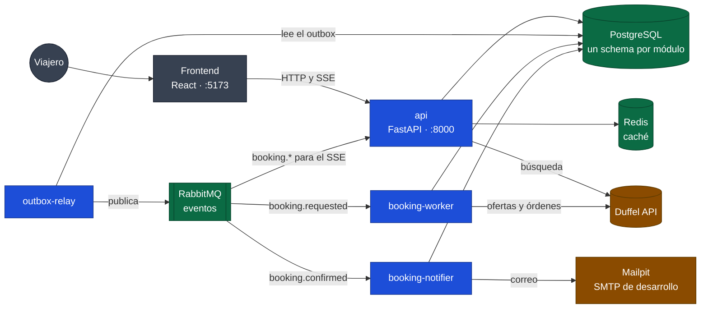
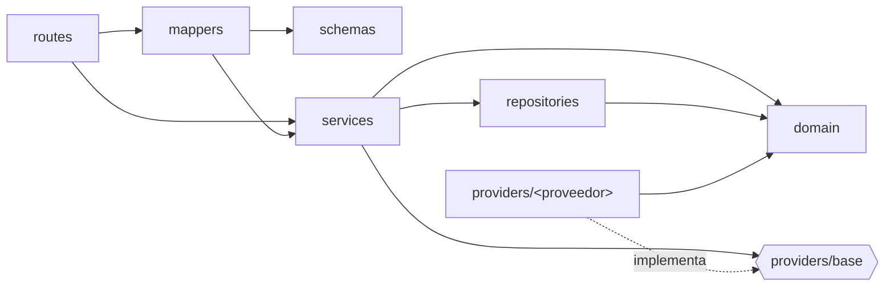
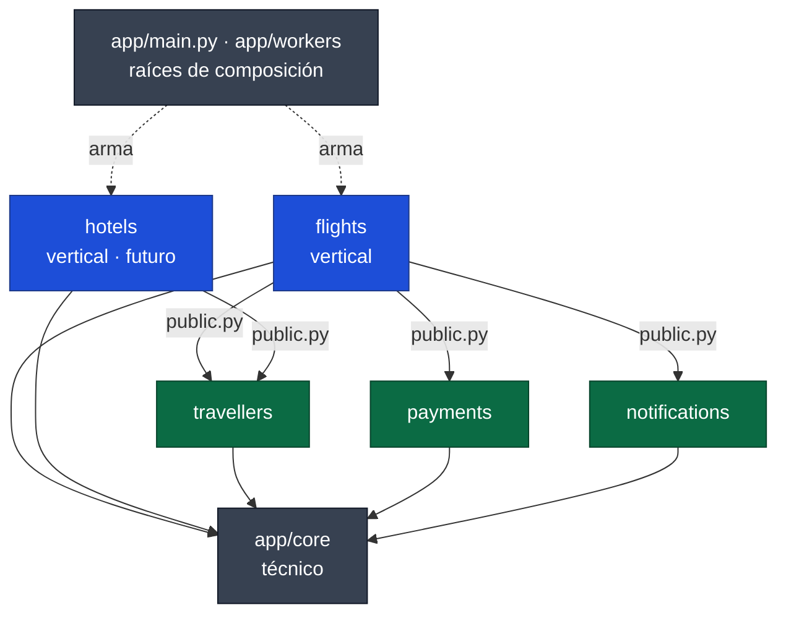

# Arquitectura global

> Reglas que aplican a todo el proyecto. Los detalles de cada etapa están en los documentos `NN-*.md` de esta carpeta.
> Última actualización: 2026-10-27

## 1. Objetivo

Plataforma de **viajes empresariales** (vuelos y, más adelante, hoteles), de una o varias personas, con frontend y backend propios. Los viajes se guardan para consultar después el historial, como particular o como empresa. La versión actual es la "vainilla": un viaje de una persona con un vuelo.

La plataforma:

1. **No depende de un proveedor concreto.** Cada vertical define su contrato y cada proveedor se conecta con el **patrón Adapter**.
2. **Expone datos normalizados** mediante DTOs propios. El frontend nunca ve el formato del proveedor.
3. **Vende con ganancia.** Internamente se lleva el **precio de compra** (`cost`) y el **precio de venta** (`price`). Hacia afuera solo sale el de venta.
4. **No duplica operaciones con efectos.** Toda operación que cobra o reserva es idempotente (ver §7).

## 2. Vista general



Colores: **azul**, procesos del backend (una sola imagen, cuatro procesos); **verde**, datos y mensajería; **marrón**, servicios externos; **gris**, el cliente. Todo corre en `docker compose`.

| Componente | Rol | Desde |
|---|---|---|
| `frontend/` | SPA. Consume solo la API propia | Etapa 1 |
| `api` | FastAPI. Búsqueda, aeropuertos y reservas; SSE hacia el navegador | Etapa 1 |
| `outbox-relay` | Publica en RabbitMQ los eventos guardados en `messaging.outbox` | Etapa 2 |
| `booking-worker` | Procesa las reservas: reconfirma el precio, cobra y reserva con Duffel | Etapa 2 |
| `booking-notifier` | Manda el correo de confirmación | Etapa 2 |
| PostgreSQL | Fuente de verdad: aeropuertos, reservas, viajeros, autorizaciones, outbox/inbox | Etapa 1 |
| Redis | Caché (cache-aside) de aeropuertos | Etapa 1 |
| RabbitMQ | Transporte de eventos entre procesos. No guarda claves ni estados | Etapa 2 |
| Mailpit | Servidor SMTP de desarrollo con bandeja web (http://localhost:8025) | Etapa 2 |

Todo corre en Docker. Un `docker-compose.yml` en la raíz levanta todos los servicios y `make up` es el punto de entrada. Cómo funciona la reserva de punta a punta, con diagramas y guía de depuración: [02-reserva-vuelos.md](02-reserva-vuelos.md).

## 3. Estructura del repositorio

```
booking-system/
├── Makefile                 # punto de entrada: make up / down / test / logs ...
├── docker-compose.yml       # todos los servicios
├── AGENTS.md / CLAUDE.md    # memoria y convenciones para agentes de código
├── docs/
│   ├── architecture/        # este documento + uno por etapa
│   ├── frontend/            # propuestas de diseño (Claude Design)
│   ├── prompts/
│   ├── research/            # investigaciones que sirven de memoria (p. ej. equipaje)
│   ├── providers/           # documentación de cada proveedor (Duffel)
│   └── samples/             # respuestas reales de proveedores
├── backend/
│   ├── migrations/          # Alembic: una migración por cambio de modelo
│   ├── docker/              # inicialización de postgres y rabbitmq (vhosts de test)
│   └── app/
│       ├── main.py          # raíz de composición de la API
│       ├── workers/         # raíz de composición de cada proceso en segundo plano
│       ├── core/            # técnico: config, http, errors, money, pricing, db, cache, messaging
│       ├── flights/         # vertical de vuelos: búsqueda, reservas, correo de confirmación
│       ├── travellers/      # compartido: viajeros y pasaporte
│       ├── payments/        # compartido: cobro al viajero (PaymentGateway)
│       ├── notifications/   # compartido: envío de correos (EmailSender)
│       ├── hotels/          # futuro, misma estructura que flights
│       └── tests/           # tests de toda la app (límites entre módulos)
└── frontend/
    └── src/
        ├── api/             # cliente generado del OpenAPI + hooks
        ├── features/        # una carpeta por flujo: flights, trip, checkout, booking; cada una expone public.ts
        ├── components/      # ui/ (base) y flight/ (piezas de vuelo compartidas)
        ├── lib/             # formato, hooks sin interfaz y flights/ (reglas compartidas)
        └── routes/
```

### 3.1 Estructura de un módulo del backend

Todos los módulos (`flights`, `hotels`…) repiten esta forma:

```
app/<módulo>/
├── core/config.py           # settings del módulo (credenciales del proveedor, timeouts)
├── domain/                  # cada uno, archivo o paquete con un archivo por tema (ver abajo)
│   ├── constants            # constantes de negocio
│   ├── validators           # reglas de validación y tipos validados
│   ├── dtos                 # DTOs: lo que circula entre capas
│   ├── errors               # errores de dominio
│   └── models               # modelos de base de datos (SQLAlchemy); solo persistencia
├── providers/
│   ├── base.py              # puerto (Protocol)
│   └── <proveedor>/         # adapter: client.py (HTTP), mapper.py (puro), provider.py
├── repositories/            # acceso a PostgreSQL (+ caché Redis cuando aplica)
├── services/                # casos de uso
├── api/
│   ├── routes/              # solo endpoints, un archivo por tema; __init__ arma el router
│   ├── schemas/             # forma de las respuestas públicas, sin lógica
│   ├── mappers/             # dominio → schema: decide qué sale hacia el cliente
│   ├── dependencies.py      # armado (adapters, servicios) y dependencias del request
│   └── errors.py            # error de dominio → HTTP
├── notifications/           # correos del módulo: plantillas y consumidores de eventos (opcional)
└── tests/                   # unit/, integration/, fixtures/, support.py, conftest.py
```

**Archivo o paquete.** En un módulo chico cada tipo del dominio es un archivo (`travellers/domain/dtos.py`). Cuando un archivo junta temas distintos, pasa a ser un paquete con un archivo por tema y un `__init__.py` que solo tiene el docstring; se importa desde el tema (`from app.flights.domain.dtos.bookings import BookingRequest`). Así quedó `flights`:

| Paquete | Temas |
|---|---|
| `domain/dtos/` | `base`, `search` (criterios), `itinerary` (aerolíneas, lugares, tramos, segmentos), `offers` (ofertas y condiciones), `places` (autocompletado), `results` (vuelos agrupados con sus tarifas), `bookings`, `orders` |
| `domain/errors/` | `provider`, `search`, `bookings` |
| `domain/validators/` | `search`, `passengers` (reglas de la aerolínea) |
| `domain/constants/` | `search`, `places`, `bookings` |
| `domain/models/` | `schema` (el schema de PostgreSQL), `airports`, `bookings` |
| `api/routes/`, `api/schemas/`, `api/mappers/` | `search`, `places`, `bookings` |

## 4. Reglas de dependencias entre capas



- `domain` no importa nada del módulo. Puede usar `app.core` (por ejemplo `Money` o `AppError`).
- `services` conoce el **puerto** y los repositorios, **nunca** un adapter concreto.
- El formato de un proveedor solo existe dentro de su carpeta `providers/<proveedor>/`.
- `api/dependencies.py` es el único lugar donde se elige qué adapter, repositorio o política se usa.
- Un módulo no importa los internos de otro módulo: solo su interfaz pública (`app/<módulo>/public.py`). Lo técnico compartido sube a `app/core`; lo de negocio compartido es un módulo propio (por ejemplo `travellers`). Ver §4.1.

### 4.1 Monolito modular

El backend es un **monolito modular**: un solo código y una sola imagen, que se despliega como API y como workers, dividido en módulos con límites estrictos que permitirían extraer cualquiera a un servicio.



Azul, verticales; verde, módulos compartidos; gris, lo técnico y las raíces de composición. Las flechas van siempre hacia abajo: un módulo compartido nunca importa una vertical.

| Regla | Detalle |
|---|---|
| Módulo | Una capacidad de negocio: vertical (`flights`, `hotels`) o compartida (`travellers`, `payments`, `notifications`). `app/core` es solo técnico |
| Interfaz pública | `app/<módulo>/public.py`: servicios y DTOs. Es lo único que otro módulo puede importar |
| Dependencias | Sin ciclos. Las verticales dependen de los módulos compartidos, nunca al revés |
| Datos | Cada módulo es dueño de sus tablas. Sin claves foráneas ni joins entre módulos; se referencian por id |
| Comunicación | Sincrónica por la interfaz pública (puede compartir la transacción: el que orquesta pasa la sesión). Asincrónica por eventos con Outbox |
| Límite | Cruzan DTOs, nunca modelos de SQLAlchemy |
| Raíces de composición | `app/main.py` y `app/workers/*` son los únicos que juntan módulos; quedan fuera de los contratos |
| Verificación | `import-linter` (`backend/pyproject.toml`), en `make test` y `make lint` |

## 5. Patrones

| Patrón | Dónde | Etapa |
|---|---|---|
| **Módulos por vertical** | `app/flights`, `app/hotels` | 1 |
| **Adapter** (Ports & Adapters) | `<módulo>/providers/` | 1 |
| **DTO** (interno con costo, público sin costo) | `domain/dtos/`, `api/schemas/` + `api/mappers/` | 1 |
| **Mapper** puro | `providers/<proveedor>/mapper.py` | 1 |
| **Strategy** de precios | `app/core/pricing/` | 1 |
| **Inyección de dependencias** | `api/dependencies.py` (`Depends`) | 1 |
| **Repository** | `<módulo>/repositories/` | 1 |
| **Cache-aside** | Repositorios de lectura (Redis) | 1 |
| **Idempotency Key** | Endpoints que reservan o cobran | 2 |
| **Transactional Outbox** / **Inbox** | Reservas: estado + evento en la misma transacción | 2 |
| **Server-Sent Events** | Notificación de la reserva al frontend | 2 |

## 6. Precios

- Los providers devuelven siempre el **costo**. La ganancia la aplica el servicio con una `PricingPolicy` de `app/core/pricing/`.
- Política vigente: **cargo fijo + % aleatorio determinístico**. Las constantes `FIXED_FEE`, `MIN_PERCENT` y `MAX_PERCENT` están en `fixed_fee_random_percent.py`. La semilla es `HMAC(PRICING_SECRET, "provider:offer_id")` y el resultado se redondea a 2 decimales.
- La misma oferta siempre tiene la misma ganancia, en la búsqueda, al refrescarla y al reservar.
- Los impuestos se muestran reales y la ganancia va dentro de la tarifa base.
- **Los schemas públicos no tienen campos de costo ni de ganancia.**

## 7. Idempotencia y efectos

- **Lecturas** (búsqueda, aeropuertos): se pueden repetir sin efectos.
- **Agregar a "Tu viaje":** es un *upsert* por una clave natural del ítem (`provider:itinerary_key`). Volver atrás y elegir la misma oferta, hacer doble clic o volver a buscar el mismo vuelo **nunca duplica** un ítem. En la etapa 1 el control está en el store del frontend; desde la etapa 2, en PostgreSQL con `UNIQUE (trip_id, item_key)`.
- **Escrituras con efectos** (reservar, cobrar): exigen un header `Idempotency-Key`. La clave se guarda en **PostgreSQL con restricción `UNIQUE`**, que es la fuente de verdad. Si llega dos veces, se devuelve el resultado de la primera y no se procesa de nuevo.
- **Las claves no se guardan en RabbitMQ.** Una cola no permite consultar "¿ya vi esta clave?". RabbitMQ solo transporta eventos.
- **Cambio de estado + evento**: van siempre en la **misma transacción** mediante Outbox. Nunca se publica un evento de algo que no se guardó, ni se guarda algo cuyo evento se pierde.
- **Consumidores de eventos**: son idempotentes mediante Inbox, porque RabbitMQ entrega cada mensaje *al menos una vez*.

El detalle está en `02-reserva-vuelos.md`.

## 8. Datos y caché

- **PostgreSQL** con **SQLAlchemy 2 async** y **Alembic** para las migraciones. Los modelos van en `<módulo>/domain/models` (archivo o paquete por tema).
- **Redis** como caché *cache-aside*: el repositorio busca primero en Redis y, si no está, consulta la DB y guarda el resultado con TTL. Redis nunca es fuente de verdad: si se pierde, el sistema sigue funcionando, solo más lento.
- **Las claves de caché llevan versión** (`airports:v1:...`), así un cambio de formato no lee datos viejos.

## 9. Errores

- Formato uniforme: `{"error": {"code", "message", "details"?}}`.
- Cada módulo mapea sus errores de dominio a HTTP en `api/errors.py`.
- Nunca se reenvían al cliente errores crudos del proveedor, tokens ni stack traces.

## 10. Frontend

| Capa | Elección |
|---|---|
| Base | React 19 + TypeScript + Vite (SPA) |
| Contrato con el backend | `openapi-typescript` + `openapi-fetch`: tipos generados del OpenAPI de FastAPI |
| Datos del servidor | TanStack Query |
| Rutas y estado en la URL | TanStack Router (search params tipados) |
| Estado del cliente | Zustand (`persist` en `sessionStorage`) |
| Formularios | React Hook Form + Zod |
| Estilos y componentes | Tailwind CSS v4 + Radix (`radix-ui`), con componentes propios al estilo de shadcn/ui en `src/components/ui` |
| Tipografía | IBM Plex Sans / IBM Plex Mono (`@fontsource`) |
| Formato | `Intl.NumberFormat`, `Intl.DateTimeFormat`, date-fns |
| Tests | Vitest + Testing Library + MSW (Playwright más adelante) |
| Calidad | Biome (linter + formatter) |
| Runtime | Node 24 LTS + pnpm, en Docker. Vite hace proxy `/api` → backend (sin CORS) |

Reglas del frontend:

- **El frontend no calcula precios ni reglas de negocio.** Muestra lo que devuelve la API.
- **Valores desconocidos:**
  - `null` se muestra como «Sin dato».
  - `0` (cantidad) se muestra como «No incluida».
  - `"0.00"` (penalidad) se muestra como «Gratis».
- **Nunca se infiere** lo que el proveedor no informa. Por ejemplo, el equipaje no se deduce del tipo de aerolínea; ver `docs/research/equipaje-low-cost-vs-tradicionales.md`.
- **Horarios de vuelo:** se muestran en la hora local del aeropuerto, sin convertir.
- **Montos:** se muestran en su moneda original, sin convertir.

## 11. Tests

- **Toda comunicación con proveedores externos** (Duffel, pasarelas de pago…) **está mockeada.** Se usan respuestas reales capturadas en `tests/fixtures/`. La red de seguridad del `conftest.py` raíz rechaza cualquier request no mockeada.
- **Infraestructura propia** (PostgreSQL, Redis, RabbitMQ): los tests de integración usan instancias reales en Docker, con bases y vhosts de test, aisladas de las de desarrollo. Los unitarios usan fakes en memoria.
- **Frontend:** MSW con los mismos fixtures reales.

## 12. Convenciones

Las convenciones de código (idioma, docstrings Google, `Field(description=...)`, archivos del dominio) están en `AGENTS.md`, en la raíz.

## 13. Registro de decisiones

| # | Fecha | Decisión |
|---|---|---|
| 1 | 2026-10-23 | Backend en Python + FastAPI, en Docker con `python:3.14-slim`. |
| 2 | 2026-10-23 | Monorepo: `backend/` y `frontend/` en la raíz. |
| 3 | 2026-10-23 | Módulos por vertical, cada uno con domain, providers, services, api y tests. |
| 4 | 2026-10-23 | Adapter para los proveedores de cada vertical; Duffel es el primero de vuelos. |
| 5 | 2026-10-23 | DTOs propios: uno interno (con costo y ganancia) y otro público (solo precio de venta). |
| 6 | 2026-10-23 | `httpx2` como cliente HTTP async compartido. |
| 7 | 2026-10-23 | `Protocol` en lugar de ABC para los puertos. |
| 8 | 2026-10-23 | Filtro por aerolínea en el contrato de la plataforma; el adapter de Duffel filtra la respuesta. |
| 9 | 2026-10-23 | Coordenadas de aeropuertos incluidas en `Place`. |
| 10 | 2026-10-23 | Tests por módulo; proveedores siempre mockeados con respuestas reales. |
| 11 | 2026-10-26 | Ganancia: `FIXED_FEE` + % aleatorio en [`MIN_PERCENT`, `MAX_PERCENT`], como constantes. |
| 12 | 2026-10-26 | Aleatorio estable por HMAC(`PRICING_SECRET`, `provider:offer_id`), sin persistencia. |
| 13 | 2026-10-26 | Precio de venta redondeado a 2 decimales. |
| 14 | 2026-10-26 | Filtro por aerolínea: coincide solo por `owner`. |
| 15 | 2026-10-26 | Dominio dividido en `constants`, `validators`, `dtos`, `errors` y `models` (este último solo para DB). |
| 16 | 2026-10-26 | Documentación de arquitectura en `docs/architecture/`: un documento global + uno por etapa. |
| 17 | 2026-10-26 | Frontend: React 19 + Vite + TypeScript, TanStack Query/Router, Zustand, Tailwind v4 + shadcn/ui, tipos generados del OpenAPI. Diseño base: propuesta A de Claude Design. |
| 18 | 2026-10-26 | PostgreSQL (SQLAlchemy 2 async + Alembic) como fuente de verdad; Redis como caché cache-aside. |
| 19 | 2026-10-26 | Equipaje: `0` significa "no incluido"; `None` significa "el proveedor no informa". No se infiere "solo artículo personal" (Duffel documenta que la ausencia es falta de información; ver `docs/research/`). |
| 20 | 2026-10-26 | Agrupación de tarifas por clave de itinerario propia (independiente del proveedor). |
| 21 | 2026-10-26 | Reservas asíncronas: Idempotency-Key en PostgreSQL, Transactional Outbox + Inbox, RabbitMQ como transporte y SSE hacia el frontend (etapa 2). |
| 22 | 2026-10-26 | Tests: proveedores externos mockeados; PostgreSQL, Redis y RabbitMQ reales en Docker para los tests de integración. |
| 23 | 2026-10-26 | "Tu viaje" idempotente: *upsert* por `item_key = provider:itinerary_key`. Misma oferta → sin cambios; otra tarifa o una oferta renovada del mismo vuelo → reemplaza. |
| 24 | 2026-10-26 | Aeropuertos: `airportsdata` (MIT) como fuente principal, más OurAirports (dominio público) para relevancia (`importance`) y nombres alternativos. |
| 25 | 2026-10-26 | Dependencias del frontend: se respeta la antigüedad mínima de publicación de pnpm, sin excepciones; ante un paquete muy nuevo se usa la versión anterior. |
| 26 | 2026-10-26 | TypeScript 7 para el proyecto; los tipos de la API se generan con `openapi-typescript` + TypeScript 5.9 vía `pnpm dlx`. |
| 27 | 2026-10-26 | Los títulos muestran el lugar buscado (NYC → "New York"), no el aeropuerto donde aterriza cada vuelo. |
| 28 | 2026-10-26 | `supplier_timeout` de Duffel en 45 s (HTTP 60 s): con 10 s, Duffel descartaba sin avisar a las aerolíneas lentas. |
| 29 | 2026-10-26 | Respuestas de la API con gzip (`GZipMiddleware`). |
| 30 | 2026-10-26 | Ida y vuelta: se busca como ida y vuelta (tarifa combinada) y se muestra en dos pasos (ida, después sus vueltas), igual para cualquier tamaño. Sin cambios en el contrato de la API. |
| 31 | 2026-10-26 | Alcance actual: un viaje de una persona con un vuelo. Lo que excede ese alcance en el diseño queda deshabilitado ("próximamente"). |
| 32 | 2026-10-27 | Monolito modular: módulos con interfaz pública (`public.py`), dueños de sus datos, sin ciclos ni claves foráneas entre módulos (§4.1). |
| 33 | 2026-10-27 | Los viajeros son un módulo propio, `app/travellers`, compartido por todas las verticales. El pasaporte es de `travellers`; las tarjetas de descuento o fidelidad, de vuelos (sin soporte). |
| 34 | 2026-10-27 | Un schema de PostgreSQL por módulo (`flights`, `travellers`, `payments`, `messaging`); límites verificados con `import-linter` en los tests. |
| 35 | 2026-10-27 | Cobro detrás de `app/payments` (`PaymentGateway`: autorizar, capturar, anular), simulado por ahora; a Duffel se le paga con `balance`. |
| 36 | 2026-10-27 | Si el precio cambia al reconfirmar, la misma reserva espera la autorización del viajero (`awaiting_price_approval` → `price-decision`); nunca se cobra sin ella. |
| 37 | 2026-10-27 | El inbox se marca con el resultado final y de forma idempotente; el efecto único lo garantiza el estado de la reserva bajo lock. Lease del worker (4 min) menor que la ventana de reintentos (10 × 30 s). |
| 38 | 2026-10-27 | Duffel ignora `Idempotency-Key`: se reconcilia por `offer_id` + `metadata.booking_id`. Una oferta vencida responde como inexistente (`not_found`) → `offer_unavailable`. |
| 39 | 2026-10-27 | El SSE solo avisa (`booking_id`, `status`, `version`); los datos se leen con `GET`. Sin datos personales en RabbitMQ ni en el outbox. |
| 40 | 2026-10-27 | Rutas de reservas bajo la vertical: `/api/v1/flights/bookings`. El buscador queda en un adulto. |
| 41 | 2026-10-27 | Correos detrás de `app/notifications` (`EmailSender` con adapters `smtp` y `console`, elegidos por `EMAIL_BACKEND`). En desarrollo, SMTP a Mailpit; en otro ambiente, el SMTP del proveedor por variables. Plantillas con Jinja2 (autoescape en HTML). |
| 42 | 2026-10-27 | El correo de confirmación sale de forma asíncrona por el evento `booking.confirmed` (cola `flights.booking-notifier`, proceso `booking-notifier`), idempotente por inbox y con entrega *at-least-once*. Se arma con la vista pública de la reserva, así nunca lleva costo ni ganancia. |
| 43 | 2026-10-27 | Pantalla de confirmación v2 (Propuesta A v2): estados confirmada, confirmando y no se pudo reservar. Una reserva fallida se explica en la pantalla 6; el cambio de precio y la cancelación siguen en la 5. |
| 48 | 2026-10-28 | Límites entre features del frontend, igual que en el backend: una feature importa otra solo por su `public.ts`; lo compartido va a `components/` (`flight/`) o `lib/` (`flights/`), que no importan features. Lo verifica Biome (`noRestrictedImports`) en `make lint`. |
| 47 | 2026-10-28 | Timeout de 130 s solo para crear la orden en Duffel (`order_timeout_s`): las aerolíneas pueden tardar hasta 120 s y cortar antes deja el resultado incierto. El resto de las llamadas sigue en 60 s. |
| 46 | 2026-10-28 | Verificación de la tarjeta antes de la retención real: compra pequeña, comprobación y reversión (`PaymentGateway.verify_card`). Si la reversión falla, la reserva sigue y queda un log para reembolsar a mano. |
| 45 | 2026-10-28 | Estado `issuance_error` («Error de emisión»): la aerolínea pudo haber emitido pero no se pudo confirmar o cobrar. Conserva la retención y la orden, no reintenta (mejora posterior) y lo atiende una persona o un agente de IA. Nunca se libera el dinero si no se sabe si hay ticket. |
| 44 | 2026-10-27 | Archivos del dominio por tema: cada tipo (`dtos`, `errors`, `validators`, `constants`, `models`) pasa a paquete con un archivo por tema cuando junta temas distintos. La capa `api/` se separa en `routes/` (endpoints), `schemas/` (forma, sin lógica), `mappers/` (dominio → schema) y `dependencies.py`. |
