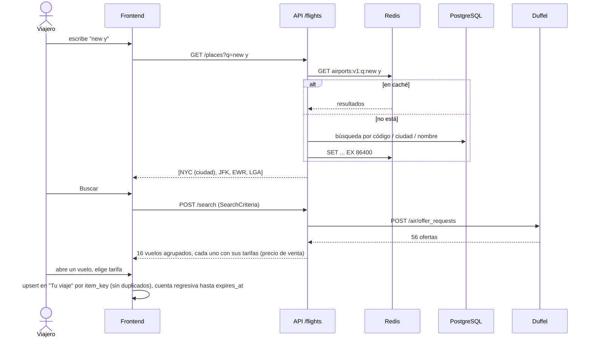

# Etapa 1: Búsqueda de vuelos

> Estado: **implementada** (pendiente de revisión del PR).
> **Alcance del PR:** buscar vuelos, ver resultados agrupados, ver el detalle, elegir una tarifa y dejarla en "Tu viaje".
> Reglas generales: [00-global.md](00-global.md). Siguiente etapa: [02-reserva-vuelos.md](02-reserva-vuelos.md).
> Última actualización: 2026-10-26

## 1. Alcance

| # | Entregable | Estado |
|---|---|---|
| 1.1 | `POST /api/v1/flights/search`: adapter de Duffel, DTOs, filtro por aerolínea, ganancia | ✅ Hecho |
| 1.2 | Equipaje: `0` ≠ `None` | ✅ Hecho |
| 1.3 | Agrupación de tarifas por vuelo (clave de itinerario) | ✅ Hecho |
| 1.4 | Aeropuertos: tabla en PostgreSQL + caché Redis + `GET /api/v1/flights/places` | ✅ Hecho |
| 1.5 | `docker-compose.yml` en la raíz con api, frontend, postgres y redis | ✅ Hecho |
| 1.6 | Frontend: búsqueda → espera → resultados → detalle → "Tu viaje" (desktop y mobile) | ✅ Hecho |
| 1.7 | Idempotencia de "Tu viaje": la misma oferta o el mismo vuelo no se duplican | ✅ Hecho |
| 1.8 | Resultados grandes: gzip, búsquedas completas (`supplier_timeout` 45 s), tarifas en modal, ida y vuelta en dos pasos | ✅ Hecho |

**Verificación:**
- **Tests:** 93 de backend y 46 de frontend.
- **Recorrido en navegador real:** con Playwright, en desktop (1280 px) y mobile (390 px), contra Duffel en modo test. Cubre búsqueda con autocompletado, resultados (solo ida y ida y vuelta en dos pasos, con una búsqueda real BOG-CLO de 1.690 combinaciones), matriz de tarifas, detalle y "Tu viaje". Elegir la misma tarifa dos veces deja un solo ítem, y la consola queda sin errores.

**Versión actual ("vainilla"):** un viaje de **una persona** con **un vuelo** (ida o ida y vuelta). El objetivo final son viajes empresariales de una o varias personas, guardados para consultar el historial como particular o como empresa ([00-global.md §1](00-global.md#1-objetivo)).

**Fuera de alcance**, en etapas siguientes:
- pasajeros, pago, confirmación y reserva (etapa 2);
- persistir "Tu viaje" en el servidor y el historial de viajes;
- agregar otro vuelo, hoteles y viajes de varias personas.

## 2. Flujo



## 3. Búsqueda (hecho)

### 3.1 Puerto `FlightProvider`

```python
class FlightProvider(Protocol):
    name: str

    async def search(self, criteria: SearchCriteria) -> SearchResult: ...
```

- Devuelve solo DTOs, siempre con el **costo**.
- Traduce sus fallas a `InvalidSearchError`, `ProviderTimeoutError` o `ProviderError`.

### 3.2 Normalización de los DTOs

| Concepto | Normalización |
|---|---|
| Dinero | `Money { amount: Decimal, currency }`. En JSON, `amount` es string |
| Duraciones | Minutos enteros (`duration_minutes`) |
| Horarios de vuelo | Hora local sin zona + `time_zone` del aeropuerto |
| Vencimientos | UTC |
| Valores desconocidos | `None`, nunca un default inventado |
| Ids | Los del proveedor (`off_...`, `pas_...`) + campo `provider` |
| Lugares | Con coordenadas (`latitude`, `longitude`) para mapas |

**Campos calculados por el mapper:**
- `stops`;
- `connections[].duration_minutes`, calculado con la zona horaria de cada aeropuerto.

### 3.3 `SearchCriteria`

```json
{ "origin": "LHR", "destination": "JFK", "departure_date": "2026-12-15", "return_date": null,
  "passengers": { "adults": 1, "children_ages": [] }, "cabin_class": "economy",
  "max_connections": 1, "airlines": ["BA"] }
```

**Validaciones** (en `domain/validators.py`):
- códigos IATA;
- origen distinto de destino;
- fechas: la ida no puede ser en el pasado y la vuelta no puede ser anterior a la ida;
- como máximo 9 pasajeros;
- un infante por adulto;
- `max_connections` entre 0 y 2.

### 3.4 Filtro por aerolínea

**Duffel no lo soporta.** Ni la búsqueda ni *List Offers* aceptan un parámetro de aerolínea.

- El adapter filtra la respuesta, quedándose con las ofertas cuyo `owner` está en la lista.
- No acelera la búsqueda, porque Duffel consulta igual a todas las aerolíneas.

### 3.5 Errores

| Situación | Código | HTTP |
|---|---|---|
| Validación de criterios | `validation_error` | 422 |
| Duffel rechaza los criterios | `invalid_search` | 422 |
| Timeout del proveedor | `provider_timeout` | 504 |
| Otra falla del proveedor | `provider_error` | 502 |

### 3.6 Configuración

| Variable | Default | Uso |
|---|---|---|
| `DUFFEL_API_URL` | `https://api.duffel.com` | Base URL |
| `DUFFEL_API_TOKEN` | — | `duffel_test_...` |
| `DUFFEL_API_VERSION` | `v2` | Header `Duffel-Version` |
| `DUFFEL_SUPPLIER_TIMEOUT_MS` | `45000` | Espera de Duffel por aerolínea (2 a 60 s). Con 10 s quedaban afuera Avianca y LATAM en idas y vueltas (tardan ~20 s en el sandbox); Duffel descarta sin avisar a las que no llegan |
| `DUFFEL_HTTP_TIMEOUT_S` | `60` | Timeout de nuestras requests (mayor que la espera por aerolínea) |
| `PRICING_SECRET` | `local-dev-secret` | Semilla del HMAC de la ganancia |

## 4. Equipaje: `0` ≠ `None` (hecho)

**Investigación completa:** [docs/research/equipaje-low-cost-vs-tradicionales.md](../research/equipaje-low-cost-vs-tradicionales.md).

**Problema:** el mapper completa con `0` cuando Duffel no informa un tipo de equipaje. En la muestra real, las 10 ofertas *Economy Impact* de Lufthansa **no traen** el ítem `carry_on`, y hoy se muestran como "0 de mano".

**Por qué `None` y no "solo artículo personal":**
- Duffel documenta que, si no hay información de un tipo de equipaje, *"no entry will be present"*. Que falte el ítem significa "sin información".
- *Economy Impact* incluye valija despachada y permite cambio y reembolso, así que no es una tarifa básica.
- Duffel no tiene un tipo para el artículo personal.
- Las tradicionales también venden tarifas de "solo artículo personal" (Lufthansa Economy Basic desde mayo de 2026), así que el tipo de aerolínea tampoco permite inferirlo.

**Cambio:**

| Duffel | DTO | Frontend |
|---|---|---|
| `{"type": "checked", "quantity": 1}` | `checked = 1` | «1 incluida» |
| `{"type": "checked", "quantity": 0}` | `checked = 0` | «No incluida» |
| no hay ítem `carry_on` | `carry_on = None` | «Sin dato», con tooltip: «La aerolínea no informa este equipaje para la tarifa. Revisá sus condiciones de transporte» y enlace |

- `Baggage.checked` y `Baggage.carry_on` pasan a ser `int | None`, con `None` por defecto.
- `Carrier` suma `conditions_of_carriage_url` (Duffel lo envía en el `owner` y hoy lo descartamos). Es el enlace del tooltip.
- **Filtro "Con valija":** cuenta solo `checked ≥ 1`. `None` no cuenta.
- **Nunca se infiere equipaje** por tipo de aerolínea, nombre de tarifa o precio.
- Test con el fixture real: las ofertas *Economy Impact* deben tener `carry_on is None` y `checked == 1`; *Economy Light* debe tener `checked == 0`.

## 5. Agrupación de tarifas (hecho)

### 5.1 Por qué

La búsqueda real LHR → JFK devolvió **56 ofertas que son 16 vuelos**: el mismo vuelo aparece hasta 5 veces, una por tarifa (Light, Comfort, Comfort Plus, Flex, Impact). El diseño muestra **una tarjeta por vuelo** con una matriz de tarifas.

### 5.2 Clave de itinerario

Es nuestra, no depende del proveedor:

```
itinerary_key = sha256( por cada slice, por cada segmento:
                        marketing_carrier.code + flight_number + departing_at (local) )[:16]
```

- **Verificado con la muestra real:** da exactamente los mismos 16 grupos que el `comparison_key` de Duffel, sin diferencias.
- Agrupar por el `operating_carrier` daría 13 grupos, porque mezclaría ventas de distintas aerolíneas del mismo avión. Se descarta: cada vendedor es una tarjeta distinta.

La misma clave se usa para **agrupar** tarifas en los resultados y como **clave de idempotencia de "Tu viaje"** (ver §7.4).

### 5.3 Qué es del vuelo y qué es de la tarifa

Esto se verificó con la muestra real: los campos de "Vuelo" no cambian en ninguno de los 16 grupos.

| Vuelo (compartido) | Tarifa (una por oferta) |
|---|---|
| `owner`, emisiones | `offer_id`, nombre de la tarifa (`fare_brand`) |
| Slices: origen, destino, duración, escalas, conexiones | Precio de venta (`total`, `base`, `taxes`) |
| Segmentos: horarios, carriers, número de vuelo, avión, terminales | Equipaje por slice |
| Cabina y comodidades | Condiciones de cambio y reembolso, beneficios |
| | `expires_at`, condiciones de pago, documentos requeridos |

`expires_at`, el pago y los documentos coinciden dentro de cada grupo en la muestra. Igual quedan en la tarifa porque **son atributos de cada oferta** en Duffel.

### 5.4 Dónde se agrupa

- **En el servicio** (`FlightSearchService`), después de aplicar los precios. Así funciona igual para cualquier proveedor.
- El dominio sigue trabajando con `Offer`. La agrupación es una vista para la API.
- Los grupos se ordenan por el precio más bajo de sus tarifas, y las tarifas de cada grupo de menor a mayor.

### 5.5 Respuesta nueva

```json
{
  "provider": "duffel",
  "search_id": "orq_...",
  "passengers": [{ "id": "pas_...", "type": "adult", "age": null }],
  "expires_at": "2026-10-23T21:26:50Z",
  "flights": [
    {
      "key": "3f9a1c0b7e2d4a51",
      "owner": { "code": "LH", "name": "Lufthansa", "logo_url": "..." },
      "emissions_kg": 379,
      "lowest_price": { "amount": "432.14", "currency": "USD" },
      "slices": [ { "origin": {...}, "destination": {...}, "duration_minutes": 760, "stops": 1,
                    "segments": [...], "connections": [{ "airport": "ZRH", "duration_minutes": 75 }] } ],
      "fares": [
        { "offer_id": "off_...", "name": "Economy Light", "price": {...},
          "baggage": [{ "checked": 0, "carry_on": 1 }], "conditions": {...}, "benefits": [...],
          "expires_at": "...", "payment": {...}, "requires_identity_documents": false }
      ]
    }
  ]
}
```

- **Tamaño:** cada vuelo lleva sus segmentos **una sola vez**, en lugar de repetirlos en cada tarifa. Esto reduce bastante los ~9 MB que devolvió una ida y vuelta real. Si sigue siendo grande, el próximo paso es paginar los grupos.
- **El contrato cambia:** `offers` pasa a ser `flights[].fares[]`. Todavía no hay consumidores, así que no hace falta versionar.

## 6. Aeropuertos (hecho)

### 6.1 Fuente de datos

**[`airportsdata`](https://pypi.org/project/airportsdata/)**, con licencia MIT (versión 20260905).

- 7.884 aeropuertos con código IATA.
- Cada uno trae nombre, ciudad, país, coordenadas y **zona horaria IANA**.
- Incluye una base aparte de **IATA Multi-Airport Cities** (por ejemplo, NYC → JFK, EWR y LGA).
- Es un fork de `mwgg/Airports`, validado contra AIP nacionales, ARINC e IATA.

**Complemento: [OurAirports](https://ourairports.com/data/)**, de dominio público. Se descarga al correr la carga y aporta dos cosas que `airportsdata` no tiene:

- **`importance`** (0–4), según el tipo de aeropuerto y si tiene vuelos comerciales (`scheduled_service`). Sin esto, al buscar "madri" aparecía TOJ (Torrejón, militar) antes que MAD, y al buscar "new y" aparecían NYS (hidroaviones) o ISP antes que JFK.
- **Nombres alternativos** (`keywords`), por ejemplo "Londres" para LHR o "München" para MUC.

Si OurAirports no está disponible, la carga sigue igual, sin esos dos datos. OurAirports sola no alcanza como fuente porque **no trae zona horaria** ni códigos de ciudad.

### 6.2 Modelo (`flights/domain/models.py`)

```
airports
├── iata_code      CHAR(3)  PK
├── icao_code      CHAR(4)  NULL
├── name           TEXT
├── city_name      TEXT
├── city_code      CHAR(3)  NULL     # código IATA de la ciudad si es multi-aeropuerto (NYC, LON)
├── country_code   CHAR(2)
├── time_zone      TEXT
├── latitude       DOUBLE
├── longitude      DOUBLE
├── importance     SMALLINT  # 0–4, de OurAirports: tipo de aeropuerto + vuelos comerciales
└── search_text    TEXT  (índice trigram, pg_trgm)  # iata + ciudad + nombre + nombres alternativos, sin tildes, en minúsculas

cities                               # solo ciudades multi-aeropuerto
├── iata_code      CHAR(3)  PK       # NYC
├── name           TEXT
└── country_code   CHAR(2)
```

- **Migraciones:** con Alembic.
- **Carga:** un comando idempotente (`make seed-airports`) que hace *upsert* desde `airportsdata`. Se puede correr las veces que haga falta.

### 6.3 Endpoint

```
GET /api/v1/flights/places?q=new%20y&limit=8
→ 200 [ { "type": "city", "code": "NYC", "name": "New York", "country_code": "US",
          "airports": ["JFK", "EWR", "LGA"] },
        { "type": "airport", "code": "JFK", "name": "John F. Kennedy International Airport",
          "city": "New York", "country_code": "US", "time_zone": "America/New_York" }, ... ]
```

**Orden de relevancia** (implementado en `repositories/places.py`):
1. Primero las ciudades multi-aeropuerto que coinciden (como máximo `PLACE_MAX_CITIES`).
2. Después los aeropuertos, por nivel:
   1. código exacto;
   2. aeropuertos de la ciudad que coincidió (así aparece EZE al buscar "bue", aunque su ciudad en la base sea Ezeiza);
   3. ciudad que empieza con el texto;
   4. una palabra que empieza con el texto (nombre o nombre alternativo);
   5. el texto en cualquier parte;
   6. ortografía parecida.
3. Dentro de cada nivel, primero los de mayor `importance` y después los más parecidos.

**Ortografía parecida:** usa `word_similarity` de `pg_trgm` (operador `%>`, umbral `PLACE_WORD_SIMILARITY_THRESHOLD = 0.5`). Compara contra la parte más parecida del texto y no contra todo el texto, que es largo. Así "heatrow" encuentra LHR (similitud 0,55) y "ezeisa" encuentra EZE.

**Reglas:** `q` debe tener entre 2 y 50 caracteres; se normaliza sacando tildes y pasando a minúsculas.

### 6.4 Caché (cache-aside en el repositorio)

- **Clave:** `airports:v1:q:{q normalizada}:{limit}`. El valor es el JSON de los resultados.
- **TTL:** 24 h. Los datos casi no cambian; el comando de carga invalida con `airports:v1:*` (o se sube la versión de la clave).
- **Si Redis no responde,** se loguea y se consulta la DB. La caché nunca rompe el endpoint.

### 6.5 Capas

```
api/routes.py → services/places.py → repositories/airports.py → (Redis → PostgreSQL)
```

`app/core/db.py` (engine y sesión async) y `app/core/cache.py` (cliente Redis) se crean en el `lifespan`, igual que el cliente HTTP, y se inyectan por dependencia.

## 7. Frontend (hecho)

Stack y reglas en [00-global.md §10](00-global.md#10-frontend). **Diseño de referencia:** `docs/frontend/Vuelos · Propuesta A.html` (Claude Design).

### 7.1 Pantallas de este PR

| # | Pantalla | Qué incluye |
|---|---|---|
| 1 | Búsqueda | Solo ida / ida y vuelta, autocompletado de origen y destino (`/places`), fechas, pasajeros (adultos y menores con edad; bloquea un segundo infante por adulto), cabina, "solo directos" |
| 2 | Espera | Tarjetas esqueleto con la forma final; pasos "enviada / esperando / agrupando"; a los 40 s, aviso «Está tardando más de lo normal» con opción de cancelar |
| 3 | Resultados | Una tarjeta por vuelo: horarios, escalas sobre la línea (en naranja si la conexión es corta), operador, equipaje, "desde"; matriz de tarifas en un modal al abrirla; **ida y vuelta en dos pasos** (cada ida una vez, después solo sus vueltas; ver §9); orden por precio, duración y salida; filtros (directos, con valija, reembolsable, franja horaria, aerolínea); contador de vencimiento |
| 4b | Detalle | Itinerario por segmento con terminales, avión y comodidades; conexión; matriz de tarifas; condiciones en su moneda; desglose de precio; CO₂; «Guardar en mi viaje» |
| 4 | Tu viaje | Vuelos guardados, con su tarifa y su cuenta regresiva; quitar con "Deshacer"; total. «Continuar a pasajeros», «Agregar otro vuelo» y «Agregar hotel» quedan deshabilitados con «próximamente» |
| — | Estados | Sin resultados (con atajos), sin resultados por filtros (sugiere qué filtro quitar), error del proveedor (reintentar), **oferta vencida** (volver a buscar con los mismos datos y filtros, conservando el vuelo marcado) |

Todas las pantallas se hacen en **desktop y mobile**.

### 7.2 Estado

| Dato | Dónde vive |
|---|---|
| Criterios, filtros, orden e ida elegida (`out`) | Search params de la URL (TanStack Router). Se pueden compartir y recargar |
| Resultados | Caché de TanStack Query, por criterios |
| "Tu viaje" | Zustand + `sessionStorage`: `[{ flight, fare, search_id, passengers, expires_at }]`. Pasa al servidor en la etapa 2 |

### 7.3 Vencimiento

- Cada tarifa trae su `expires_at`.
- El contador pasa a ámbar cuando quedan menos de 5 minutos.
- Al vencer, "Tu viaje" marca la tarifa como vencida y ofrece «Actualizar precios», que repite la búsqueda y vuelve a ubicar el mismo vuelo por su `key`.

### 7.4 Idempotencia de "Tu viaje"

**Problema:** el usuario vuelve atrás con el navegador, elige de nuevo la misma oferta y queda **dos veces** en el viaje. Lo mismo puede pasar con un doble clic en «Guardar en mi viaje», o al volver a buscar después de que venció la oferta, porque llega el mismo vuelo con un `offer_id` nuevo.

**Clave de idempotencia de cada ítem:** `item_key = provider + ":" + itinerary_key`, por ejemplo `duffel:3f9a1c0b7e2d4a51`.

- **Identifica el vuelo**, no la oferta. Así cubre también las ofertas nuevas que llegan al volver a buscar.
- Es la misma clave de agrupación de §5.2, calculada en el backend y enviada en `flights[].key`.

**Agregar un ítem es un *upsert* por `item_key`:**

| Caso | Resultado |
|---|---|
| Misma oferta (`offer_id` igual) | **Sin cambios.** Aviso: «Este vuelo ya está en tu viaje» |
| Mismo vuelo, otra tarifa (Light → Flex) | **Reemplaza** la tarifa. Aviso: «Cambiaste la tarifa a Economy Flex», con "Deshacer" |
| Mismo vuelo desde una búsqueda nueva (oferta vencida) | **Reemplaza** la oferta por la vigente y reinicia el contador |
| Otro vuelo | Se agrega como ítem nuevo |

**Dónde se aplica en esta etapa:**
- "Tu viaje" vive en el navegador, así que el control está en la acción `addItem` del store (Zustand). El estado es un mapa `item_key → ítem`, de modo que **no puede haber duplicados por construcción**.
- El botón «Guardar en mi viaje» se deshabilita mientras procesa, para cubrir el doble clic.

**En la etapa 2**, cuando "Tu viaje" pase al servidor:
- `PUT /api/v1/trips/{trip_id}/items/{item_key}`. Por ser `PUT` sobre una clave natural, es idempotente por definición HTTP.
- En PostgreSQL, `UNIQUE (trip_id, item_key)` con `INSERT … ON CONFLICT DO UPDATE`.
- El mismo control queda **internamente** en el backend, aunque el cliente falle.

> **Es distinta de la Idempotency-Key de la reserva** (etapa 2):
> - `item_key` evita **ítems duplicados en el viaje**.
> - La `Idempotency-Key` de `POST /bookings` evita **procesar dos veces la misma reserva**.
>
> Son dos controles, en dos momentos distintos.

## 8. Tests de esta etapa

| Nivel | Qué |
|---|---|
| Mapper | Equipaje `None` en *Economy Impact* y `0` en *Economy Light*; `conditions_of_carriage_url`; todo lo existente |
| Servicio | 56 ofertas → 16 vuelos; tarifas ordenadas; un vuelo por vendedor; precios aplicados antes de agrupar |
| Repositorio de aeropuertos | Contra PostgreSQL y Redis de test: búsqueda por código, ciudad y nombre sin tildes; *hit*/*miss* de caché; Redis caído → igual responde |
| API | `/search` con el nuevo contrato y sin `cost`/`markup`; `/places` con validaciones |
| Frontend | Componentes con MSW y el fixture real: agrupación visible, «Sin dato» frente a «No incluida», vencimiento, filtros sin resultados, agregar y quitar en "Tu viaje" |
| Ida y vuelta | Cada ida una vez con sus vueltas (fixture real de 55 combinaciones); elegir ida, abrir tarifas de la combinación, «Cambiar ida»; las vueltas respetan el orden elegido |
| Idempotencia de "Tu viaje" | Agregar la misma oferta dos veces deja un ítem; otra tarifa del mismo vuelo reemplaza; un vuelo de una búsqueda nueva reemplaza la oferta vencida; doble clic no duplica |

## 9. Decisiones y hallazgos de la implementación

| Tema | Decisión |
|---|---|
| Título de resultados y de "Tu viaje" | Usa el lugar **buscado**, no el aeropuerto del primer resultado. Una búsqueda a NYC devolvió vuelos a JFK, EWR y SWF, y el título decía "Newburgh". |
| Ciudades multi-aeropuerto | La base de NYC de `airportsdata` tiene JFK y LGA, pero Duffel también resuelve NYC a EWR y SWF. Los resultados muestran lo que devuelve el proveedor. |
| Fechas | `<input type="date">` nativo: accesible y con el calendario del sistema en mobile. Un calendario propio queda como mejora. |
| Formularios | Estado local + Zod. React Hook Form entra con el formulario de pasajeros (etapa 2). |
| Tipos de la API | `openapi-typescript` necesita la API de JavaScript de TypeScript, que TypeScript 7 (nativo) no tiene. `pnpm gen:api` lo corre con `pnpm dlx` y TypeScript 5.9; el proyecto usa TypeScript 7. |
| Supply chain | pnpm 12 exige una antigüedad mínima de publicación. No se agregan excepciones: si un paquete es muy nuevo, se usa la versión anterior (por ejemplo `@tanstack/react-query` 5.104.5 en lugar de 5.105.0, publicada el mismo día). |
| MSW 3 | La opción es `onUnhandledFrame: "error"` (antes `onUnhandledRequest`). Por defecto solo advierte. Hay un test (`src/test/safety-net.test.ts`) que verifica que una request sin mock falla. |
| openapi-fetch | Recibe `fetch: (r) => globalThis.fetch(r)`. Si no, guarda el `fetch` del momento del import y MSW no intercepta. |
| Lockfile | Se modifica solo desde el contenedor (`make fe-add`). pnpm lo escribe con permisos `600`. |
| Fidelidad al diseño | La primera versión del frontend tomó del diseño los tokens y la estructura, pero armó la maquetación a ojo, y el autor lo marcó. Se rehízo trasladando cada tablero: barra oscura propia por pantalla, selector segmentado, etiquetas en mayúsculas, fecha en mono, sugerencias con encabezado, tarjetas con columna punteada, matriz con celdas de color, detalle con tabla seleccionable y barras fijas en mobile. Los tableros (`docs/frontend/Vuelos · Propuesta A.html`) son páginas empaquetadas: un manifiesto con recursos comprimidos en gzip+base64 y un template por tablero, cada uno con su propio manifiesto. Para leerlos se desempaquetan los dos niveles y se lee el `template.html` de cada uno; los estilos variables están en su script. |
| Desvíos del dibujo | El contador de vencimiento es neutro y pasa a ámbar con menos de 5 minutos (regla escrita del diseño). "Mis reservas" se reemplaza por "Tu viaje" (todavía no hay reservas). "Agregar otro vuelo", "Agregar hotel" y "Continuar a pasajeros" quedan deshabilitados ("próximamente"): la versión actual es un viaje de una persona con un vuelo. Con el viaje vacío, el botón lleva a la búsqueda. Las fechas usan el calendario nativo, con el texto formateado encima. |
| Requests duplicadas | Con `StrictMode` (solo en desarrollo) React monta dos veces, y React Query cancelaba la primera búsqueda porque su función usaba el `AbortSignal`. Como el backend no se entera de la cancelación, **Duffel recibía dos búsquedas**. Ahora las queries de búsqueda y de aeropuertos no usan el signal: el segundo montaje reutiliza la request en curso. |
| Rendimiento con resultados grandes | Una búsqueda real devolvió unos 2.000 vuelos (12,4 MB). Medido en navegador con 2.000 vuelos: ordenar 30 s → 1,2 s y abrir una tarjeta 1,7 s → 0,3 s, al calcular las etiquetas en O(n) (`flightInsights`, antes cada tarjeta comparaba contra todas) y memorizar tarjetas y callbacks. Filtrar seguía en ~7 s porque se actualizaban miles de tarjetas; con la ida y vuelta en dos pasos se dibujan muchas menos. |
| Tarifas en modal | A pedido del autor, la matriz de tarifas se abre en un modal (`FaresDialog`) y no desplegada dentro de la tarjeta, como mostraba el tablero. Las tarjetas ya no tienen estado de abierto o cerrado, así que abrir tarifas no vuelve a renderizar la lista. |
| Ida y vuelta en dos pasos | Se sigue buscando ida y vuelta: la tarifa combinada suele ser más barata que dos tramos solo ida. Lo que cambia es cómo se muestra. **Toda** ida y vuelta se muestra igual, sin umbral por cantidad, para que el sistema tenga una sola forma de uso: primero cada ida una vez (`groupByOutbound`, con el precio de su combinación más barata), y al elegirla, solo las vueltas de esa ida (`out` en la URL, «Cambiar ida» para volver). Cada vuelta abre las tarifas de la combinación completa. No cambia el contrato de la API: las combinaciones ya vienen en la respuesta. BOG-CLO real (1.690 combinaciones): 65 tarjetas en el primer paso; elegir ida y abrir tarifas tardan ~130 ms cada uno. |
| Búsquedas completas | `supplier_timeout` subió de 10 s a 45 s: con 10 s, Duffel dejaba afuera sin avisar las aerolíneas lentas (Avianca y LATAM en BOG-CLO: 3 vuelos en lugar de 1.690). Una ida y vuelta grande tarda ~25 s. La espera marca "tarda más de lo normal" a los 40 s. |
| Compresión | El backend responde con gzip (`GZipMiddleware`). Los resultados repiten los mismos tramos en cada combinación: una ida y vuelta real de 4,5 MB viaja en 145 KB. |
| Tamaños reales (Duffel test, 2026-10-26) | LHR-JFK solo ida: 243 tarifas en 20 vuelos, 253 KB (10 KB con gzip). LHR-JFK ida y vuelta: 2.947 tarifas en 276 vuelos (20 idas × 21 vueltas), 4,5 MB (140 KB con gzip). BOG-MAD y JFK-LAX ida y vuelta: unas 230 tarifas en unos 60 vuelos, ~0,5 MB (16 KB con gzip). Con 276 vuelos: ordenar 0,45 s, filtrar 0,5 s, abrir tarifas 0,25 s. |

## 10. Pendientes conocidos

| Tema | Detalle |
|---|---|
| Logging | Sin configuración: los logs salen sin nivel ni hora. Falta un log por búsqueda (ruta, fechas, tiempo y ofertas por aerolínea) para diagnosticar resultados pobres |
| Respuestas grandes | Una ida y vuelta grande pesa 16,5 MB sin comprimir (0,4 MB con gzip) y tarda ~25 s. Opciones: resultados progresivos (Batch Offer Requests de Duffel) o paginar en el servidor |
| Cobertura del sandbox | Duffel test no cubre todas las rutas: BAQ-EOH solo trae a Duffel Airways (ZZ), BAQ-MDE trae 621 vuelos. Evaluar buscar por código de ciudad (Medellín = MDE + EOH), como NYC |
| Una persona, un vuelo | El buscador todavía permite varios pasajeros, y elegir un vuelo distinto desde resultados lo suma como segundo vuelo del viaje |
| Bundle del frontend | 588 KB minificado. Dividir por ruta (`import()` dinámico) |
| Autocompletado | Las coincidencias por ortografía parecida pueden mostrar aeropuertos poco relevantes (por ejemplo ELS para "londres", después de LHR) |
| Nombres en inglés | Ciudades y aeropuertos se muestran como vienen de la fuente, en inglés; los nombres alternativos de OurAirports cubren algunos casos ("Londres") |
| Calendario | Reemplazar el `<input type="date">` nativo por uno con el estilo del diseño |
| Tests e2e | El recorrido con Playwright se hizo a mano; falta sumarlo al repo como suite |
