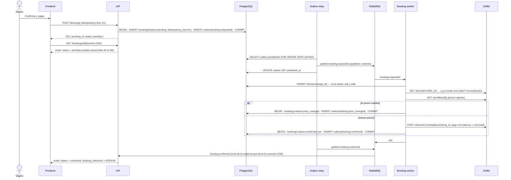
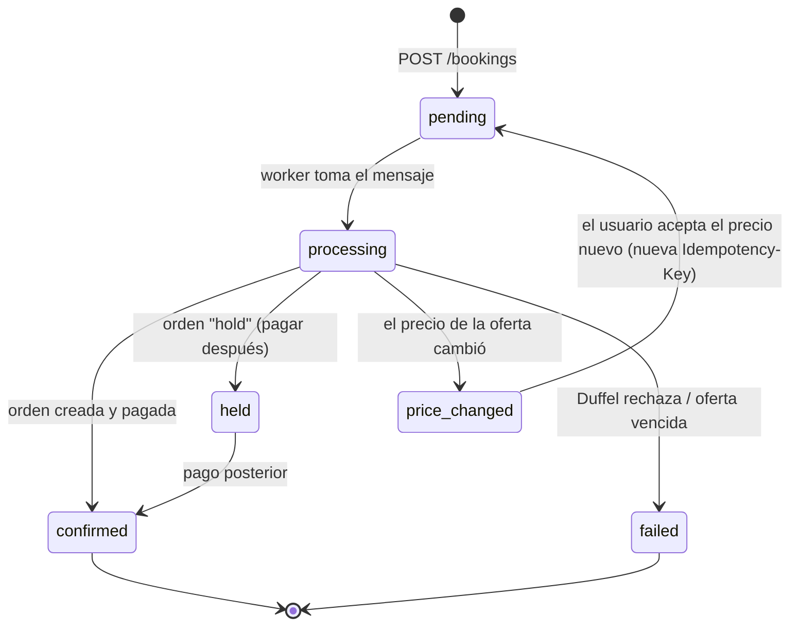

# Etapa 2: Reserva de vuelos

> Estado: **planificada**. Este documento es el diseño propuesto; se revisa al empezar la etapa.
> Reglas generales: [00-global.md](00-global.md). Etapa anterior: [01-busqueda-vuelos.md](01-busqueda-vuelos.md).
> Última actualización: 2026-10-26

## 1. Objetivo

Reservar las tarifas guardadas en "Tu viaje", correspondientes a las pantallas 5 (Pasajeros y pago) y 6 (Confirmación) del diseño, con tres garantías:

1. **Sin reservas duplicadas**, aunque el usuario haga doble clic, el navegador reintente o un worker se caiga a mitad de camino.
2. **Sin bloquear al usuario** mientras la aerolínea confirma, lo que puede tardar varios segundos. La reserva se procesa **en segundo plano** y el frontend se entera por **SSE**.
3. **El estado guardado y la notificación nunca se desincronizan**, gracias a Transactional Outbox: si la reserva quedó guardada, el evento sale; si no se guardó, no sale.

### 1.1 Dos niveles de idempotencia

| Nivel | Evita | Clave | Dónde |
|---|---|---|---|
| Ítems de "Tu viaje" | El mismo vuelo dos veces en el viaje (volver atrás, doble clic, búsqueda nueva) | `item_key = provider:itinerary_key` (natural) | Etapa 1: store del frontend. **Etapa 2: `PUT /trips/{id}/items/{item_key}` + `UNIQUE (trip_id, item_key)`** |
| Reserva | Procesar dos veces la misma reserva (doble envío, reintentos, reentregas) | `Idempotency-Key` (UUID por intento de checkout) | `bookings.idempotency_key UNIQUE` + Inbox en el worker |

Ver [01-busqueda-vuelos.md §7.4](01-busqueda-vuelos.md#74-idempotencia-de-tu-viaje).

## 2. Piezas

| Pieza | Rol |
|---|---|
| **Idempotency-Key** | Header que el frontend genera (UUID v4) por cada intento de checkout. Se guarda en PostgreSQL con `UNIQUE` |
| **PostgreSQL** | Fuente de verdad: `bookings`, `outbox`, `inbox` |
| **Outbox relay** (worker) | Lee los eventos pendientes de `outbox` y los publica en RabbitMQ |
| **RabbitMQ** | Transporte de eventos entre la API y los workers. **No guarda claves ni estados** |
| **Booking worker** | Consume `booking.requested` y habla con Duffel: refresca la oferta, crea la orden y guarda el resultado |
| **SSE** | `GET /api/v1/bookings/{id}/events`: la API empuja al navegador los cambios de estado de la reserva |

> **Por qué la Idempotency-Key no va en RabbitMQ.**
> - RabbitMQ es una cola: mueve mensajes, pero no permite preguntar "¿ya vi esta clave?" y no conserva los mensajes una vez consumidos.
> - Para deduplicar hace falta un almacenamiento consultable con unicidad garantizada: **PostgreSQL con `UNIQUE`**, en la misma transacción que crea la reserva.
> - Si más adelante se quiere rechazar duplicados aún más rápido, se puede agregar un `SET NX` en Redis delante, pero PostgreSQL sigue siendo la garantía.
> - En este diseño RabbitMQ sí cumple su rol natural: **desacoplar** la API (responde enseguida) del procesamiento lento (Duffel).

## 3. Flujo



## 4. Idempotency-Key

| Caso | Respuesta |
|---|---|
| Clave nueva | Se crea la reserva → `202` |
| Misma clave, mismo body | Se devuelve la reserva existente, con su estado actual (`202` o `200`). **No** se procesa de nuevo |
| Misma clave, body distinto | `422 idempotency_key_reused`. Se compara contra un hash del body guardado con la clave |
| Sin header | `400 idempotency_key_required` |

- **Tabla:** `bookings.idempotency_key UNIQUE` + `bookings.request_hash`.
- **Concurrencia:** el `UNIQUE` resuelve la carrera de dos requests simultáneas. La segunda recibe un error de integridad, que se traduce en "devolver la existente".
- **Vigencia:** la clave dura lo que dura la reserva. No se reutiliza.

## 5. Transactional Outbox

```
outbox
├── id            UUID PK
├── aggregate_id  UUID       # booking_id
├── type          TEXT       # booking.requested | booking.confirmed | booking.failed | booking.price_changed
├── payload       JSONB
├── created_at    TIMESTAMPTZ
└── published_at  TIMESTAMPTZ NULL   (índice parcial WHERE published_at IS NULL)
```

- **Regla:** quien cambia `bookings.status` inserta el evento en `outbox` **en la misma transacción**. Nunca se publica directo a RabbitMQ desde la API ni desde el worker.
- **Relay:**
  - hace *polling* corto (por ejemplo cada 500 ms) con `FOR UPDATE SKIP LOCKED`, así varias réplicas no publican lo mismo;
  - publica con **publisher confirms** y recién después marca `published_at`.
- **Garantía:** *at-least-once*. Si el relay se cae entre publicar y marcar, el evento sale dos veces. Por eso los consumidores usan Inbox.

### 5.1 Inbox (consumidores idempotentes)

```
inbox
├── message_id    UUID PK     # = outbox.id, viaja en el mensaje
├── consumer      TEXT
└── processed_at  TIMESTAMPTZ
```

El worker inserta en `inbox` y aplica el efecto en la misma transacción. Si el `message_id` ya existe, hace *ack* sin procesar.

## 6. El riesgo real: la llamada a Duffel

El *outbox* y el *inbox* protegen **nuestra** base de datos, pero la orden en Duffel es un efecto externo, fuera de nuestra transacción.

**Escenario:** el worker crea la orden en Duffel, se cae antes del `COMMIT` y RabbitMQ reentrega el mensaje. Sin protección, se reservaría dos veces.

**Mitigación:**
1. Antes de crear la orden: `GET /air/orders?offer_id={offer_id}`. Si ya existe, se toma esa orden y se continúa sin crear otra. **Verificado:** el endpoint *List Orders* de Duffel acepta el filtro `offer_id`.
2. Cada orden se crea con `metadata.booking_id`, para auditar y reconciliar.
3. Duffel solo permite reservar **una oferta por offer request**, lo que limita el daño si algo se escapa.
4. Lo que **no** se encontró en la documentación es un header `Idempotency-Key` propio de Duffel. Si existe, se agrega como capa extra.

## 7. SSE (Server-Sent Events)

```
GET /api/v1/bookings/{id}/events
Accept: text/event-stream

event: status
id: 3
data: {"booking_id":"…","status":"confirmed","booking_reference":"RZPNX8"}
```

- **Al conectar,** la API envía primero el **estado actual leído de la DB**. Así, si la reserva se confirmó antes de que el navegador abriera el SSE, no se pierde el evento.
- **Fan-out entre réplicas:** cada instancia de la API tiene una cola exclusiva y temporal en RabbitMQ, ligada al exchange `bookings.events` (topic, `booking.*`). La instancia reenvía cada evento a las conexiones SSE abiertas para ese `booking_id`.
- **Reconexión:** el navegador reconecta solo y envía `Last-Event-ID`; la API vuelve a mandar el estado actual.
- **Plan B:** `GET /api/v1/bookings/{id}` devuelve el estado sin streaming.
- **Implementación:** `StreamingResponse` de FastAPI con `media_type="text/event-stream"`, o `sse-starlette`. Hay que enviar un *heartbeat* cada 15 s para que no corten los proxies.

**Sobre "que queden dependientes uno del otro":** el SSE no puede estar dentro de una transacción, porque es una conexión con el navegador. Lo que el Outbox garantiza es que **el evento existe si y solo si el cambio de estado se guardó**. El SSE es solo el canal de entrega; como el frontend siempre puede volver a leer el estado, una notificación perdida o duplicada no rompe nada.

## 8. Estados de la reserva



## 9. Precio y cobro

| Concepto | Monto |
|---|---|
| Cobro al cliente | `price.total`, el precio de venta mostrado. La pasarela de pago está a definir |
| Pago a Duffel | `cost.total`, con `payments: [{ type: "balance" }]` (ilimitado en modo test) |
| Ganancia | Se recalcula con la misma `PricingPolicy` y la misma clave (`duffel:off_...`), así que coincide con lo mostrado |

Si al refrescar la oferta **cambia el costo**, la reserva pasa a `price_changed` y **no se cobra**. El usuario confirma el precio nuevo, como pide el diseño: «Nunca se cobra un monto distinto sin avisar».

## 10. Endpoints

| Método | Ruta | Uso |
|---|---|---|
| `POST` | `/api/v1/bookings` | Crea una reserva para una tarifa de "Tu viaje" (header `Idempotency-Key`) → `202` |
| `GET` | `/api/v1/bookings/{id}` | Estado actual |
| `GET` | `/api/v1/bookings/{id}/events` | SSE con los cambios de estado |

Cada vuelo de "Tu viaje" es **una orden separada** en Duffel, con su propia oferta y su propio vencimiento. Un viaje con dos vuelos genera dos reservas, cada una con su Idempotency-Key.

## 11. Infraestructura nueva

- **RabbitMQ:** imagen `rabbitmq:management`.
- **Workers:** dos servicios en `docker-compose`, `outbox-relay` y `booking-worker`, con la misma imagen del backend y otro comando.
- **Exchanges:**
  - `bookings.commands` (direct): `booking.requested`;
  - `bookings.events` (topic): `booking.confirmed`, `booking.failed`, `booking.price_changed`.
- **Dead-letter queue** para mensajes que fallan N veces, con alerta en los logs.

## 12. Tests previstos

| Nivel | Qué |
|---|---|
| Idempotencia | Misma clave dos veces → una sola reserva; misma clave con otro body → 422; dos requests concurrentes → una sola reserva |
| Outbox | El estado y el evento se guardan en la misma transacción (si falla uno, no queda ninguno); el relay no publica dos veces con dos réplicas |
| Inbox | Mensaje reentregado → sin efecto doble |
| Worker | Duffel mockeado: orden creada, precio cambiado, oferta vencida, reconciliación por `offer_id` |
| SSE | Estado inicial al conectar, evento posterior, reconexión con `Last-Event-ID` |

## 13. Decisiones abiertas

| Tema | Opciones |
|---|---|
| Pasarela de pago al cliente | Duffel Payments, Stripe u otra |
| Persistir "Tu viaje" en el servidor | Necesario para reservar varios vuelos de forma consistente. Incluye mover la idempotencia de ítems a PostgreSQL (§1.1) |
| Cliente de RabbitMQ | `aio-pika` (async), recomendado |
