# Etapa 2: Reserva de vuelos

> Estado: **implementada** (2026-10-27). Diseño original y su discusión: [spec](../superpowers/specs/2026-10-27-reserva-vuelos-design.md); plan por fases: [plan](../superpowers/plans/2026-10-27-reserva-vuelos.md).
> Reglas generales: [00-global.md](00-global.md) (en especial §4.1, monolito modular). Etapa anterior: [01-busqueda-vuelos.md](01-busqueda-vuelos.md). Comportamiento verificado de Duffel: [duffel-busqueda-y-reserva.md §4.6](../providers/duffel-busqueda-y-reserva.md).
> Última actualización: 2026-10-27

Este documento explica **cómo funciona la reserva de punta a punta**: qué procesos corren, qué archivo hace cada cosa, qué pasa en cada paso y por qué es seguro repetirlo. Al final está la guía para probarlo y depurarlo en local (§15).

## Índice

1. [Objetivo y garantías](#1-objetivo-y-garantías)
2. [Panorama: procesos e infraestructura](#2-panorama-procesos-e-infraestructura)
3. [Módulos y mapa del código](#3-módulos-y-mapa-del-código)
4. [Recorrido de una reserva](#4-recorrido-de-una-reserva)
5. [Estados de la reserva](#5-estados-de-la-reserva)
6. [Datos](#6-datos)
7. [Idempotencia: por qué nada se hace dos veces](#7-idempotencia-por-qué-nada-se-hace-dos-veces)
8. [Worker de reservas](#8-worker-de-reservas)
9. [Mensajería: outbox, relay, colas y reintentos](#9-mensajería-outbox-relay-colas-y-reintentos)
10. [SSE: cómo se entera el navegador](#10-sse-cómo-se-entera-el-navegador)
11. [Correo de confirmación](#11-correo-de-confirmación)
12. [Precio y cobro](#12-precio-y-cobro)
13. [API](#13-api)
14. [Frontend](#14-frontend)
15. [Cómo probarlo y depurarlo](#15-cómo-probarlo-y-depurarlo)
16. [Tests](#16-tests)
17. [Pendientes conocidos](#17-pendientes-conocidos)

## 1. Objetivo y garantías

Reservar el vuelo guardado en "Tu viaje" con las pantallas 5 (Pasajeros y pago) y 6 (Confirmación) del diseño, y avisar por correo cuando se confirma. Con cuatro garantías:

| Garantía | Cómo se logra |
|---|---|
| **Sin reservas ni cobros duplicados**, aunque haya doble clic, reintentos del navegador o un worker que se caiga a mitad de camino | `Idempotency-Key` con `UNIQUE` en PostgreSQL, claim atómico con lease, reconciliación con Duffel, autorizaciones idempotentes (§7) |
| **Sin bloquear al viajero** mientras la aerolínea confirma | La API responde enseguida (`202`) y un worker procesa en segundo plano; el navegador se entera por SSE (§10) |
| **Estado y evento nunca desincronizados** | Transactional Outbox: el cambio de estado y su evento se guardan en la misma transacción (§9) |
| **Nunca se cobra un precio que el viajero no vio** | El worker recalcula el precio; si cambió, la reserva espera su autorización sin cobrar nada (§5, §8) |

## 2. Panorama: procesos e infraestructura

Todo es **un solo código y una sola imagen** (monolito modular) que corre como cuatro procesos distintos. Los procesos no se llaman entre sí: se comunican por PostgreSQL y RabbitMQ.

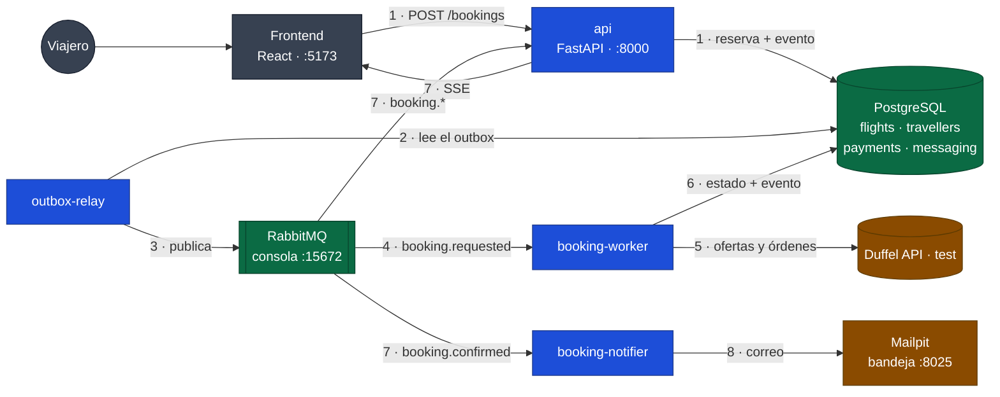

Azul: los cuatro procesos (misma imagen); verde: datos y mensajería; marrón: externos. Los números siguen una reserva: la API la guarda con su evento (1), el relay lo publica (2-3), el worker la procesa contra Duffel y guarda el resultado con otro evento (4-6), que el relay publica para el SSE de la API y para el notifier (7), que manda el correo (8).

| Proceso | Qué hace | Archivo de entrada |
|---|---|---|
| `api` | Recibe la reserva, la guarda con su evento y responde `202`. Sirve `GET` y el SSE | `backend/app/main.py` |
| `outbox-relay` | Cada 500 ms toma los eventos pendientes de `messaging.outbox` y los publica en RabbitMQ | `backend/app/workers/outbox_relay.py` |
| `booking-worker` | Consume `booking.requested`: reconfirma el precio, cobra y reserva con Duffel | `backend/app/workers/booking_worker.py` |
| `booking-notifier` | Consume `booking.confirmed`: manda el correo de confirmación | `backend/app/workers/booking_notifier.py` |

| Infraestructura | Para qué | Si se cae |
|---|---|---|
| PostgreSQL | Fuente de verdad: reservas, viajeros, autorizaciones, outbox e inbox | Nada funciona (es la verdad) |
| RabbitMQ | Transporte de eventos. No guarda claves ni estados | Las reservas quedan `pending` en la base y los eventos esperan en el outbox; al volver, el relay los publica |
| Mailpit | Servidor SMTP de desarrollo que guarda los correos para verlos | El notifier reintenta; la reserva no se ve afectada |
| Redis | Caché de aeropuertos (etapa 1) | La búsqueda de aeropuertos va a PostgreSQL |

## 3. Módulos y mapa del código

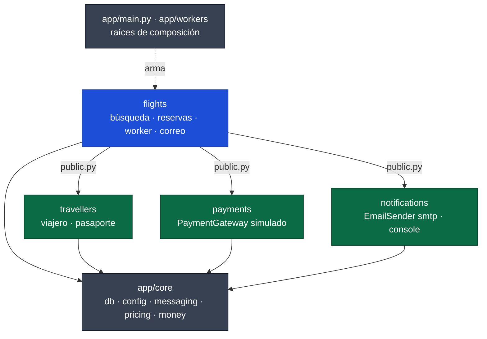

- Un módulo solo importa de otro su `public.py`. Lo verifica `import-linter` en `make test` y `make lint` (4 contratos en `backend/pyproject.toml`).
- Cada módulo es dueño de su schema de PostgreSQL. Entre módulos no hay claves foráneas: la reserva guarda `traveller_id` como un UUID suelto.

### 3.1 Backend: qué archivo hace qué

| Archivo | Responsabilidad |
|---|---|
| **`app/flights/api/`** | |
| `routes/bookings.py` | Los cuatro endpoints de reservas (solo endpoints) |
| `routes/search.py`, `routes/places.py` | Búsqueda y autocompletado; `routes/__init__.py` arma el router `/api/v1/flights` |
| `schemas/bookings.py` | `BookingResponse`, `OrderResponse`: la **forma** de la vista pública, sin costo, ganancia ni datos de contacto. Sin lógica |
| `mappers/bookings.py` | `to_booking_response`: reserva guardada → vista pública. Lo usan la API y el correo |
| `mappers/search.py` | `to_search_response`: resultado agrupado → respuesta; descarta costo y ganancia de cada tarifa |
| `dependencies.py` | Arma `BookingService` con la sesión y el provider (único lugar que elige adapters); `idempotency_key` lee el header; `existing_booking` da 404 antes de abrir el SSE |
| `errors.py` | Error de dominio → código HTTP |
| **`app/flights/services/`** | |
| `bookings.py` | `BookingService`: crear (idempotente), leer, decidir el precio |
| `booking_prices.py` | Precio esperado, ofrecido, aprobado y a cobrar de una reserva |
| `booking_state.py` | `change_status`, `announce`, `request_processing`: todo cambio de estado escribe su evento en el outbox |
| `booking_worker.py` | `BookingProcessor`: el procesamiento en segundo plano (§8) |
| `booking_events.py` | `booking_status_stream`: el generador del SSE (§10) |
| `pricing.py` | `apply_pricing`: el mismo precio de venta en búsqueda y reserva |
| **`app/flights/domain/`** (un archivo por tema) | |
| `dtos/bookings.py` | `BookingRequest`, `BookingPassenger`, `AirlinePassenger`, `BookingStatus`, `FailureCode`, `PriceDecisionRequest` |
| `dtos/orders.py` | `BookableOffer`, `OrderRequest`, `Ticket`, `Order` |
| `dtos/itinerary.py`, `dtos/offers.py` | Tramos, segmentos y equipaje; ofertas, condiciones y montos (compartidos con la búsqueda) |
| `validators/passengers.py` | Reglas de la aerolínea: transliteración (`Muñoz` → `MUNOZ`), 40 caracteres, edad |
| `constants/bookings.py` | Lease del worker, pasajeros por reserva, largo de los nombres |
| `models/bookings.py` | Tabla `flights.bookings` |
| `errors/provider.py`, `errors/bookings.py` | `OfferUnavailableError`, `OfferAlreadyBookedError`…; `IdempotencyKeyReusedError`, `PriceMismatchError`… |
| **`app/flights/repositories/bookings.py`** | Lecturas, lock (`FOR UPDATE`) y el **claim** atómico |
| **`app/flights/providers/duffel/`** | |
| `client.py` | HTTP a Duffel y traducción de sus errores (`offer_request_already_booked`, `not_found`…) |
| `mapper.py` | Puro: oferta → `BookableOffer`, `OrderRequest` → JSON, JSON → `Order` |
| `provider.py` | `get_offer`, `find_order` (reconciliación por `metadata.booking_id`), `create_order` |
| **`app/flights/notifications/`** | |
| `booking_notifier.py` | Consumidor de `booking.confirmed` |
| `confirmation_email.py` | Vista del correo y render con Jinja2 (parte de `BookingResponse`) |
| `templates/booking_confirmed.{html,txt}.j2` | Las plantillas del tablero "Correo de confirmación" |
| **`app/flights/core/messaging.py`** | Exchanges, colas y routing keys del módulo |
| **`app/travellers/`** | `public.py` (`create_traveller`, `get_traveller`), validaciones genéricas (email, E.164, pasaporte) |
| **`app/payments/`** | `public.py` (`create_payment_gateway`), `providers/fake/gateway.py` (aprueba todo salvo `…0002`) |
| **`app/notifications/`** | `public.py` (`create_email_sender`), `providers/smtp`, `providers/console`, `core/config.py` (`EMAIL_BACKEND`, `SMTP_*`) |
| **`app/core/messaging/`** | `outbox.py`, `inbox.py`, `relay.py`, `consumer.py` (reintentos y DLQ), `broadcaster.py` (SSE), `topology.py`, `envelope.py` |
| **`app/workers/`** | Un archivo por proceso; `runtime.py` (logs y apagado con SIGTERM) |

### 3.2 Frontend: qué archivo hace qué

| Archivo | Responsabilidad |
|---|---|
| `src/api/bookings.ts` | `useCreateBooking`, `useBooking` (con *polling* de respaldo), `usePriceDecision`, `useBookingEvents` (SSE) |
| `src/features/checkout/CheckoutPage.tsx` | Pantalla 5: orquesta formulario, intento, SSE, diálogo de precio y navegación |
| `src/features/checkout/logic.ts` | Reglas espejo del backend: transliteración, edad, E.164, Luhn, schema Zod, armado del body |
| `src/features/checkout/store.ts` | `useCheckout`: borrador del pasajero e intento (`Idempotency-Key`, `bookingId`) por ítem, en `sessionStorage` |
| `src/features/checkout/PassengerSection.tsx`, `PaymentSection.tsx`, `FlightSummary.tsx`, `PriceChangedDialog.tsx` | Partes de la pantalla 5 |
| `src/features/booking/BookingPage.tsx` | Pantalla 6 v2: confirmada, confirmando y no se pudo reservar |
| `src/features/booking/logic.ts` | Reglas de la confirmación: «Qué incluye», equipaje, «Gestionar», mensajes por `failure_code` |

## 4. Recorrido de una reserva

El camino feliz, con los puntos donde se bifurca:

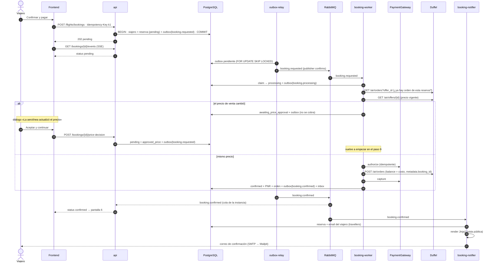

Si algo falla en el worker (tarjeta rechazada, oferta no disponible, pasajero rechazado), la reserva pasa a `failed`, el cobro autorizado se anula y la pantalla 5 navega a la 6, que explica el motivo (estado 5 del tablero).

## 5. Estados de la reserva

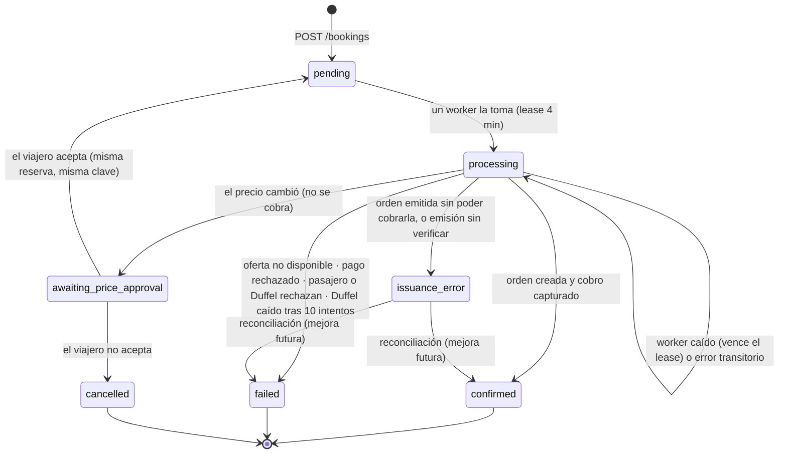

| Transición | Quién la hace | Evento que escribe en el outbox |
|---|---|---|
| — → `pending` | API, `BookingService.create` | `booking.requested` (comando para el worker) |
| `pending` → `processing` | Worker, `BookingRepository.claim` | `booking.processing` |
| `processing` → `awaiting_price_approval` / `confirmed` / `failed` | Worker, `change_status` | `booking.awaiting_price_approval` / `booking.confirmed` / `booking.failed` |
| `processing` → `issuance_error` | Worker, `_issuance_error` | `booking.issuance_error` |
| `awaiting_price_approval` → `pending` | API, `BookingService.decide_price` | `booking.pending` + `booking.requested` |
| `awaiting_price_approval` → `cancelled` | API, `BookingService.decide_price` | `booking.cancelled` |

Cada cambio sube `version`, que es el `id` de los eventos SSE. `failure_code`: `offer_expired`, `offer_unavailable`, `passenger_rejected`, `payment_declined`, `provider_rejected`, `provider_unavailable`; y, de un `issuance_error`, `capture_failed` y `order_unverified`. **`issuance_error` no es un estado final** (podría reconciliarse), pero hoy nada lo mueve: la reserva se queda ahí.

## 6. Datos

Cada módulo tiene su schema. Las flechas punteadas son referencias por id **sin clave foránea**: cruzan módulos.

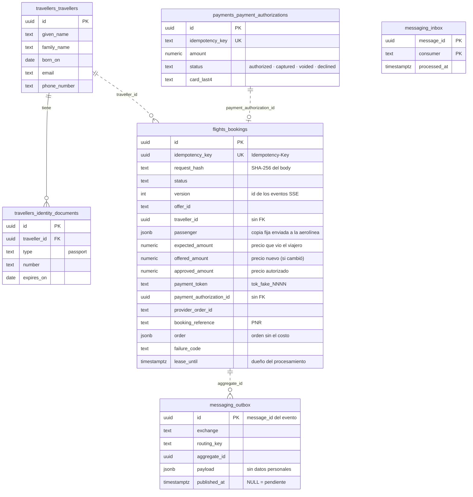

| Qué | Dónde está | Qué **no** se guarda |
|---|---|---|
| Datos del viajero y pasaporte | `travellers.*` | — |
| Pasajero tal como lo recibió la aerolínea (`MUNOZ`) | `flights.bookings.passenger` | — |
| Precio de venta (esperado, ofrecido, aprobado) | `flights.bookings` | Costo y ganancia: se recalculan con la `PricingPolicy` |
| La orden confirmada | `flights.bookings.order` | El `total` de la orden (es el costo) |
| Tarjeta | `payments.payment_authorizations.card_last4` | Número completo y código: nunca salen del navegador |
| Eventos | `messaging.outbox` | Datos personales: solo `booking_id`, `status` y `version` |

## 7. Idempotencia: por qué nada se hace dos veces

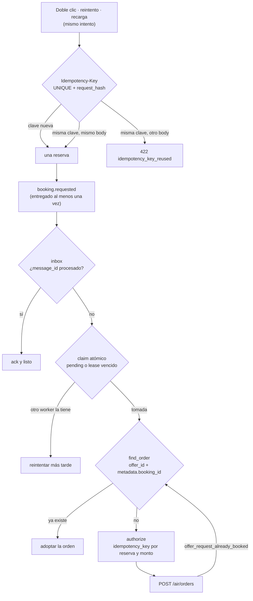

| Nivel | Clave | Dónde |
|---|---|---|
| Reserva | `Idempotency-Key` (UUID por intento; el frontend lo guarda con el ítem) | `bookings.idempotency_key UNIQUE` + `request_hash` |
| Consumo de mensajes | `message_id` = `outbox.id` | `messaging.inbox`, marcado con `ON CONFLICT DO NOTHING` |
| Efecto en el worker | Estado de la reserva bajo `SELECT … FOR UPDATE` | Solo una entrega mueve la reserva desde `processing` |
| Orden en Duffel | `offer_id` + `metadata.booking_id` | Reconciliación antes de crear y ante `offer_request_already_booked`. Duffel **ignora** el header `Idempotency-Key` |
| Cobro | `flights-booking:{id}:{monto}{moneda}` | `payment_authorizations.idempotency_key UNIQUE` |
| Correo | `message_id` del evento | Inbox del consumidor `flights.booking-notifier` (entrega *at-least-once*) |

| `POST /bookings` | Respuesta |
|---|---|
| Clave nueva | `202` con la reserva `pending` |
| Misma clave, mismo body (incluso 5 en paralelo) | `200` con la existente: una reserva, un viajero, un evento |
| Misma clave, otro body | `422 idempotency_key_reused` |
| Sin clave o no es UUID | `400 idempotency_key_required` |

**El inbox se marca junto con el resultado, no al tomar el mensaje.** Si se marcara al tomarlo, un worker que muere después dejaría el mensaje "procesado" y la reserva trabada en `processing`.

## 8. Worker de reservas

`BookingProcessor.handle` en `app/flights/services/booking_worker.py`:

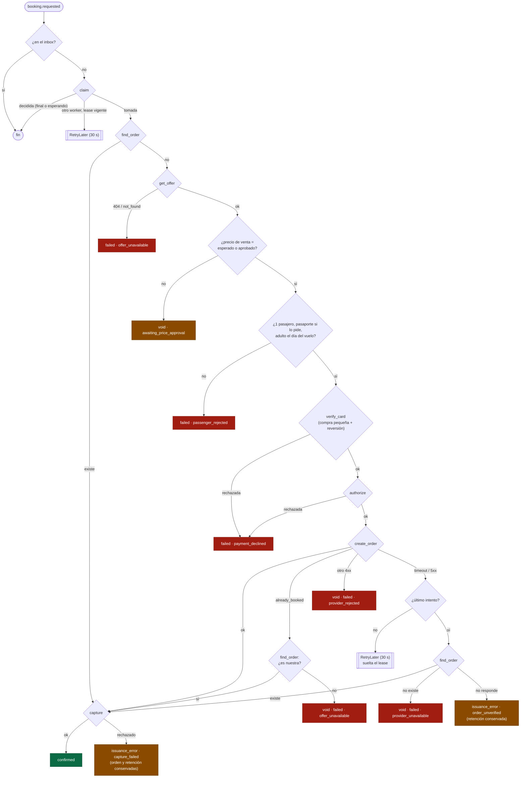

- **Lease de 4 minutos, solo para el worker que muere.** Cuando el worker sigue vivo y pide un reintento por una falla del proveedor, **suelta el lease** (`lease_until = NULL`, la reserva sigue en `processing`) y el siguiente intento la toma de inmediato, llamando otra vez a Duffel. Sin esto, cada reintento se descartaba como «lo procesa otro worker» hasta que vencía el lease propio, y se gastaban 7 de los 10 intentos esperando. Si el worker muere, otra entrega toma la reserva cuando el lease vence. El peor caso (consultar la orden y la oferta, hasta 60 s cada una, y crear la orden, hasta **130 s**) puede superar los 4 minutos. Si el lease vence con el worker todavía vivo, otro worker toma la reserva, pero no duplica nada: Duffel rechaza la segunda orden (`offer_request_already_booked`), se reconcilia y el estado solo cambia si la reserva sigue en `processing`. Conviene igual subir el lease y los intentos (§17).
- **El pasajero se manda con el `pas_…` del refresco de la oferta.** El frontend no lo conoce.
- **El pago a Duffel es el costo** (`balance`); el cobro al viajero es el precio de venta (§12).

### 8.1 Qué pasa si fallan los 10 reintentos

Cada reintento llama a Duffel (30 s entre uno y otro, unos 5 minutos en total). En el último intento, `_give_up`:

1. consulta `find_order`; si la orden existe, **confirma** con ella;
2. si no existe, **anula la autorización, marca `failed(provider_unavailable)` y registra el mensaje como procesado**. El viajero ve «La aerolínea no respondió a tiempo» y no se le cobra;
3. si la consulta tampoco responde, **no sabe si la orden existe**: pasa a `issuance_error(order_unverified)` y **no libera el dinero** (§8.2).

La cola `…dlq` solo recibe mensajes cuyo handler lanza una excepción inesperada en el último intento; este camino no llega a ella.

**Mientras tarda** (más de 1 minuto desde que se creó la reserva), las pantallas 5 y 6 muestran «Está tardando más de lo habitual»: el viajero no tiene que esperar en la página, porque apenas se confirme se le manda el correo de confirmación (§11).

**Lo que no está cubierto hoy:**

| Caso | Consecuencia | Qué haría falta |
|---|---|---|
| Duffel creó la orden pero respondió 502 y `find_order` también falla en el último intento | Queda en **`issuance_error(order_unverified)`** con la autorización conservada y un log `error`; nadie la retoma | Un reconciliador periódico y una cola de casos para agentes (§8.2) |
| Una caída de Duffel de más de ~5 minutos | La reserva falla aunque habría podido salir más tarde | Reintentos más espaciados (30 s y luego minutos) o un estado «sin confirmar» con reconciliación diferida |
| El último intento encuentra la reserva tomada con un lease vivo | El mensaje se descarta con un warning y la reserva queda en `processing` sin que nadie la retome | Un barrido de reservas `processing` con el lease vencido que vuelva a encolar `booking.requested` |
| La reserva termina en `failed` | No se manda ningún correo (solo está diseñado el de confirmación) y el aviso de demora promete correo solo si se confirma | Correo de «no se pudo reservar» y alertas sobre la DLQ y los logs `error` |
| Mensajes en la DLQ | Nadie los reprocesa | Un comando para inspeccionarlos y reenviarlos |

### 8.2 Garantías de emisión y cobro, y el estado «Error de emisión»

Orden de las operaciones de una reserva. Cada paso solo ocurre si el anterior salió bien:

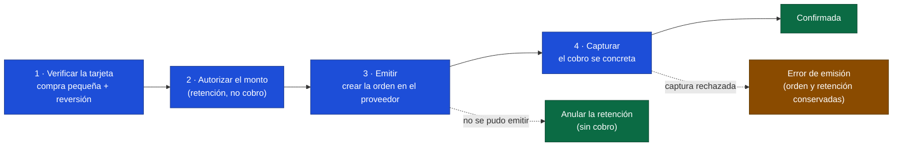

**Qué se garantiza hoy:**

| Riesgo | Garantía |
|---|---|
| Cobrar sin haber emitido | **Sí.** La captura es el último paso y solo ocurre con la orden ya creada. Antes solo hay una retención |
| Dos órdenes para una reserva | **Sí.** Se busca la orden existente antes de crear (`find_order`) y Duffel rechaza una segunda orden de la misma búsqueda |
| El worker muere entre emitir y confirmar | **Sí.** El reintento encuentra la orden, captura y confirma. Autorizar, capturar y anular son idempotentes |
| **Emitir y no poder cobrar** (captura rechazada) | **Ahora se detecta:** `issuance_error(capture_failed)`. La orden y la retención se conservan; nada se libera ni se reintenta solo |
| **No saber si se emitió** (la consulta falla en el último intento) | **Ahora se detecta:** `issuance_error(order_unverified)`. Antes se anulaba la retención y se marcaba la reserva como fallida aunque hubiera un ticket |
| Una reserva que nadie retoma | **No.** Sigue pendiente un barrido que la reencole (§17) |
| Tickets que lleguen después de crearse la orden | **Sin verificar** en la documentación de Duffel; hoy se confirma al crearse la orden |

**El estado `issuance_error` (Error de emisión)** significa: *la aerolínea pudo haber emitido la reserva, pero no se pudo confirmar ni cobrar*. Por eso:

- **Conserva el dinero y los datos:** no anula la autorización, y guarda el id de la orden, el localizador y la orden (si se conocen) para quien la revise.
- **No es final, pero no se reintenta:** reintentar desde ese estado y reconciliarlo es una mejora posterior. Hoy la reserva pasa ahí y se queda.
- **El viajero no ve un ticket:** la API solo devuelve el localizador y la orden de una reserva confirmada. La pantalla dice «Error de emisión», que no vuelva a reservar ese vuelo (podría duplicarse), que no se concretó ningún cobro (aunque el monto puede figurar retenido) y le muestra el número de reserva para pedir ayuda.
- **El checkout no cierra el intento:** si el viajero vuelve, cae en la misma reserva y no puede crear otra para el mismo vuelo.
- **Emite el evento `booking.issuance_error`**, que hoy nadie consume.

**Verificación de la tarjeta.** Antes de la retención real el worker hace lo que hacen la mayoría de las plataformas: una **compra pequeña** (1,00 en la moneda de la reserva), comprueba que salió bien y **pide su reversión**; recién después sigue el flujo (`PaymentGateway.verify_card`, idempotente por reserva).

| Resultado | Qué hace el worker |
|---|---|
| Compra rechazada | `failed(payment_declined)`; no se pide la retención ni se emite nada |
| Compra aprobada y revertida | Sigue con la autorización |
| Compra aprobada pero **la reversión falla** | Sigue con la reserva (la tarjeta funciona) y registra un log `error` con el id de la compra: **hay que reembolsarla a mano** |

El gateway simulado rechaza las tarjetas que terminan en `0002` y no puede revertir las que terminan en `0003`. Un gateway real puede reemplazar la compra por su verificación nativa; el contrato (`verify_card`) no cambia.

**Casos que no se resuelven con código.** Un `issuance_error`, una compra de verificación sin revertir o un error de operaciones (por ejemplo, saldo insuficiente en Duffel) necesitan a una **persona o a un agente de IA**. Hoy solo queda un log `error` con el `booking_id` y el `offer_id`. Falta la cola de casos, las herramientas con permisos (capturar, anular, cancelar la orden dentro de la ventana de anulación, reembolsar) y la auditoría; el diseño general está en [XX-failover-proveedores.md §5](XX-failover-proveedores.md#5-casos-que-no-se-resuelven-con-código-agentes-humanos-o-de-ia).

Todos los errores posibles de la emisión, con cómo se tratan hoy y quién los resuelve, están en [duffel-errores-de-emision.md](../research/duffel-errores-de-emision.md).

## 9. Mensajería: outbox, relay, colas y reintentos

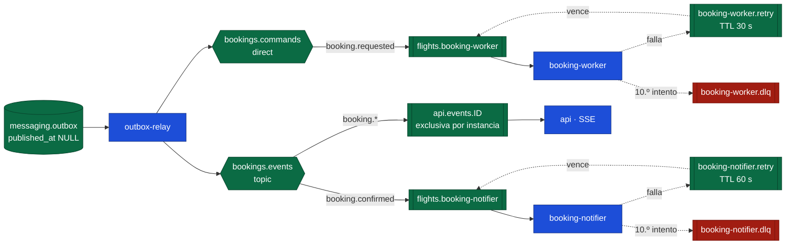

| Pieza | Cómo funciona |
|---|---|
| `add_event` (`outbox.py`) | Lo llama quien cambia un estado, **dentro de su transacción**. Si hay rollback, el evento no existe |
| Relay (`relay.py`) | Lotes de 100 con `FOR UPDATE SKIP LOCKED` (varios relays no publican lo mismo); publica con *publisher confirms* y recién entonces marca `published_at`. Garantía *at-least-once*. Declara las topologías antes de publicar, así un comando nunca va a una cola inexistente |
| Consumidor (`consumer.py`) | `ack` después del handler. Si el handler falla, copia el mensaje a `.retry` (vuelve tras el TTL) con el número de intento en el header `x-attempt`; en el último, a `.dlq` con un log `error`. Un mensaje malformado va directo a `.dlq` |
| Difusor (`broadcaster.py`) | Cada instancia de la API tiene una cola exclusiva ligada a `booking.*` y reparte los eventos a sus conexiones SSE. Si RabbitMQ no está al arrancar, la API arranca igual y el difusor reintenta cada 5 s |

## 10. SSE: cómo se entera el navegador

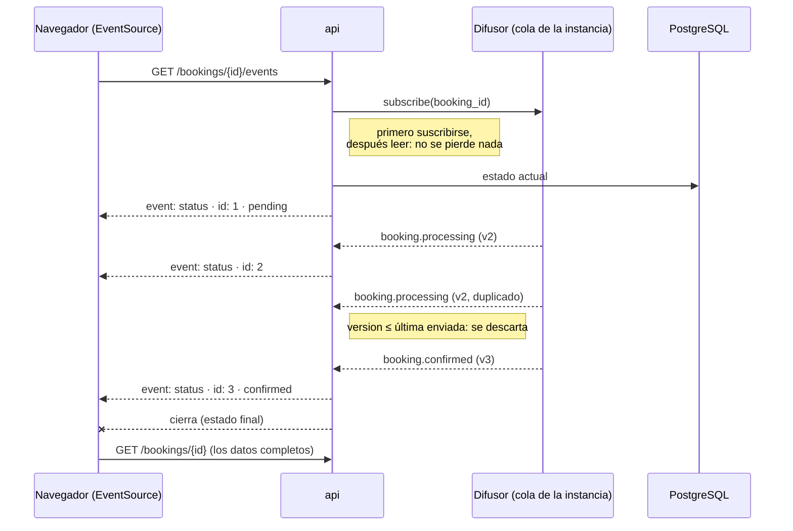

- **El evento solo avisa** (`booking_id`, `status`, `version`). Con cada aviso el frontend vuelve a pedir `GET /bookings/{id}`, así un aviso perdido o duplicado nunca muestra un estado incorrecto.
- **Sin eventos, la API relee la base cada 15 s.** FastAPI manda el *keepalive* (`: ping`).
- **El frontend cierra el `EventSource` al llegar a un estado final,** porque si no el navegador reconectaría solo. Si no hay `EventSource`, consulta cada 5 s mientras la reserva no sea final.

## 11. Correo de confirmación

Tablero "Correo de confirmación" de la Propuesta A v2 (`docs/frontend/Vuelos · Propuesta A v2.html`) y sus notas.

| Tema | Detalle |
|---|---|
| Disparador | `booking.confirmed`, en un proceso aparte. La reserva ya está confirmada y cobrada: un servidor de correo caído solo demora el correo (reintentos cada 60 s, hasta 10) |
| Destinatario | El email del viajero, leído con `travellers.public.get_traveller`. No está en la respuesta pública de la reserva |
| Contenido | Se arma con `BookingResponse`, la misma vista pública que la pantalla 6: no puede llevar costo ni ganancia |
| Asunto | `Reserva confirmada · {PNR} · {origen} ⇄ {destino}, {día mes}` (`→` en solo ida). Vista previa oculta: `Ida {fecha} y vuelta {fecha} · {aerolínea} · {total}` |
| Maquetado | Tablas `role="presentation"` de 600 px, estilos en línea, IBM Plex con Arial y Courier New de respaldo, `color-scheme: light dark`, media query bajo 480 px. Versión de texto plano con código, tramos, total y enlace |
| Escapado | Autoescape en `.html.j2`: los nombres vienen del viajero. Un test lo verifica (la primera versión no escapaba: `select_autoescape(["html"])` no reconoce la extensión doble) |
| Enlace | `APP_URL` + `/bookings/{id}` |

**Cómo se elige el servidor de correo** (`app/notifications/public.py`):

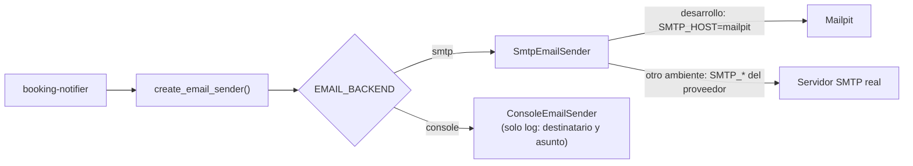

| Variable | Desarrollo (compose) | Otro ambiente |
|---|---|---|
| `EMAIL_BACKEND` | `smtp` | `smtp`, o `console` si no hay correo |
| `SMTP_HOST` / `SMTP_PORT` | `mailpit` / `1025` | Los del proveedor (ej. 587) |
| `SMTP_USERNAME` / `SMTP_PASSWORD` | — | Credenciales del proveedor |
| `SMTP_STARTTLS` / `SMTP_SSL` | `false` | Según el proveedor |
| `EMAIL_FROM` | `Vuelos <reservas@vuelos.test>` | Remitente real |

Otro proveedor por API (SES, SendGrid) se suma con un adapter en `app/notifications/providers/` y un valor nuevo de `EmailBackend`; el notifier no cambia.

## 12. Precio y cobro

| Concepto | Monto |
|---|---|
| Lo que ve y paga el viajero | Precio de venta (`price.total`) = costo + ganancia de la `PricingPolicy`, con la misma clave (`duffel:off_…`) en búsqueda y reserva |
| Verificación de la tarjeta | Antes de la retención: compra pequeña (1,00), comprobación y reversión (§8.2) |
| Cobro al viajero | `PaymentGateway`: autorizar antes de la orden, capturar si se creó, anular si no. Por ahora **simulado**: token `tok_fake_<últimos 4>`, la tarjeta terminada en `0002` se rechaza |
| Pago a Duffel | `cost.total` con `payments: [{type: "balance"}]` |
| Si el precio cambió | No se autoriza nada; la reserva espera la decisión del viajero. Si había una autorización de un intento anterior, se anula |

## 13. API

| Método | Ruta | Uso |
|---|---|---|
| `POST` | `/api/v1/flights/bookings` | Crea la reserva (header `Idempotency-Key`) → `202` nueva / `200` reintento |
| `GET` | `/api/v1/flights/bookings/{id}` | Estado actual y, si está confirmada, la orden |
| `POST` | `/api/v1/flights/bookings/{id}/price-decision` | `accept` / `reject` del precio nuevo → `202`; `409 price_decision_not_applicable`; `422 price_mismatch` |
| `GET` | `/api/v1/flights/bookings/{id}/events` | SSE con los cambios de estado |

La respuesta pública (`BookingResponse`) **no tiene** costo, ganancia, email, teléfono, pasaporte ni token de pago. Los detalles de cada campo están en Swagger (`http://localhost:8000/docs`).

## 14. Frontend

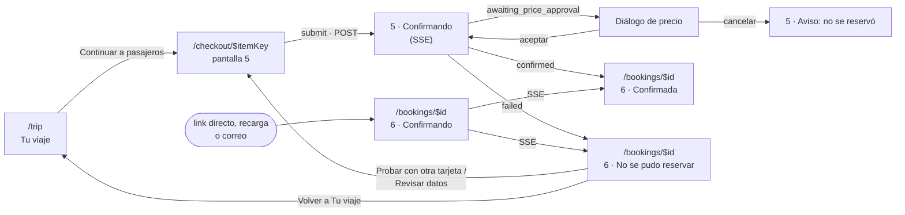

**Dónde vive cada estado:**

| Dato | Dónde |
|---|---|
| Vuelo y tarifa elegidos | `useTrip` (Zustand + `sessionStorage`), como en la etapa 1 |
| Borrador del pasajero (nunca la tarjeta) | `useCheckout.drafts[itemKey]`, en `sessionStorage`: sobrevive a una oferta vencida o una recarga |
| Intento: `Idempotency-Key` y `bookingId` | `useCheckout.attempts[itemKey]`. Mismo intento → misma clave (doble clic, error de red, recarga); tras un fallo, clave nueva |
| La reserva | TanStack Query (`bookingKeys.detail(id)`), invalidada por cada evento SSE |

**Pantalla 6 v2:** confirmada (ida y vuelta, escala con conexión corta resaltada, datos faltantes como «Sin dato»), confirmando (SSE + esqueleto) y no se pudo reservar (motivo por `failure_code`, «No se cobró nada» y el resumen del ítem de "Tu viaje", porque `GET` no trae la orden de una reserva fallida). «Gestionar reserva» son filas informativas por `available_actions`, cruzadas con las condiciones.

**Error de emisión (pantalla 6):** no tiene tablero de diseño todavía. Sigue el de «no se pudo reservar» en ámbar y no ofrece volver a intentar. El texto es provisional: no promete correo ni un contacto, porque aún no existen.

**Desvíos del tablero** (regla: si lo escrito contradice el dibujo, se sigue lo escrito):

| Tablero | Implementación | Por qué |
|---|---|---|
| Error del apellido: «Usá solo letras sin tildes…» | «Usá solo letras, espacios, guion (-) o apóstrofo (').» | El mismo tablero dice que las tildes se transliteran con aviso |
| Diálogo de precio: «Ver otras tarifas» | «Cancelar» | Volver a buscar reemplazaría la búsqueda vigente: evolución futura |
| «Reservar ahora y pagar después» activo | Deshabilitado, «próximamente» | `hold` fuera de alcance |
| Contador siempre ámbar | Neutro, ámbar con menos de 5 min | Regla escrita del diseño |
| Mobile de la pantalla 5: selects para género y nacimiento | Mismos controles que desktop, compactos | Un solo formulario |
| — | «Pago simulado…» bajo la tarjeta | Para que nadie crea que se cobra |
| Correo: check y avión en PNG | Caracteres (✓, ✈) | Faltan los recursos gráficos |

## 15. Cómo probarlo y depurarlo

### 15.1 Levantar todo

```bash
make up          # api, workers, frontend, postgres, redis, rabbitmq, mailpit
make ps          # estado de los contenedores
make logs-workers  # outbox-relay y booking-worker en vivo
```

| Consola | URL |
|---|---|
| App | http://localhost:5173 |
| Swagger | http://localhost:8000/docs |
| RabbitMQ (`booking` / `booking`) | http://localhost:15672 |
| Mailpit (correos) | http://localhost:8025 |

### 15.2 Escenarios

| Escenario | Cómo |
|---|---|
| Reserva confirmada | Buscar (Duffel Airways reserva siempre en modo test), «Continuar a pasajeros», tarjeta `4242 4242 4242 4242`, vencimiento `12/30`, código `123`. El correo llega a Mailpit |
| Tarjeta rechazada | Tarjeta `4000 0000 0000 0002`. Termina en la pantalla 6 con «La tarjeta fue rechazada» |
| Cambio de precio | `docker compose stop booking-worker` y `docker compose run --rm -e PRICING_SECRET=precio-cambiado booking-worker`: el worker calcula otra ganancia y el precio "cambia". Al terminar, Ctrl+C y `docker compose up -d booking-worker` |
| Oferta vencida | Esperar 30 minutos después de buscar y confirmar: `offer_unavailable` |
| Reintento idempotente | Cortar la red del navegador (DevTools → Offline) al confirmar y volver a intentar: misma `Idempotency-Key`, una sola reserva |
| Worker caído | `docker compose stop booking-worker`, confirmar una reserva (queda `pending` con el mensaje en la cola), `docker compose start booking-worker`: la procesa |
| Reversión de la compra pequeña fallida | Tarjeta `4000 0000 0009 0003`: la reserva se confirma y el log del worker dice «was not reversed; refund it by hand» |
| Error de emisión | No se reproduce desde la interfaz (el gateway simulado no rechaza capturas); lo cubren los tests del worker. Para ver la pantalla: `UPDATE flights.bookings SET status='issuance_error', failure_code='capture_failed' WHERE id='…'` y abrir `/bookings/{id}` |
| Correo con SMTP caído | `docker compose stop mailpit`, confirmar, ver los reintentos en `docker compose logs booking-notifier`, `docker compose start mailpit`: llega |

### 15.3 Seguir una reserva

```sql
-- make psql
SELECT id, status, version, failure_code, booking_reference, lease_until
FROM flights.bookings ORDER BY created_at DESC LIMIT 5;

-- Eventos de una reserva: published_at NULL = el relay todavía no los publicó
SELECT routing_key, payload, created_at, published_at
FROM messaging.outbox WHERE aggregate_id = '<booking_id>' ORDER BY created_at;

-- Quién procesó qué
SELECT consumer, message_id, processed_at FROM messaging.inbox ORDER BY processed_at DESC LIMIT 10;

-- Cobro simulado de la reserva
SELECT a.status, a.amount, a.currency, a.card_last4
FROM payments.payment_authorizations a
JOIN flights.bookings b ON b.payment_authorization_id = a.id
WHERE b.id = '<booking_id>';
```

> El último `JOIN` cruza dos módulos: sirve para depurar a mano, pero el código nunca lo hace (regla del monolito modular).

| Síntoma | Dónde mirar |
|---|---|
| Queda en `pending` | ¿Hay eventos con `published_at NULL`? → logs de `outbox-relay`. ¿Hay mensajes en `flights.booking-worker`? → consola de RabbitMQ y logs de `booking-worker` |
| Queda en `processing` | `lease_until` vigente: un worker la tiene o murió (se retoma al vencer). Logs de `booking-worker` |
| Mensajes en `…dlq` | Fallaron 10 veces o están malformados. El log `error` del worker o del notifier dice por qué |
| No llega el correo | Logs de `booking-notifier`; ¿`EMAIL_BACKEND=console`?; ¿Mailpit arriba? |
| El navegador no se actualiza | Pestaña Network → `events` (tipo `eventsource`). Aunque falle, la página consulta cada 5 s |

## 16. Tests

230 tests de backend y 105 de frontend (`make test`). Proveedores externos siempre mockeados con respuestas reales; PostgreSQL, RabbitMQ (vhost `test`) y Mailpit reales.

| Nivel | Qué |
|---|---|
| Límites | `import-linter`: 4 contratos (capas sin ciclos y solo `public.py` de `travellers`, `payments` y `notifications`) |
| Mensajería | Evento con commit sale y con rollback no; dos relays en paralelo publican cada evento una vez; reintentos y DLQ; mensaje malformado; inbox; difusor por entidad |
| `travellers` / `payments` / `notifications` | Validaciones; rollback del que llama = sin viajero; autorización idempotente (también en paralelo); elección del sender por ambiente; SMTP real contra Mailpit verificado por su API |
| Adapter de Duffel | Fixtures reales: oferta, órdenes, `offer_request_already_booked`, monto incorrecto, oferta inexistente y vencida |
| API | Idempotencia (5 requests en paralelo), nombres inválidos, decisión de precio idempotente, SSE (estado inicial, duplicados y atrasados descartados, cierre, reconexión, 404, relectura sin eventos) |
| Worker | Confirmada; reentrega; precio cambiado → aprobación → confirmada; segundo cambio; oferta vencida; pago rechazado; orden rechazada; sin pasaporte; menor de 18; orden de un intento anterior; ya reservada por esta u otra reserva; lease vigente; último intento sin orden |
| Emisión y cobro | Captura rechazada → `issuance_error(capture_failed)` con la retención y la orden conservadas; resultado sin verificar en el último intento → `issuance_error(order_unverified)`; un `issuance_error` no se procesa ni se reserva dos veces; un error inesperado suelta el lease; la API no muestra localizador ni orden fuera de `confirmed`; verificación de la tarjeta antes de la retención (aprobada, rechazada, reversión fallida e idempotente); timeout de 130 s solo al crear la orden |
| Correo | Render con la reserva real ida y vuelta (asunto, vista previa, tramos, «Qué incluye», enlace, sin costo, texto plano), solo ida, conexión corta, datos faltantes, escapado; notifier: envía al email de `travellers`, no reenvía, reintenta si el SMTP falla |
| Frontend | Lógica del checkout y de la confirmación; pantalla 5 (errores, transliteración, SSE, diálogo de precio, reintento con la misma clave, borrador, oferta vencida, rechazo → pantalla 6); pantalla 6 (todos los estados, copiar, «Gestionar» sin botones) |
| Navegador | Recorrido real contra Duffel test con Playwright (desktop 1280 y mobile 390); correo real capturado en Mailpit |

## 17. Pendientes conocidos

| Tema | Detalle |
|---|---|
| Acceso por UUID | Sin usuarios, quien tenga el `booking_id` ve la reserva (sin datos de contacto). Se resuelve con autenticación |
| Pasarela real | `PaymentGateway` simulado; elegir Duffel Payments, Stripe u otra |
| Recuperación tras agotar los reintentos | Ver §8.1 y §8.2: no hay un proceso que reconcilie después, ni correo de fallo, ni alertas. «Error de emisión» ya conserva el dinero y la orden mientras tanto. Es el pendiente más importante de la reserva |
| `hold` | Estado `held`, pago posterior idempotente y la cuenta regresiva de la pantalla 6 |
| Documentos de identidad (sin prioridad) | Hoy el formulario pide el pasaporte **solo si Duffel marca la oferta con `passenger_identity_documents_required`**; si no, muestra «Esta oferta no pide pasaporte». Falta cubrir: (1) vuelos donde el viajero cree que se necesita documento pero el proveedor no lo marca, p. ej. un doméstico donde se exige la cédula en el aeropuerto; (2) otros tipos de documento que Duffel acepta (`supported_identity_documents`, `tax_id`, número de viajero frecuente); (3) pedir el pasaporte de forma opcional aunque no sea obligatorio, y (4) el texto del aviso: dice lo que informa el proveedor, no lo que pide la aerolínea. Para decidir el alcance, revisar con una reserva real qué devuelve la oferta en `requires_identity_documents` y `supported_identity_documents`. El campo ya está modelado en `travellers.identity_documents` (hoy solo `passport`) |
| «Ver otras tarifas» desde el diálogo de precio | Requiere reemplazar la búsqueda vigente |
| Gestionar | Cambiar, cancelar y actualizar contacto (`available_actions`) |
| "Tu viaje" en el servidor | `PUT /trips/{id}/items/{item_key}` cuando haya varios vuelos o cuentas |
| Correo | PNG del check y del avión; datos legales del pie; correos de "reservado sin pagar" y "no se pudo reservar" |
| Reconciliación manual | Si en el último intento Duffel tampoco responde a la consulta, la reserva queda en `issuance_error(order_unverified)` con la retención conservada y un log `error`: una persona revisa si existe una orden con ese `metadata.booking_id` (§8.2) |
| Limpieza de `messaging.outbox` e `messaging.inbox` | Nada borra las filas: las del outbox ya publicadas y las del inbox ya procesadas quedan para siempre. En desarrollo no importa; en producción hace falta un borrado periódico (outbox con `published_at` viejo; inbox con `processed_at` más viejo que la ventana máxima de reentregas, hoy 10 intentos × 60 s, con margen, para no volver a procesar un duplicado tardío) |
| Imagen del backend | `api` y los tres workers construyen la misma imagen por separado |
| Suite e2e | El recorrido con Playwright se hizo a mano; falta sumarlo al repo (también de la etapa 1) |
| Reintentar y reconciliar un «Error de emisión» | Mejora posterior acordada: hoy la reserva se queda en ese estado. Un reconciliador debería consultar la orden, capturar o anular y mover la reserva a `confirmed` o `failed` |
| Casos para agentes humanos o de IA | Cola de casos, contexto completo (guardar el `x-request-id` de Duffel), herramientas con permisos y auditoría. Ver el plan XX y el inventario de errores |
| Usuario que hace la reserva | Sin control de acceso no se puede hoy. Cuando exista, **guardar quién reserva** (`user_id` / `created_by` en la reserva y en los casos) |
| Lease y reintentos | El peor caso de una llamada a Duffel (60 + 60 + 130 s) supera el lease de 4 minutos: subirlo, y alargar la ventana de reintentos para que siga siendo mayor |
| Errores de Duffel mal mapeados | `price_changed` debería abrir la aprobación del precio; `insufficient_balance` no es culpa del pasajero; `500`/`502`: Duffel pide no reintentar el `POST`. Ver el inventario |
| Webhooks de Duffel | `order.created`, `order.creation_failed` y `order.airline_initiated_change_detected`. Obligatorios si se paga con tarjeta (respuestas `200`/`202`) |
| Tickets emitidos después de la orden | Verificar con Duffel si los `documents` pueden completarse más tarde y, si es así, esperar antes de confirmar |
| Verificación de tarjeta con un gateway real | Adaptar `verify_card` a la verificación nativa de la pasarela elegida |
| Failover entre proveedores | Plan general en [XX-failover-proveedores.md](XX-failover-proveedores.md), sin etapa asignada |
