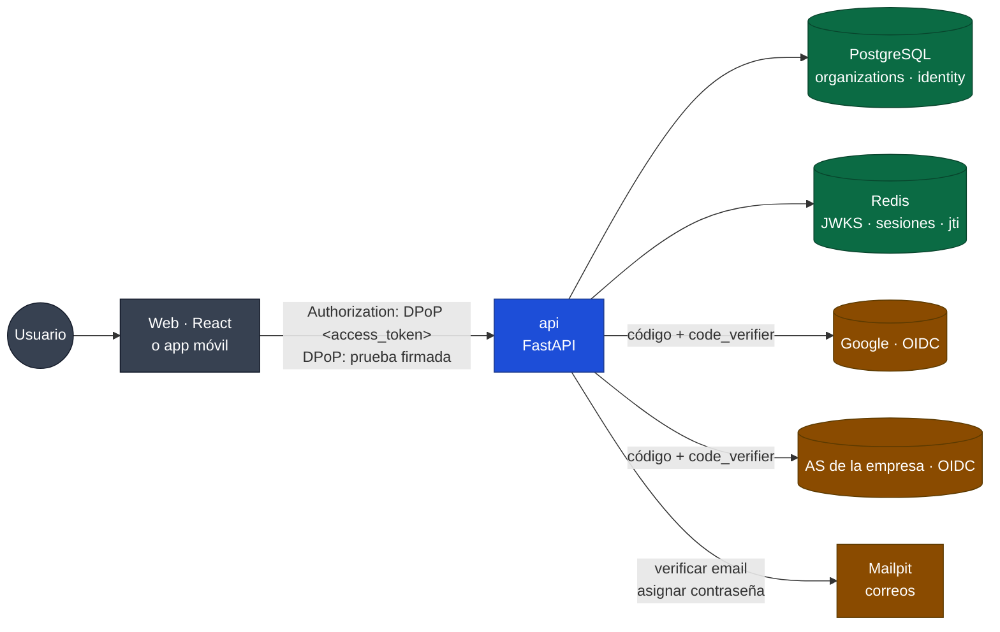
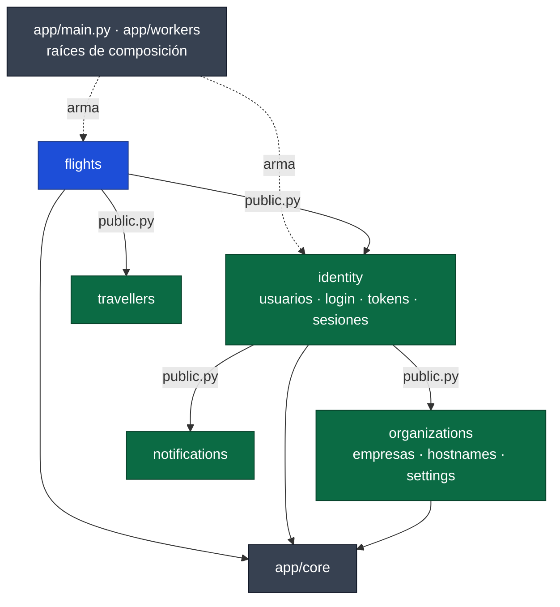
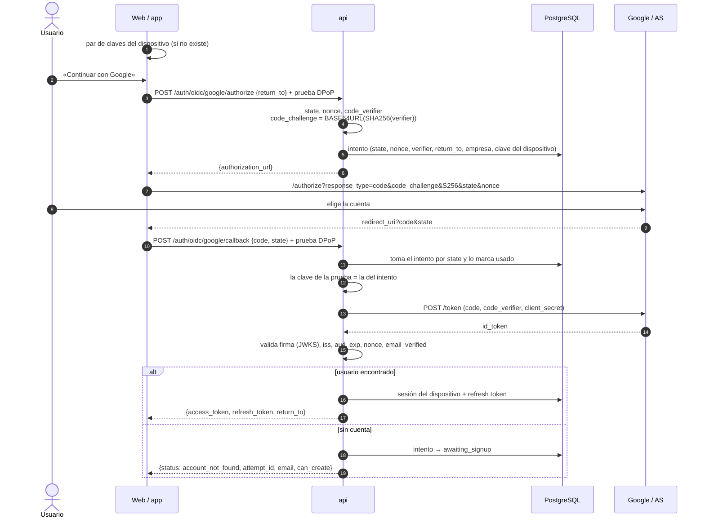
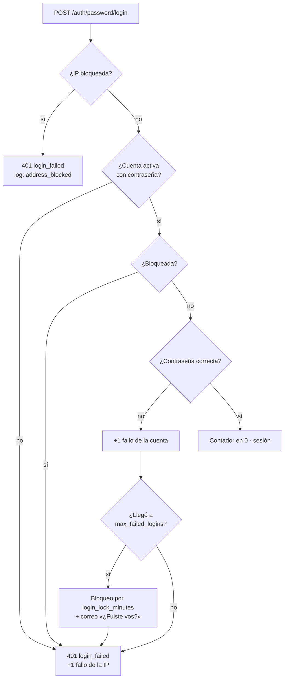
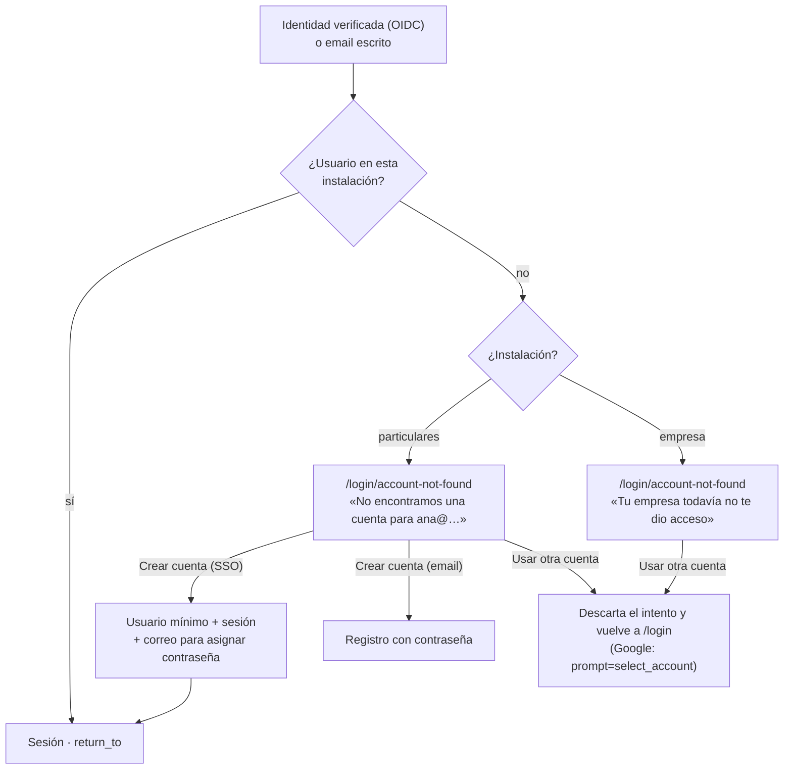
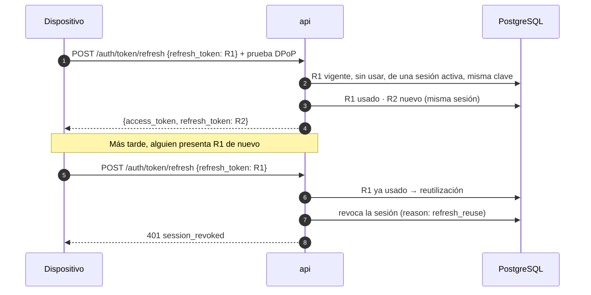
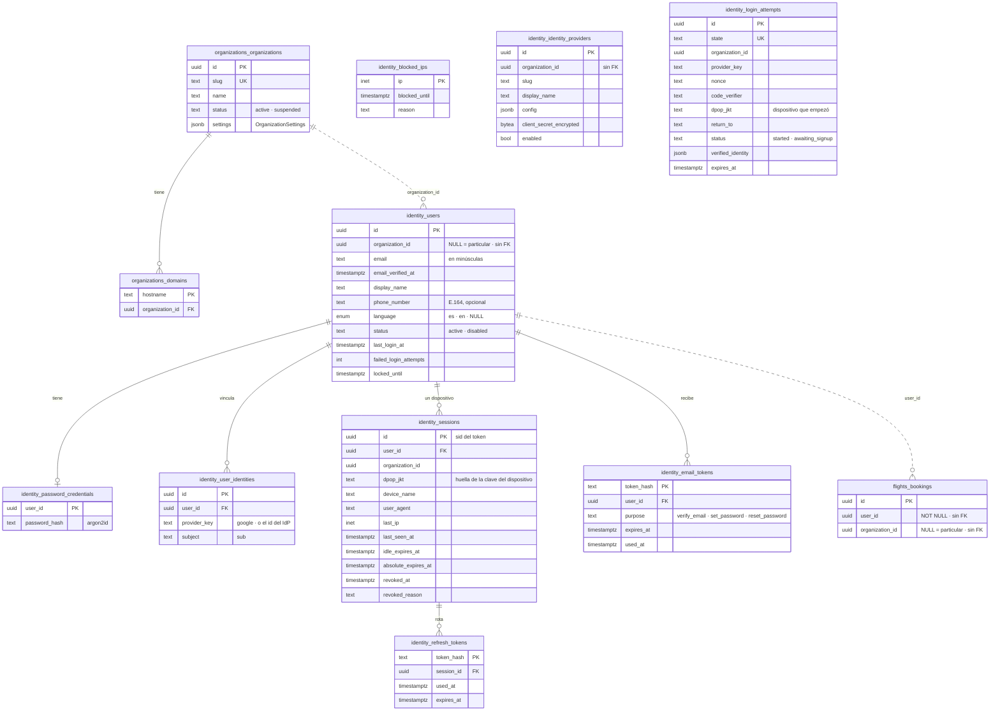
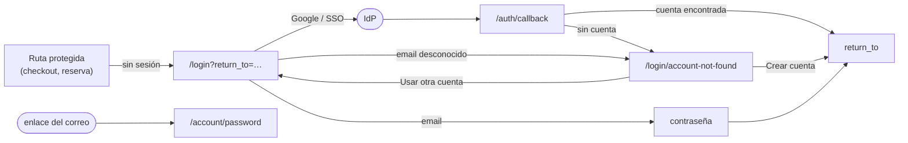

# Etapa 3: Usuarios, empresas e inicio de sesión

> Estado: **implementada** (2026-10-30). Lo que cambió al implementar está en §20 (backend) y §21 (frontend y ajustes posteriores), que mandan sobre el texto original donde difieren. Decisiones en §16, registradas en [00-global.md §13](00-global.md#13-registro-de-decisiones) (49-67). Plan: [2026-10-28-usuarios-y-acceso.md](../superpowers/plans/2026-10-28-usuarios-y-acceso.md).
> Reglas generales: [00-global.md](00-global.md) (en especial §4.1, monolito modular). Etapa anterior: [02-reserva-vuelos.md](02-reserva-vuelos.md). Tablero de diseño pendiente: [prompt para Claude Design](../prompts/claude-design-usuarios.md).
> Última actualización: 2026-10-29

Este documento define **quién es quién** en la plataforma (usuarios, empresas y particulares), **cómo se entra** (OAuth2/OIDC con PKCE o email y contraseña) y **cómo se mantiene la sesión**: tokens propios, firmados con clave asimétrica, rotados y atados al dispositivo.

## Índice

1. [Objetivo y alcance](#1-objetivo-y-alcance)
2. [Conceptos](#2-conceptos)
3. [Panorama](#3-panorama)
4. [Módulos y mapa del código](#4-módulos-y-mapa-del-código)
5. [Empresas y su resolución](#5-empresas-y-su-resolución)
6. [Métodos de inicio de sesión](#6-métodos-de-inicio-de-sesión)
7. [Recorrido OAuth2 / OIDC con PKCE](#7-recorrido-oauth2--oidc-con-pkce)
8. [Email y contraseña](#8-email-y-contraseña)
9. [Alta de usuarios y «no encontramos tu cuenta»](#9-alta-de-usuarios-y-no-encontramos-tu-cuenta)
10. [Tokens de la plataforma](#10-tokens-de-la-plataforma)
11. [Sesiones por dispositivo y detección de robo](#11-sesiones-por-dispositivo-y-detección-de-robo)
12. [Datos](#12-datos)
13. [API](#13-api)
14. [Frontend](#14-frontend)
15. [Cómo probarlo](#15-cómo-probarlo)
16. [Decisiones](#16-decisiones)
17. [Tests](#17-tests)
18. [Fases de implementación](#18-fases-de-implementación)
19. [Fuera de alcance y pendientes](#19-fuera-de-alcance-y-pendientes)
20. [Ajustes al implementar (fases 1 a 6)](#20-ajustes-al-implementar-fases-1-a-6)
21. [Fase 7: frontend](#21-fase-7-frontend-2026-10-30)

## 1. Objetivo y alcance

La plataforma apunta a **viajes corporativos**: cada empresa tiene su **instalación personalizada** (su dirección, su configuración, sus usuarios) sobre **nuestra infraestructura compartida**. También se aceptan **particulares**, que reservan sin empresa (`organization_id = NULL`).

**Entra:**

- Usuarios, con empresa o particulares.
- Empresas mínimas, con un campo `settings` (JSON) cuya primera clave es `password_login_enabled`: si la empresa permite email y contraseña o solo sus métodos OAuth2.
- Inicio de sesión con **OAuth2 Authorization Code + PKCE (OIDC)**: Google para particulares y un servidor de autorización (AS) propio, configurable por empresa.
- Inicio de sesión con **email y contraseña**.
- «No encontramos tu cuenta»: crearla (particulares) o volver e intentar con otra.
- **Sesión propia** de la plataforma: access token JWT firmado con clave asimétrica, refresh token con rotación, **una sesión por dispositivo**, lista de dispositivos y **revocación si el token se usa desde otro dispositivo**.
- Correo para **asignar la contraseña** a usuarios creados por SSO o por la empresa.
- La reserva pasa a tener dueño (`user_id`). Resuelve los pendientes «Acceso por UUID» y «Usuario que hace la reserva» de la etapa 2.

**No entra** (§19): **SAML** (etapa futura: no hay un IdP SAML para probar), **autorización** (roles y permisos), panel de empresa, marca por empresa, MFA propia.

**Lo que no somos:** no somos un proveedor de identidad ni un servidor de autorización OAuth2 para terceros. Somos **cliente** de los IdP (Google, el AS de cada empresa) y, con lo que nos entregan, abrimos **nuestra propia sesión**.

## 2. Conceptos

| Término | Qué es aquí |
|---|---|
| **Empresa** (`organization`) | El tenant: su instalación (uno o más hostnames), sus usuarios y sus `settings` |
| **Particular** | Usuario con `organization_id = NULL`, en la instalación principal |
| **Usuario** (`user`) | La cuenta con la que alguien entra. **No es el viajero**: el viajero (`travellers`) son los datos del pasajero de una reserva |
| **IdP** | Quien prueba quién es la persona: Google o el AS de una empresa |
| **Identidad vinculada** | El par `(proveedor, sub)` con que un IdP identifica a la persona, unido a un usuario |
| **Intento de login** | El estado entre que salimos al IdP y volvemos: `state`, `nonce`, `code_verifier`. Si no hay cuenta, guarda la identidad verificada mientras la persona decide |
| **Dispositivo** | Un navegador o una instalación de la app, identificado por **su par de claves** (§11) |
| **Sesión** | Una por dispositivo. Agrupa la cadena de refresh tokens y se puede ver y cerrar desde la lista de dispositivos |
| **Access token** | JWT propio, de vida corta, firmado por la plataforma, con datos del usuario y, más adelante, sus permisos |
| **Refresh token** | Valor opaco de un solo uso para pedir el siguiente par de tokens |

## 3. Panorama



1. **El navegador (o la app) inicia el login, el backend lo cierra.** El cliente abre la URL del IdP y recibe el `code`, pero el canje del `code` lo hace el backend, con su `client_secret` y el `code_verifier` que nunca salió del servidor. El cliente nunca ve tokens del IdP.
2. **Con la identidad verificada, la plataforma emite sus tokens.** Los tokens del IdP se descartan.
3. **Sin cookies.** Los tokens viajan en headers (`Authorization`), lo que sirve igual para la web y para la app móvil.
4. **Cada request lleva una prueba firmada por la clave del dispositivo** (DPoP, RFC 9449). Un token copiado a otro dispositivo no sirve sin esa clave, y al detectarlo se revoca la sesión (§11).

## 4. Módulos y mapa del código



| Módulo | Es dueño de | Expone en `public.py` |
|---|---|---|
| `organizations` | Empresa: nombre, `slug`, estado, hostnames y `settings` | `resolve_by_host(host)`, `get(id)`; `OrganizationRef` con sus `settings` ya validados (`OrganizationSettings`) |
| `identity` | Usuarios, contraseñas, identidades vinculadas, IdPs de cada empresa, intentos de login, sesiones, refresh tokens y claves de firma | `Principal` (`user_id`, `organization_id`, `session_id`, `email`, `display_name`) y las dependencias `current_principal` / `optional_principal` |

- `travellers` no conoce a `identity`: el perfil del titular (`travellers.profiles`) guarda el `user_id` sin FK, e `identity` lo lee por la interfaz pública de `travellers` (decisión 66).
- Los workers no cambian: trabajan con ids y los eventos no llevan datos de sesión.
- `import-linter` suma un contrato por módulo nuevo (solo `public.py`).

```
app/identity/
├── public.py                  # Principal, current_principal, optional_principal
├── core/config.py             # AUTH_SIGNING_KEYS, duraciones, IDENTITY_SECRETS_KEY
├── domain/                    # dtos/, errors/, constants/, validators/, models/ por tema
├── providers/
│   ├── base.py                # puertos: OidcClient, PasswordHasher
│   └── oidc/                  # discovery, PKCE, canje del código, validación del id_token
├── tokens/                    # emisión y validación del JWT propio y de las pruebas DPoP
├── repositories/
├── services/                  # login, signup, passwords, sessions (refresh y revocación)
├── commands/                  # crear empresa, IdP y usuario de empresa (hasta que haya panel)
└── api/                       # routes/ (auth, me, sessions), schemas/, mappers/, dependencies.py, errors.py
```

## 5. Empresas y su resolución

**Base compartida con `organization_id` en cada fila** (C16), resuelta por el **hostname** de la instalación, no por el email:

| Host | Empresa |
|---|---|
| `localhost` (principal) | Ninguna: particulares |
| `acme.localhost` | La empresa con ese hostname en `organizations.domains` |
| Host desconocido | `404` en todo `/api`, sin revelar qué empresas existen |

- Un middleware resuelve la empresa del request. El host sale de `X-Forwarded-Host` solo si el proxy es de confianza (`FORWARDED_ALLOW_IPS`). Vite tiene `changeOrigin: true`, así que hay que reenviar el host original (ajuste en `vite.config.ts`). Chrome y Firefox resuelven `*.localhost` a `127.0.0.1` sin tocar `hosts`.
- La app móvil apunta a la URL de la instalación de su empresa, así que la regla es la misma.
- **El token lleva la empresa (`org`)** y la API la compara con la del host: un token de Acme no sirve en otra instalación.

### 5.1 `settings` de la empresa

Un campo `organizations.organizations.settings` de tipo `jsonb`, validado con un modelo Pydantic (`OrganizationSettings`) que define cada clave, su tipo y su valor por defecto. Así se pueden sumar configuraciones sin migrar la tabla y nunca se lee una clave que no está documentada.

```json
{ "password_login_enabled": true, "max_failed_logins": 3, "login_lock_minutes": 30, "trusted_networks": ["200.1.2.0/24"] }
```

| Clave | Tipo | Defecto | Efecto |
|---|---|---|---|
| `password_login_enabled` | `bool` | `true` | Si es `false`, la instalación solo acepta los IdP de la empresa: no hay login, registro ni correo de contraseña |
| `max_failed_logins` | `int` (1-20) | `3` | Contraseñas equivocadas seguidas que bloquean el ingreso con contraseña (§8.1) |
| `login_lock_minutes` | `int` (1-1440) | `30` | Cuánto dura ese bloqueo si nadie cambia la contraseña |
| `trusted_networks` | lista de CIDR | `[]` | Redes públicas de las oficinas de la empresa: nunca se bloquean por IP (§8.1) |

Los particulares no tienen fila de empresa: para ellos se aplican los valores por defecto de la plataforma (contraseña y Google habilitados).

## 6. Métodos de inicio de sesión

| Instalación | Email y contraseña | IdP de la plataforma | OIDC propio |
|---|---|---|---|
| Principal (particulares) | Sí | Google (cuando esté su cliente) y, en desarrollo, Keycloak | — |
| Empresa | Si `password_login_enabled` | No (C17) | Los que configure |

`GET /api/v1/auth/methods` devuelve los de la instalación actual y la pantalla dibuja solo esos. Si la contraseña está deshabilitada, sus endpoints responden `404` en ese host.

**Todos los proveedores son filas de `identity.identity_providers`**, con el mismo código: los de la plataforma (particulares) tienen `organization_id = NULL` y los de una empresa, su id. Google, el Keycloak de desarrollo y el AS de una empresa solo se diferencian en la configuración:

| Campo | Para qué |
|---|---|
| `issuer` | Identifica al IdP; con él se lee `/.well-known/openid-configuration` y se valida el `iss` del id_token |
| `backchannel_base_url` | Opcional, solo en desarrollo: base para las llamadas servidor a servidor cuando el host que ve el navegador no es el que ve el contenedor (Keycloak, §15.1) |
| `client_id`, `client_secret` | El secreto se guarda cifrado con `IDENTITY_SECRETS_KEY` (variable de `backend/.env`) |
| `scopes` | Por defecto `openid email profile` |
| `trust_email` | Si se acepta el email aunque el IdP no mande `email_verified` (algunos AS de empresa no lo mandan) |
| `extra_authorize_params` | Por ejemplo `prompt=select_account` en Google |

Se cargan con un comando (`make idp-add org=<slug o vacío> …`), que cifra el secreto.

- El discovery y el JWKS del IdP se cachean en Redis con TTL (`identity:v1:jwks:<issuer>`). Si una firma no valida con la caché, se pide el JWKS una vez más (el IdP pudo rotar la clave).
- Por ahora las empresas, los IdP y los usuarios de empresa se crean con comandos (`make org-create`, `make idp-add`, `make org-user-add`), sin panel (§19).

## 7. Recorrido OAuth2 / OIDC con PKCE

Igual para Google y para el AS de una empresa, y para la web y la app (cambia la `redirect_uri`).



| Pieza | Protege contra |
|---|---|
| PKCE (`S256`), con el verifier solo en el servidor | Que alguien que intercepte el `code` lo canjee |
| Intento atado a la clave del dispositivo | CSRF de login: el `code` solo lo canjea el dispositivo que empezó. Cumple el papel que tendría una cookie |
| `state` y `nonce` | Respuestas cruzadas y reutilización de un id_token |
| Intento de un solo uso, con vencimiento de 10 min | Reenviar el callback |
| `email_verified` (o confianza explícita en el IdP de la empresa) | Entrar a la cuenta de otro con un email no comprobado |
| `return_to` solo como ruta propia | *Open redirect* |

La `redirect_uri` de la web es una ruta del frontend (`/auth/callback`), no de la API. La de la app será su esquema propio o un *app link*. Ambas se registran en el IdP y el backend solo acepta las de su lista.

**Cómo se encuentra el usuario**, dentro de la empresa del host:

1. Por la identidad vinculada `(proveedor, sub)`. El `sub` es estable; el email puede cambiar.
2. Si no, por email: un usuario de esa instalación con ese email **verificado** → se vincula la identidad.
3. Si no → §9.

> **Toma de cuenta anticipada.** Si alguien registró con contraseña el email de otra persona sin verificarlo, el paso 2 no vincula: esa cuenta sin verificar se descarta al crear la nueva. Así nadie conserva una contraseña sobre la cuenta de otro.

## 8. Email y contraseña

- **Pantalla en dos pasos (*identifier-first*):** primero el email (`/auth/password/lookup` responde si existe y si tiene contraseña), después la contraseña. Si la cuenta existe pero no tiene contraseña (se creó por SSO), se ofrece entrar con su IdP o reenviar el correo para asignarla.
- **Hash:** Argon2id, con rehash al entrar si cambian los parámetros.
- **Registro (particulares):** crea el usuario sin verificar y manda un enlace. **Sin verificar no se entra**; al verificar se abre la sesión.
- **Asignar y recuperar contraseña:** el mismo enlace de un solo uso (`set_password`, 7 días; `reset_password`, 30 min). Abrir el enlace de asignar también verifica el email. Recuperarla cierra todas las sesiones del usuario.
- Los tokens de los enlaces se guardan **hasheados** (SHA-256); el valor solo viaja en el correo.
- **Bloqueo por intentos fallidos**, por cuenta y por IP (§8.1).
- **Límite de correos**: registro, «olvidé mi contraseña» y reenvíos, por email y por IP, con contador en Redis (`429 too_many_attempts`). Si Redis se cae, no hay límite y queda un `warning`.
- Con `password_login_enabled = false`, nada de esto existe en esa instalación, aunque el usuario tenga una contraseña de antes.

### 8.1 Bloqueo por intentos fallidos

**Hacia afuera, todo login fallido es igual:** `401 login_failed`, con el mismo mensaje (la interfaz muestra «No pudimos iniciar sesión»). Una contraseña equivocada, una cuenta que no existe, una cuenta bloqueada, un email sin verificar, una cuenta sin contraseña, una IP bloqueada o una respuesta inválida del proveedor OIDC no se distinguen. Así un atacante no aprende nada probando. **Hacia adentro**, cada rechazo deja un log `warning` con el motivo (`reason=wrong_password`, `unknown_email`, `account_locked`, `address_blocked`, `invalid_identity`...), la IP, el usuario si se conoce y el email enmascarado (`a***@example.test`).



**Por cuenta** (PostgreSQL, columnas `failed_login_attempts` y `locked_until` de `identity.users`):

| Regla | Detalle |
|---|---|
| Cuándo se bloquea | Al llegar a `max_failed_logins` contraseñas equivocadas **seguidas** (setting de la empresa; 3 para particulares). Un login correcto vuelve el contador a 0 |
| Qué se bloquea | Solo el ingreso **con contraseña**, por `login_lock_minutes`. El SSO sigue: el proveedor tiene sus propios controles, y bloquearlo dejaría a cualquiera dejar sin acceso a otra persona con 3 intentos |
| El correo | «¿Fuiste vos?»: cuenta lo que pasó y trae un enlace para cambiar la contraseña (el de recuperación, 30 min) |
| Cómo se desbloquea | Cambiando la contraseña (enlace del correo o «olvidé mi contraseña»), o esperando a que venza |
| Con el bloqueo vigente | Ni la contraseña correcta entra: responde igual que cualquier fallo |

**Por dispositivo y por IP**, solo para el ingreso con contraseña (`LoginGuard`; contadores en Redis, bloqueos de IP en PostgreSQL, `identity.blocked_ips`). Tres capas, de la más fina a la más gruesa, pensadas para que muchas personas detrás de una misma IP (una oficina) no se bloqueen entre sí:

| Capa | Regla |
|---|---|
| **a. Dispositivo** | Cada login trae la clave DPoP del dispositivo. Pasados `DEVICE_FAILED_LOGINS_LIMIT` fallos (10) en la ventana, ese dispositivo no puede intentar más hasta que la ventana termine. Los demás dispositivos de la misma IP siguen. Un atacante puede generar claves nuevas, por eso no es la única capa |
| **b. IP dentro de la instalación** | Los contadores y el bloqueo son por `(empresa, IP)`: un ataque a la instalación principal no bloquea esa IP en Acme, ni al revés |
| **c. Redes de confianza** | Las IP de `settings.trusted_networks` de la empresa nunca se cuentan ni se bloquean; siguen los límites por dispositivo y por cuenta |

| Límite por IP | Valor por defecto (variables de `IdentitySettings`) |
|---|---|
| Fallos de login desde una IP en la ventana | 20 (`IP_FAILED_LOGINS_LIMIT`) |
| Emails distintos probados desde una IP en la ventana (incluye los `lookup` de emails que no existen) | 10 (`IP_DISTINCT_EMAILS_LIMIT`) |
| Ventana | 15 min (`IP_WINDOW_S`) |
| Duración del bloqueo | 60 min (`IP_BLOCK_MINUTES`) |

- Una IP bloqueada en una instalación no puede hacer `lookup` ni login con contraseña ahí.
- **El SSO queda afuera de estos límites**: una IP bloqueada puede terminar un login por el proveedor, y las fallas del SSO no suman a ningún contador. El proveedor de la empresa avala a su gente con sus propios controles (contraseña, MFA, políticas), y por ese paso no se puede adivinar nada: el `state` es aleatorio, el `code` sirve una vez y PKCE impide canjear un `code` robado.
- Los contadores viven en Redis porque perderlos solo olvida intentos. El bloqueo, en cambio, está en PostgreSQL: si Redis se cae, las IP ya bloqueadas siguen bloqueadas.
- **La IP real** sale de `X-Forwarded-For` solo si el que llama es un proxy de confianza (`TRUSTED_PROXIES`); si no, de la conexión (`app/core/proxy.py`). Vite manda la IP del navegador.
- **Mejora posterior:** frenar en vez de cortar (esperas crecientes o un desafío en el cliente, como un CAPTCHA o una prueba de trabajo) cuando se pasa el límite de la IP. Suma una capa que hoy no está en el cronograma.

**Tradeoff aceptado:** el paso 1 del login (`lookup`) sigue diciendo si un email existe, porque lo pide el flujo «no encontramos tu cuenta». Lo frena el límite por IP.

## 9. Alta de usuarios y «no encontramos tu cuenta»

### 9.1 Cómo nace cada usuario

| Origen | Datos | Contraseña | Sesión |
|---|---|---|---|
| **Particular por SSO** (Google) | Mínimos: email verificado y nombre del IdP, más la identidad vinculada | Se le manda el correo para asignarla. Mientras no la asigne entra solo por SSO | Se abre enseguida |
| **Particular con email** | Email y contraseña | La que eligió | Al verificar el email |
| **Usuario de empresa** | Lo crea la empresa (hoy por comando; después desde su panel). No necesita contraseña | Si la empresa tiene `password_login_enabled`, se le manda el correo para asignarla; si no, no | Al entrar por primera vez con su IdP o su contraseña |

El usuario de empresa no tiene identidad vinculada hasta su primer login con el IdP de la empresa: ahí se vincula por email (paso 2 de §7).

### 9.2 Sin cuenta

Si el email no está en la instalación, se pregunta si quiere crear la cuenta o si se equivocó y quiere volver a intentar con otra.



- La identidad verificada espera en el intento (`awaiting_signup`), **atada a la clave del dispositivo** y con 10 min de vencimiento. Crear la cuenta no vuelve a pasar por el IdP.
- «Usar otra cuenta» borra el intento. Con Google se manda `prompt=select_account`: si no, Google volvería a entrar solo con la misma cuenta.
- **En una empresa no se crea nada desde el login**: los usuarios los da de alta la empresa.
- **Enumeración de cuentas:** con el email escrito, «no encontramos tu cuenta» revela qué emails existen. Es un costo aceptado a cambio de la experiencia pedida, mitigado con el límite de intentos.

## 10. Tokens de la plataforma

### 10.1 Access token

Un **JWT firmado con clave asimétrica** (C21: `ES256`). La plataforma firma con su clave privada y cualquiera puede verificar con la pública, publicada en `GET /api/v1/auth/jwks.json`. Eso sirve para la app móvil, para otros servicios que se extraigan del monolito y para rotar claves (`kid` en el header).

> Firmado no es cifrado: **cualquiera que tenga el token puede leer su contenido**. No lleva nada que el usuario no pueda ver (ni costos, ni datos de otros, ni secretos).

```json
{
  "iss": "http://localhost:5173",
  "aud": "booking-api",
  "sub": "<user_id>",
  "org": null,
  "sid": "<session_id>",
  "iat": 1793174400,
  "exp": 1793175000,
  "jti": "<uuid>",
  "name": "Ana Pérez",
  "email": "ana@example.com",
  "cnf": { "jkt": "<huella de la clave pública del dispositivo>" }
}
```

- **Vida corta: 10 min** (C20). Se renueva con el refresh token.
- **Datos del usuario y, más adelante, sus permisos** (`perms`), para que el frontend sepa **qué opciones mostrar**. **La API no confía en eso para autorizar**: cuando exista la autorización (§19), cada endpoint la verifica en el backend.
- `cnf.jkt` ata el token a la clave del dispositivo (§11).
- La clave privada vive en `backend/.env` (`AUTH_SIGNING_KEYS`, con `kid`), nunca en el repo. Para rotarla se agrega la nueva, se firma con ella y la vieja queda publicada en el JWKS hasta que venzan sus tokens.

### 10.2 Refresh token y rotación



- Valor opaco de 256 bits; en la base solo su SHA-256.
- **Un solo uso.** Cada refresh devuelve uno nuevo y marca el anterior. Si un refresh ya usado vuelve a aparecer, alguien lo copió: se revoca **toda la sesión** de ese dispositivo.
- Dos pestañas pueden pedir el refresh a la vez. El frontend lo serializa con la Web Locks API, para no disparar la detección de reutilización contra sí mismo.
- **Vencimiento de la sesión** (C20): 30 días sin uso y 90 días como máximo. Después hay que volver a entrar.

## 11. Sesiones por dispositivo y detección de robo

### 11.1 El dispositivo es su clave

Cada navegador o instalación de la app genera **un par de claves** (ES256) la primera vez:

| Cliente | Dónde vive la clave privada |
|---|---|
| Web | WebCrypto, **no exportable**, guardada en IndexedDB. El JavaScript la puede usar para firmar, pero no leerla ni copiarla |
| App móvil (futuro) | Keystore (Android) o Secure Enclave (iOS) |

En cada request el cliente manda, además del token, una **prueba DPoP**: un JWT corto firmado con esa clave que dice método, URL, momento y un hash del access token.

```
Authorization: DPoP eyJhbGciOiJFUzI1NiIs…      ← access token (cnf.jkt = huella de la clave)
DPoP: eyJ0eXAiOiJkcG9wK2p3dCIsImFsZyI6…        ← prueba: htm, htu, iat, jti, ath
```

La API valida que la prueba esté firmada por la clave cuya huella dice `cnf.jkt`, que `htm`/`htu` sean los del request, que `iat` sea de hace menos de 60 s, que `ath` sea el hash del token y que el `jti` no se haya visto (caché en Redis hasta que vence la ventana).

**Por qué DPoP y no huellas del navegador o la IP** (C13): la IP cambia todo el tiempo en un celular y el *user agent* se copia. Una clave que no se puede exportar es lo único que prueba de verdad que el token sigue en el mismo dispositivo. Es un estándar (RFC 9449), sirve igual en web y en la app, y protege también el refresh token.

> El token sigue siendo un token *bearer* en el sentido que se pidió: va en el header `Authorization`, sin cookies. El esquema es `DPoP` en lugar de `Bearer` porque un token `Bearer` puro sirve en cualquier dispositivo y no se podría detectar la copia.

### 11.2 Qué se revoca y cuándo

| Situación | Respuesta | Sesión |
|---|---|---|
| Access token sin prueba, con esquema `Bearer` o con una prueba firmada por otra clave | `401 token_binding_mismatch` | **Revocada** (`key_mismatch`) |
| Refresh token ya usado | `401 session_revoked` | **Revocada** (`refresh_reuse`) |
| Refresh token con una prueba de otra clave | `401 session_revoked` | **Revocada** (`key_mismatch`) |
| Prueba vencida, `jti` repetido o `htu` equivocado | `401 invalid_dpop_proof` | Sigue: puede ser un reloj desfasado o un reintento |
| Access token vencido | `401 token_expired` | Sigue: el cliente hace refresh |
| El usuario cierra un dispositivo desde la lista | — | Revocada (`user_revoked`) |
| Cambio o recuperación de contraseña | — | Todas revocadas (`password_changed`) |

- **Revocación inmediata:** el access token es corto, pero no se espera a que venza. Cada request comprueba que la sesión `sid` siga activa, con caché en Redis (`identity:v1:session:<sid>`) que se borra al revocar. Si Redis no está, se consulta PostgreSQL.
- Revocar al ver un token sin su clave también lo puede provocar quien lo robó. Es intencional: ante la duda se corta la sesión y el usuario vuelve a entrar.
- **Límite:** DPoP evita que un token **sacado** del dispositivo sirva en otro. No evita que un XSS use la clave mientras la página está abierta. Contra eso sigue valiendo la política de contenido (CSP) y no tener XSS.

### 11.3 Lista de dispositivos

`GET /api/v1/me/sessions` devuelve una fila por sesión activa:

| Campo | Ejemplo |
|---|---|
| `device_name` | «Chrome en Windows». La web lo arma del *user agent*; la app manda el modelo |
| `created_at`, `last_seen_at` | Cuándo entró y cuándo se usó por última vez |
| `last_ip` | La última IP vista. La ubicación aproximada queda para después |
| `current` | `true` para el dispositivo que hace la consulta |

Se puede cerrar una sesión (`DELETE /me/sessions/{id}`) o todas menos la actual. El dispositivo cerrado recibe `401 session_revoked` en su próximo request.

## 12. Datos

Dos schemas nuevos, `organizations` e `identity`. Hay claves foráneas dentro de cada módulo; entre módulos se usan ids sueltos (líneas punteadas).



| Restricción | Para qué |
|---|---|
| `UNIQUE NULLS NOT DISTINCT (organization_id, email)` en `users` | Un email una vez por instalación. Sin `NULLS NOT DISTINCT`, dos particulares podrían repetirlo (`NULL ≠ NULL`). La misma persona puede ser particular y usuario de su empresa: son instalaciones distintas |
| `UNIQUE (provider_key, subject)` en `user_identities` | Una identidad del IdP pertenece a un solo usuario |
| `UNIQUE (organization_id, slug)` en `identity_providers` | El slug va en las URLs (`/auth/oidc/okta/...`) |
| Índice parcial en `sessions (user_id) WHERE revoked_at IS NULL` | La lista de dispositivos |

### 12.1 Índices y las consultas que sirven

Un `UNIQUE` en PostgreSQL ya crea un índice B-tree: no hace falta otro índice con las mismas columnas. Sirve también para las búsquedas por su primera columna sola.

| Tabla | Índice | Consultas que sirve |
|---|---|---|
| `organizations.domains` | PK `hostname`; `organization_id` | Resolver la instalación por host; los hostnames de una empresa |
| `organizations.organizations` | PK `id`; `UNIQUE slug` | Comandos por slug |
| `identity.users` | `UNIQUE (organization_id, email)` | Login, `lookup`, alta y vínculo por email (`organization_id + email`); los usuarios de una empresa (`organization_id`) |
| `identity.user_identities` | `UNIQUE (provider_key, subject)`; `user_id` | Encontrar al usuario por la identidad del proveedor; las identidades de un usuario |
| `identity.sessions` | PK `id`; parcial `user_id WHERE revoked_at IS NULL` | Validar el `sid` de cada request; la lista de dispositivos y «cerrar los demás» |
| `identity.refresh_tokens` | PK `token_hash`; `session_id` | Refresh; borrar los de una sesión |
| `identity.email_tokens` | PK `token_hash`; `user_id` | Canjear un enlace; invalidar los pendientes de un usuario |
| `identity.identity_providers` | `UNIQUE (organization_id, slug)` | El proveedor de un login; los botones de una instalación |
| `identity.login_attempts` | `UNIQUE state`; `expires_at` | El callback por `state`; borrar los vencidos |
| `identity.blocked_ips` | PK `ip` | ¿Está bloqueada esta IP? |
| `flights.bookings` | `(organization_id, user_id)` | Las reservas de un dueño (el futuro «Mis reservas») |

**`IS NOT DISTINCT FROM` no usa índices con parámetros.** Comparar `organization_id` (que es `NULL` para particulares) con `IS NOT DISTINCT FROM $1` es correcto, pero con una consulta preparada, como las de asyncpg, PostgreSQL no puede usar esa columna del índice: busca solo por `email` y revisa la empresa fila por fila. Verificado con `EXPLAIN` sobre `identity.users`: con `IS NOT DISTINCT FROM` el índice solo se usa para `email`; con `=` se usa completo. Por eso las consultas usan `equals_or_null` (`app/core/db.py`), que arma `= $1` o `IS NULL` según el valor, y las dos formas usan el índice completo.

| Qué | Qué **no** se guarda |
|---|---|
| Refresh tokens, enlaces por correo | El valor: solo su SHA-256 |
| Contraseña | Solo el hash Argon2id |
| Secretos OIDC de las empresas | En claro: van cifrados |
| Access tokens propios | No se guardan: se verifican por firma y `sid` |
| Tokens del IdP | `access_token`, `refresh_token` e `id_token` del IdP se descartan |
| Clave privada del dispositivo | Nunca sale del dispositivo; se guarda solo su huella (`dpop_jkt`) |

Las filas vencidas de `login_attempts`, `refresh_tokens` y `email_tokens` y las sesiones revocadas viejas se borran periódicamente. Se suma al pendiente de limpieza del outbox/inbox de la etapa 2.

## 13. API

Bajo `/api/v1`. Las rutas que operan sobre un dispositivo exigen la prueba DPoP aunque todavía no haya token.

| Método | Ruta | Uso |
|---|---|---|
| `GET` | `/auth/methods` | Métodos de la instalación: `password_enabled` y los IdP (`slug`, nombre) |
| `GET` | `/auth/jwks.json` | Claves públicas con que se firman los access tokens |
| `POST` | `/auth/oidc/{provider}/authorize` | `{return_to, redirect_uri}` → `{authorization_url}` |
| `POST` | `/auth/oidc/{provider}/callback` | `{code, state}` → tokens, o `{status: "account_not_found", attempt_id, email, display_name, can_create}`. Cualquier fallo: `401 login_failed` |
| `POST` | `/auth/signup/pending/{attempt_id}` | «Crear cuenta» (solo particulares), con `phone_number` y `language` opcionales → tokens |
| `DELETE` | `/auth/signup/pending/{attempt_id}` | «Usar otra cuenta» → `204` |
| `POST` | `/auth/password/lookup` | `{email}` → `{exists, has_password}` |
| `POST` | `/auth/password/login` | `{email, password, device_name}` → tokens. Cualquier fallo: `401 login_failed` (§8.1) |
| `POST` | `/auth/password/signup` | Particulares: `{email, display_name, password, phone_number?, language?}`; crea sin verificar y manda el correo → `202` |
| `POST` | `/auth/email/verify` | `{token}` → tokens |
| `POST` | `/auth/password/set` | `{token, password}` desde el correo (asignar o recuperar) → `204` |
| `POST` | `/auth/password/forgot` | `{email}` → `202` siempre |
| `POST` | `/auth/token/refresh` | `{refresh_token}` → tokens nuevos |
| `POST` | `/auth/logout` | Revoca la sesión actual → `204` |
| `GET` | `/me` | El usuario, con `phone_number` y `language` (`null` = el cliente usa el idioma del navegador o del sistema) |
| `GET` | `/me/sessions` | Dispositivos con sesión activa |
| `DELETE` | `/me/sessions/{id}` · `/me/sessions?scope=others` | Cierra uno o todos menos el actual → `204` |

Respuesta con tokens:

```json
{
  "token_type": "DPoP",
  "access_token": "eyJ…",
  "expires_in": 600,
  "refresh_token": "…",
  "session_id": "…",
  "return_to": "/trip"
}
```

**Rutas que se protegen:**

| Ruta | Acceso |
|---|---|
| Búsqueda y aeropuertos | Pública en la plataforma principal. En la instalación de una empresa, solo con sesión de un usuario de esa empresa: sin ella, `401` (`installation_principal`, C19) |
| `POST /flights/bookings` y la decisión de precio | Con sesión. La reserva guarda `user_id` y `organization_id` |
| `GET /flights/bookings/{id}`, `price-decision` y el SSE | Dentro del **scope obligatorio** de la reserva: misma empresa (`organization_id IS NOT DISTINCT FROM` la del usuario) **y** mismo `user_id`. Si no, `404` (no `403`: no se confirma que exista). Cuando haya autorización, un rol podrá relajar el filtro de usuario dentro de su empresa; el de empresa no se relaja nunca. Ver la fase 5 del plan |

**SSE con token.** `EventSource` no puede mandar headers. El frontend pasa a leer el stream con `fetch` (cuerpo `text/event-stream`), con el token y la prueba DPoP en los headers. La API cierra el stream cuando vence el access token y el cliente reconecta con uno nuevo; la reconexión ya existe desde la etapa 2.

## 14. Frontend



- **Falta el tablero de diseño** (regla «el diseño manda»). El prompt está en [`docs/prompts/claude-design-usuarios.md`](../prompts/claude-design-usuarios.md).
- Feature `src/features/auth/` con su `public.ts`; la lista de dispositivos en `src/features/account/`.
- **Dónde vive cada cosa:**

| Dato | Dónde |
|---|---|
| Clave del dispositivo | WebCrypto no exportable, en IndexedDB |
| Refresh token | IndexedDB, junto a la clave. Sin la clave no sirve |
| Access token | Solo en memoria. Al recargar la página, se pide uno nuevo con el refresh |
| Usuario actual | Se lee del access token (nombre, email, futuros permisos) para decidir qué mostrar; `GET /me` cuando hace falta el dato fresco |
| "Tu viaje" | Igual que hoy, en `sessionStorage`. Sobrevive al login: `return_to` devuelve al checkout |

- El cliente de `openapi-fetch` suma un *middleware* que agrega `Authorization` y `DPoP` a cada request, hace el refresh ante `401 token_expired` (serializado con Web Locks) y manda a `/login?return_to=…` ante `401 session_revoked`, con el aviso «Cerramos tu sesión por seguridad».
- El formulario de pasajero puede precargar nombre y email del usuario, editables: quien reserva puede no ser quien viaja.

## 15. Cómo probarlo

### 15.1 Keycloak de desarrollo

Mientras no haya un cliente de Google, **todo el login OIDC se prueba con Keycloak**, que hace de IdP de los particulares y de AS de la empresa de prueba. Es solo de desarrollo, como Mailpit: no existe en otros ambientes.

| Qué | Cómo |
|---|---|
| Servicio | `keycloak` en `docker-compose.yml`, imagen oficial (`quay.io/keycloak/keycloak`, versión fijada), `start-dev --import-realm`, puerto `8080`. Usa su propia base embebida, no nuestro PostgreSQL: si se borra, se vuelve a importar del repo |
| Consola | http://localhost:8080 (`admin` / `admin`). `make keycloak` muestra la URL, como `make mailpit` |
| Realms | Exportados en `backend/docker/keycloak/realms/`, se importan al arrancar. Cualquier cambio hecho en la consola se exporta de nuevo al repo o se pierde |
| Registro en nuestra base | `make seed-dev-idps`: crea la empresa Acme (`acme.localhost`), sus usuarios y los dos IdP (idempotente, como `make seed-airports`) |

| Realm | Hace de | Cliente | `redirect_uri` |
|---|---|---|---|
| `particulares` | IdP de la plataforma (en lugar de Google). Botón «Continuar con Keycloak (prueba)» | `booking-platform`, confidencial, PKCE `S256` obligatorio | `http://localhost:5173/auth/callback` |
| `acme` | AS propio de la empresa Acme. Botón «Entrar con Acme SSO» | `booking-acme`, igual | `http://acme.localhost:5173/auth/callback` |

Usuarios de prueba (las contraseñas están en el export; son de desarrollo):

| Realm | Usuario | Para probar |
|---|---|---|
| `particulares` | `ana@example.test` | Registrada también en nuestra base: entra directo |
| `particulares` | `nuevo@example.test` | No existe en nuestra base: «no encontramos tu cuenta» → crear, y el correo para crear la contraseña |
| `particulares` | `sinverificar@example.test` | `email_verified = false`: se rechaza |
| `acme` | `viajero@acme.test` | Usuario de Acme creado por la empresa: entra y se vincula su identidad |
| `acme` | `intruso@acme.test` | Existe en el AS pero Acme no lo dio de alta: «tu empresa todavía no te dio acceso» |

**El mismo issuer para el navegador y para la API.** El navegador llega a Keycloak por `localhost:8080`, pero desde el contenedor de la API `localhost` es la propia API. Keycloak se arranca con `KC_HOSTNAME=http://localhost:8080` (el `iss` de los tokens y las URLs que ve el navegador) y `KC_HOSTNAME_BACKCHANNEL_DYNAMIC=true` (atiende las llamadas internas por `http://keycloak:8080`). Nuestra configuración del IdP usa `issuer = http://localhost:8080/realms/<realm>` y `backchannel_base_url = http://keycloak:8080`: el discovery, el canje del código y el JWKS van por la red de Docker, y el `iss` se sigue validando contra el issuer público.

Más adelante, el mismo Keycloak sirve de IdP SAML de Acme (§19).

### 15.2 Google

**Google con `localhost` funciona.** Google exige HTTPS en las URI de redirección, **salvo para `localhost`**, que acepta con `http` y puerto. Como Google es solo para particulares y los particulares usan `localhost`, no hace falta un vhost. Las empresas usan `acme.localhost`, que Google no aceptaría, pero las empresas no entran por Google. Si más adelante hace falta un dominio, se agrega un proxy con HTTPS (Caddy + `mkcert`) bajo un dominio con TLD público.

**Registrar el cliente en Google es obligatorio y gratis.** Toda aplicación que pide «Continuar con Google» necesita su propio `client_id`. Cuando una app entra con Google «sin configurar nada», es porque usa un intermediario (Auth0, Firebase, Clerk…) que ya registró su cliente en Google, y entonces el IdP es el intermediario, no Google. Crear el cliente no pide facturación ni tarjeta: se hace con una cuenta personal de Gmail en `console.cloud.google.com` (proyecto nuevo → «Google Auth Platform» → público «Externo», en modo «Testing», con el propio email como usuario de prueba → cliente «Aplicación web»). Con los scopes `openid email profile` no hace falta verificar la app.

Mientras tanto, Keycloak (§15.1) cubre el mismo recorrido. Cuando esté el cliente, se carga con `make idp-add` y no cambia código.

### 15.3 Escenarios

| Escenario | Cómo |
|---|---|
| Particular con OIDC | `make seed-dev-idps`; en `http://localhost:5173/login`, «Continuar con Keycloak (prueba)» con `ana@example.test` |
| Contraseña | Registrarse en `http://localhost:5173/login`; el enlace llega a Mailpit |
| Sin cuenta | Entrar con `nuevo@example.test`: «Crear cuenta» abre sesión y manda a Mailpit el correo para crear la contraseña. «Usar otra cuenta» vuelve al login de Keycloak |
| Email sin verificar | Entrar con `sinverificar@example.test`: se rechaza |
| Empresa | En `http://acme.localhost:5173`, «Entrar con Acme SSO» con `viajero@acme.test`. Con `intruso@acme.test`: «tu empresa todavía no te dio acceso» |
| Solo SSO | `settings.password_login_enabled = false` en Acme: el login no muestra email y contraseña, y `POST /auth/password/login` responde `404` en ese host |
| Dispositivos | Entrar desde dos navegadores y verlos en la lista; cerrar uno desde el otro |
| Robo del token | Copiar el access token desde DevTools y usarlo con `curl` como `Bearer` o con una prueba de otra clave: `401` y la sesión del navegador queda cerrada |
| Robo del refresh | Hacer refresh dos veces con el mismo valor: la segunda revoca la sesión |

## 16. Decisiones

Todas confirmadas por el autor el 2026-10-28.

| # | Decisión |
|---|---|
| C1 | No somos IdP ni servidor de autorización para terceros: somos cliente OAuth2/OIDC (Authorization Code + PKCE) y, con lo que entrega el IdP, abrimos nuestra propia sesión |
| C2 | Sin cookies: tokens propios en el header `Authorization`, pensados también para una app móvil |
| C3 | Access token JWT **firmado con clave asimétrica**, con datos del usuario y, más adelante, sus permisos, **solo para decidir qué mostrar**. La autorización se verifica siempre en el backend |
| C4 | Refresh token con **rotación** |
| C5 | **Una sesión por dispositivo**, con lista de dispositivos conectados |
| C6 | El token se ata al dispositivo; si se usa desde otro, **se revoca la sesión** |
| C7 | `organizations.settings` como JSON; primera clave: `password_login_enabled` |
| C8 | Particular creado por SSO: datos mínimos, sesión activa y correo para asignar contraseña. Sin contraseña entra solo por SSO |
| C9 | Usuarios de empresa: los crea la empresa (sin contraseña obligatoria) y se les manda el correo para asignarla, salvo que la empresa no permita contraseña. Desde el login no se crean |
| C10 | SAML pasa a una etapa futura |
| C11 | La autorización (roles y permisos) queda pendiente para cuando la plataforma esté más avanzada |
| C12 | El grafo de graphify se regenera como parte de cada PR (regla en `AGENTS.md`) |
| C13 | El token se ata al dispositivo con **DPoP (RFC 9449)** y viaja como `Authorization: DPoP <access_token>` más el header `DPoP` con la prueba (§11) |
| C14 | El login OIDC se prueba con **Keycloak en compose**, solo en desarrollo: realm `particulares` (en lugar de Google, que no tiene cliente todavía) y realm `acme` (AS de la empresa de prueba), exportados en el repo (§15.1) |

| C15 | Dos módulos: `organizations` (empresa, hostnames, `settings`) e `identity` (usuarios, login, tokens, sesiones). Descartado: un solo módulo |
| C16 | Base compartida con `organization_id` en cada fila, resuelta por hostname. Descartado: schema o base por empresa |
| C17 | Google no se ofrece en instalaciones de empresa: la empresa usa su contraseña o su IdP. Descartado por ahora: Google restringido al dominio de Workspace (`hd`) |
| C18 | Librerías: cliente OIDC propio sobre `httpx2`; `joserfc` para JWT, JWK y DPoP; `pwdlib[argon2]`; `cryptography` (Fernet) para los secretos de las empresas. Versiones fijadas al implementar. Descartado: `Authlib` |
| C19 | Buscar es público en la plataforma principal; en la instalación de una empresa todo pide sesión, incluida la búsqueda: el frontend la cierra entera por defecto y el backend responde `401` en búsqueda y aeropuertos (ajuste del 2026-10-30). Reservar siempre pide sesión |
| C20 | Duraciones: access token 10 min; sesión 30 días sin uso y 90 como máximo; intento de login 10 min. Configurables por empresa más adelante |
| C21 | Firma de los access tokens con `ES256` (ECDSA P-256). Descartados: `EdDSA` (soporte irregular en WebCrypto) y `RS256` (tokens más largos) |

Plan de implementación: [2026-10-28-usuarios-y-acceso.md](../superpowers/plans/2026-10-28-usuarios-y-acceso.md).

## 17. Tests

Sin red: ningún test llama a Google ni a un IdP real.

| Nivel | Qué |
|---|---|
| OIDC | IdP falso con `httpx2.MockTransport` y claves generadas en el test: discovery, canje con el `code_verifier` correcto, id_token con firma, `iss`, `aud`, `exp` o `nonce` inválidos, `email_verified=false`, rotación del JWKS, `state` desconocido, intento vencido, usado o de otro dispositivo |
| Tokens | Firma y `kid`; token de otra instalación; vencido; JWKS publicado; rotación de la clave de firma |
| DPoP | Prueba válida; sin prueba; esquema `Bearer`; otra clave → revoca; `htm`/`htu`/`ath` equivocados; `iat` fuera de ventana; `jti` repetido |
| Refresh | Rotación; reutilización → revoca la sesión; refresh de una sesión revocada o vencida; otra clave |
| Sesiones | Una por dispositivo; lista con `current`; cerrar una y las demás; revocación inmediata con y sin Redis; cambio de contraseña cierra todas |
| Contraseña | Hash y rehash; enlaces de un solo uso y vencidos; empresa sin contraseña → `404`; todo fallo es `login_failed` y el motivo queda en el log |
| Bloqueo | 3 contraseñas equivocadas bloquean y mandan el correo; con el bloqueo ni la correcta entra; cambiar la contraseña desbloquea; el bloqueo vence; un login correcto reinicia la cuenta; límite propio de cada empresa; IP bloqueada por fallos o por emails distintos (también por `lookup`); el dispositivo que falla se frena y los demás de la misma IP no; un bloqueo en una instalación no alcanza a otra; las redes de confianza no se bloquean; una IP bloqueada igual entra por SSO y las fallas del SSO no cuentan |
| Usuarios | Por identidad y por email verificado; no vincula a un email sin verificar; `NULLS NOT DISTINCT` entre particulares; mismo email en dos instalaciones; usuario de empresa con y sin correo de contraseña según `settings` |
| «Sin cuenta» | Crear (particular), empresa sin opción de crear, «usar otra cuenta», intento atado a otro dispositivo |
| Empresas | Host desconocido → `404`; `settings` con valores por defecto y clave desconocida rechazada |
| Reservas | Crear exige sesión y guarda `user_id`; otro usuario recibe `404` en `GET` y en el SSE; SSE con token |
| Límites | `import-linter`: `identity` y `organizations` solo por `public.py`; `organizations` no importa `identity` |
| Frontend | Middleware de tokens (refresh serializado, `session_revoked`), identifier-first, «sin cuenta», callback, lista de dispositivos; MSW con `onUnhandledFrame: "error"` |

## 18. Fases de implementación

1. **Base:** módulos `organizations` (con `settings`) e `identity`, migraciones, resolución por host, comandos de alta, `import-linter`.
2. **Tokens y sesiones:** firma `ES256` y JWKS, DPoP, sesiones por dispositivo, refresh con rotación y detección de reutilización, `GET /me`, lista de dispositivos, logout.
3. **Contraseña:** registro, verificación, login identifier-first, asignar y recuperar contraseña, límite de intentos.
4. **OIDC + PKCE:** Keycloak en compose con sus dos realms, cliente genérico, IdP de la plataforma (realm `particulares`), «no encontramos tu cuenta», correo para asignar contraseña.
5. **Reservas con dueño:** `user_id` y `organization_id` en `flights.bookings`, rutas protegidas, SSE con `fetch`.
6. **Empresas:** OIDC propio por empresa (realm `acme`), `password_login_enabled`, `make seed-dev-idps`. Google cuando haya cliente.
7. **Frontend** según el tablero. Puede empezar en paralelo desde la fase 2, cuando exista el tablero.
8. **Cierre:** documentación, `graphify update .` y `/graphify . --update`, PR.

## 19. Fuera de alcance y pendientes

| Tema | Detalle |
|---|---|
| SAML | Etapa futura (decidido el 2026-10-28: la etapa 3 cierra con OIDC y contraseña). Para probarlo no hace falta otro servicio: se agrega un cliente SAML al realm `acme` del mismo Keycloak (C14), con los mismos usuarios. Se descartaron Mock SAML (acepta cualquier email, no sirve para el caso «intruso») y SimpleSAMLphp (otro contenedor). Notas para entonces: el IdP hace un `POST` desde otro sitio, así que el intento se encuentra por `RelayState` + `InResponseTo`; validar con una librería mantenida (ataques de *XML Signature Wrapping*), que pide `xmlsec1` en el `Dockerfile` |
| Autorización | Roles (viajero, aprobador, administrador de empresa) y permisos. Van en el token para la interfaz y se verifican en cada endpoint. Hoy cada usuario ve solo lo suyo |
| Panel de empresa | Alta de usuarios, IdPs y `settings` desde la interfaz. Necesita autorización; hoy son comandos |
| Activar la contraseña después | Si una empresa pasa `password_login_enabled` a `true`, mandar el correo a los usuarios que no tienen contraseña |
| Dominios propios de empresas | `viajes.acme.com` con su certificado TLS |
| Marca por empresa | Logo y colores en la instalación |
| SCIM | Alta y baja automática desde el directorio de la empresa |
| Cierre de sesión en el IdP | RP-initiated logout de OIDC |
| MFA propia | Para usuarios con contraseña. Con SSO, la MFA es del IdP |
| App móvil | El diseño de tokens ya la contempla (DPoP con Keystore o Secure Enclave, `redirect_uri` propia) |
| Ubicación en la lista de dispositivos | Ciudad aproximada por IP |
| Perfil de viajero del usuario | **Hecho en parte (2026-10-30):** tratamiento, fecha de nacimiento y género del titular; ver [XX-viajeros-y-viajes.md](XX-viajeros-y-viajes.md). Falta el pasaporte |
| "Mis reservas" | El historial como particular o empresa, ahora posible porque la reserva tiene dueño |

## 20. Ajustes al implementar (fases 1 a 6)

Diferencias con lo escrito arriba. Se integran al texto en la fase 8.

| Tema | Diseño | Implementado | Por qué |
|---|---|---|---|
| Resolución de la instalación | Middleware | Dependencia de FastAPI (`current_installation`) aplicada a cada router de `/api` en `app/main.py` | Respeta los overrides de los tests y los hosts de la plataforma no tocan la base. Un host desconocido sigue dando `404` en todo `/api` |
| `iss` del access token | URL de la instalación | El host de la instalación (`acme.localhost`) | La API lo compara con el host del request; junto con `org`, un token no sirve en otra instalación |
| `htu` de la prueba DPoP | URL completa | Se comparan el host de la instalación y el path | Detrás del proxy de Vite la API ve otro esquema y puerto que el navegador. RFC 9449 permite ignorar query y fragmento |
| `redirect_uri` | La envía el cliente y se valida contra una lista | La arma el backend: URL de la instalación + `/auth/callback` | El `code` no puede mandarse a otro lado. La app móvil sumará su URI cuando exista |
| Configuración de cada IdP | `config` JSON | Columnas propias en `identity.identity_providers` (`issuer`, `backchannel_base_url`, `client_id`, secreto cifrado, `scopes`, `trust_email`, `extra_authorize_params`) | Tipadas y validadas por la base |
| Google | Variables `GOOGLE_*` en `.env` | Una fila más de `identity_providers` (`make idp-add`) | Mismo código para todos los proveedores |
| Keycloak en Docker | Reescribir todas las URLs del backchannel | Con `KC_HOSTNAME_BACKCHANNEL_DYNAMIC`, Keycloak ya devuelve el endpoint de tokens y el JWKS con `keycloak:8080`; solo el discovery usa `backchannel_base_url` | Verificado contra Keycloak 26.8.0 |
| «Usar otra cuenta» | `prompt=select_account` (Google) | `another_account: true` en `authorize` manda `prompt=login` a cualquier proveedor | Keycloak no admite `select_account`; `login` sirve en todos |
| Correos con enlace | Por `notifications` | Se mandan directo al terminar la transacción, no por el outbox | El token del enlace no queda en claro en la base ni en RabbitMQ. Si el envío falla queda un log y se pide otro |
| Correos de cuenta | Tablero de diseño | Plantilla provisional (`app/identity/notifications/templates/`) con los colores del correo de confirmación | Falta el tablero (prompt §11) |
| `OrganizationRef` | — | Suma `hostnames` | Los enlaces de los correos de un usuario de empresa apuntan a su instalación |
| Tests de otros módulos | Solo `public.py` | `app/identity/testing.py` (claves de dispositivo, pruebas DPoP, sesiones) es la única excepción, declarada en `pyproject.toml` | Los tests de `flights` se autentican como un dispositivo real |
| Lectura de reservas | `get_for_processing` para los workers | Igual, y un test verifica que ninguna ruta de la API ni su servicio lo usen. El SSE también lee con el scope del dueño | — |
| Datos de prueba de la etapa 2 | — | Borrados a mano (15 reservas, 15 viajeros, 20 autorizaciones, outbox e inbox procesados). La migración no tiene valor por defecto para `user_id` | Pedido del autor: no hay reservas huérfanas |
| Límite de intentos | Login | También en `lookup`, registro, «olvidé mi contraseña» y reenvíos (por email y por IP) | Evitar que se use para listar emails o para mandar correos en masa |
| Rutas de la web en los correos | `/cuenta/verificar`, `/cuenta/contrasena?tipo=crear\|recuperar` | `/account/verify-email`, `/account/password?kind=set\|reset`; en el frontend, `/login/account-not-found` | Rutas en inglés, como el resto (`/trip`, `/checkout`, `/bookings`). Los textos de la interfaz siguen en español |
| Límite de intentos del login | `429 too_many_attempts` por email | Bloqueo por cuenta y por IP con respuesta única `401 login_failed` (§8.1). El `429` queda para registro y correos | Pedido del autor (2026-10-29): mensajes que no dicen nada hacia afuera |
| Lógica en DTOs | — | Los DTOs solo declaran forma. `Installation` recibe `organization_id` y `settings` ya resueltos (`installation_of`); el nombre del id_token se arma en el cliente OIDC | Pedido del autor: sin lógica en los archivos de DTOs |
| Proxys de confianza | `TRUSTED_PROXIES` en `organizations` | En `app/core/config.py`, con `app/core/proxy.py` (`original_host`, `client_ip`) | Es técnico y lo usan dos módulos (host de la instalación e IP real para el bloqueo) |
| Usuario | — | Suma `phone_number` (E.164, opcional) y `language` (enum `es`/`en`, `NULL` = lo decide el cliente); `lang` en el access token | Pedido del autor (2026-10-29). Base para las traducciones futuras |
| Consultas por empresa | `IS NOT DISTINCT FROM` | `equals_or_null` (`=` o `IS NULL`) | Usa el índice completo con consultas preparadas (§12.1) |
| Bloqueo por IP | Por IP | Por dispositivo (clave DPoP), por `(empresa, IP)` y sin bloqueo para `trusted_networks`; el SSO queda afuera de estos límites | Que una oficina detrás de una IP no se bloquee entera, y que un ataque a una instalación no afecte a otra. Acordado con el autor el 2026-10-29 |

## 21. Fase 7: frontend (2026-10-30)

Implementado según el tablero «Propuesta A v3» (`docs/frontend/Vuelos · Propuesta A v3.html`, tableros «Cuenta 1–11», «Ingreso / Crear cuenta · pantalla completa» y sus versiones mobile), verificado en Chromium con Playwright contra los tableros y con un login real por Keycloak (desktop 1280 y mobile 390).

| Pieza | Dónde |
|---|---|
| Clave del dispositivo (ECDSA P-256 no exportable, IndexedDB), pruebas DPoP, tokens | `src/lib/auth/` (`deviceKey`, `dpop`, `tokens`, `storage`, `flow`) |
| Firma de cada request, renovación previa y reintento ante `token_expired`, refresh serializado con Web Locks, cierre de la sesión que el backend revocó | `src/api/session.ts` (middleware de `openapi-fetch`) |
| SSE de reservas con `fetch` y los headers de la sesión, con reconexión y `Last-Event-ID` | `src/api/eventStream.ts` |
| Pantallas | `src/features/auth/` (ingreso en dos pasos, «no encontramos tu cuenta», registro y «Revisá tu correo», «¿Olvidaste tu contraseña?», crear o recuperar la contraseña, verificar el email, callback del proveedor) y `src/features/account/` (dispositivos) |
| Barra superior | `src/components/layout/AccountArea.tsx`: «Mis reservas · pronto», «Ingresar» o el menú de la cuenta; ☰ por debajo de 720 px; aviso azul después de crear la cuenta con un proveedor |
| Rutas con sesión | `RequireSession` en checkout y reserva: sin sesión van a `/login?return_to=…` con «Tu viaje» guardado. |
| Instalación de empresa cerrada | `InstallationGate`, en `AppLayout`, envuelve todas las rutas: en una empresa, **toda ruta pide sesión por defecto**, también las que se agreguen en el futuro. Solo abren sin sesión las marcadas con `staticData: { withoutSession: true }`: ingreso, «no encontramos tu cuenta», registro, «¿Olvidaste tu contraseña?», callback del proveedor, verificar el email y crear o recuperar la contraseña. Sin sesión se va a `/login?return_to=<ruta y query>` y, al ingresar (con contraseña o con el IdP), se vuelve ahí: sirve para los enlaces de los correos abiertos sin sesión. En la plataforma principal cada ruta decide (buscar es público) |
| Pasajero precargado (teléfono) | El teléfono no viaja en el access token: el checkout lo toma de `GET /me` y lo separa en país y número |
| Pasajero precargado | Pantalla 5 con sesión: nombre y apellido como los recibe la aerolínea y el email de la cuenta; «Viaja otra persona» los vacía |

**Desvíos del tablero** (decididos con el autor el 2026-10-30):

| Tablero | Implementación | Por qué |
|---|---|---|
| Contraseña de al menos 8 caracteres | 10 | Lo que ya exige el backend (NIST) |
| Enlaces de 24 h (verificar y crear) y 1 h (recuperar) | 48 h, 7 días y 30 min | Se mantienen las duraciones del backend; los correos dicen las reales |
| «Email o contraseña incorrectos», «No pudimos completar el inicio de sesión con Google» | «No pudimos iniciar sesión.» | Mensaje único de login (decisión 59) |
| Caja ámbar «Demasiados intentos» con el campo deshabilitado | No se muestra en el login | Revelaría el bloqueo; queda el error genérico |
| Bienvenida y, «unos minutos después», «Creá tu contraseña» | Los dos correos seguidos | Una demora real necesita envío diferido, una pieza que no está en el cronograma |
| Registro sin teléfono | Teléfono opcional en el registro y en «Crear cuenta» después del SSO | Pedido del autor (2026-10-29) |
| «G» de Google | «G» para Google; ícono de llave para los demás proveedores (Keycloak, SSO) | La «G» solo corresponde a Google |
| Ilustración SVG del panel (viajero en el aeropuerto), con una versión mobile propia | Una foto al azar de `frontend/src/assets/login/*.webp` por carga de página, con un degradé oscuro arriba y abajo para leer la marca y el texto; en mobile, la misma foto recortada en una franja de 180 px. Para sumar fotos alcanza con dejar otro `.webp` en esa carpeta | Pedido del autor (2026-10-30), con imágenes generadas a partir de `docs/prompts/imagenes-fondo-login.md` |
| Panel y formulario de ancho libre | 70 / 30 desde 1024 px; el formulario no baja de 480 px | Pedido del autor (2026-10-30) |
| «Listo, ya tenés contraseña» → «Seguir» al inicio | «Seguir» solo si el dispositivo ya tiene sesión; si no, «Ingresar» lleva a `/login?email=…` con el email escrito (igual «Ahora no, seguir con…») | El enlace del correo se abre muchas veces en un dispositivo sin sesión; crear la contraseña no inicia sesión (pedido del autor, 2026-10-30) |

**Backend sumado en esta fase:** correo de bienvenida (alta por SSO, verificación del email y alta por la empresa), correos de cuenta según el tablero «Cuenta 11», `POST /auth/password/link` (a qué cuenta corresponde un enlace, sin gastarlo) y el código `session_expired`, distinto de `session_revoked`, para que la pantalla diga «Tu sesión venció» o «Cerramos tu sesión por seguridad».
