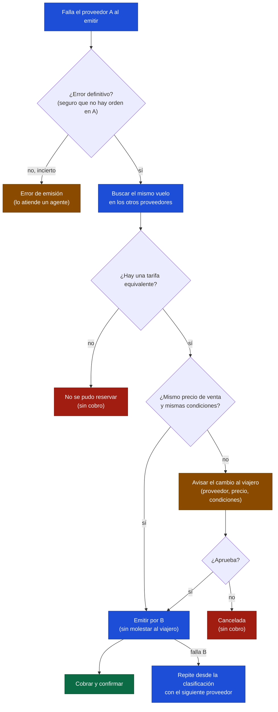

# Etapa XX: Failover entre proveedores de vuelos

> Estado: **idea, sin etapa asignada** (de ahí el `XX`). Es un plan general para aterrizar después: no hay nada implementado.
> Reglas generales: [00-global.md](00-global.md). Parte de: [02-reserva-vuelos.md](02-reserva-vuelos.md) (§8.2, estado «Error de emisión»). Errores que lo disparan: [duffel-errores-de-emision.md](../research/duffel-errores-de-emision.md).
> Fecha: 2026-10-28

## 1. La idea

Cuando el proveedor elegido (hoy Duffel) **falla de forma definitiva** al emitir, en lugar de decirle al viajero «no se pudo reservar», la plataforma:

1. busca **el mismo vuelo en otros proveedores**;
2. **valida la tarifa**: si es la misma (mismo vuelo, mismas condiciones, mismo precio de venta), sigue la emisión por ese otro proveedor sin molestar al viajero;
3. si **cambia** el precio o las condiciones, **le avisa** y solo continúa por el otro proveedor si el viajero lo aprueba;
4. si no hay equivalente, falla como hoy, con un motivo claro.

Reutiliza lo que ya existe: la aprobación de un precio nuevo (`awaiting_price_approval`), el puerto `FlightProvider`, la clave de itinerario propia (independiente del proveedor) y el precio de venta calculado por la `PricingPolicy`.

## 2. Cuándo se dispara: solo con errores definitivos

El failover es para cuando el proveedor **devuelve un error**, no para cuando todavía no sabemos qué pasó. Esa distinción es la regla de seguridad del plan: si el primer proveedor pudo haber emitido, pasar a otro **duplicaría el vuelo**.

| Clase | Ejemplos (ver el inventario) | ¿Failover? |
|---|---|---|
| **Definitivo: seguro que no hay orden** | `503` («seguro que no se creó nada»), `order_not_created`, `offer_no_longer_available`, `offer_expired`, `insufficient_balance` (nuestro saldo en ese proveedor) | **Sí** |
| **Definitivo tras comprobarlo** | `502 airline_internal` repetido, con reintentos agotados **y** `find_order` en el proveedor devuelve «no existe» | **Sí, con cautela** (ver el riesgo de la orden tardía en §6) |
| **Incierto** | Timeout, `500`/`502` de Duffel, `find_order` que no responde, retención que no se pudo capturar | **No**: pasa a «Error de emisión» y lo atiende una persona |
| **Del viajero** | Datos del pasajero inválidos, tarjeta rechazada | **No**: no lo arregla otro proveedor |

## 3. Flujo

Verde, éxito; ámbar, necesita al viajero o a una persona; rojo, termina sin cobro; azul, pasos del sistema.

## 4. Qué hay que definir

| Tema | Pregunta abierta |
|---|---|
| **«Misma tarifa»** | ¿Qué hace equivalentes a dos ofertas de proveedores distintos? Punto de partida: la clave de itinerario (mismos vuelos y horarios) más nombre de la tarifa, equipaje y condiciones de cambio y reembolso. Los nombres de tarifa no son uniformes entre proveedores |
| **Tolerancia de precio** | ¿Se acepta cualquier diferencia hacia abajo? ¿Y hacia arriba, aunque sea de centavos? Hoy cualquier diferencia pide aprobación |
| **Margen** | El precio de venta sale del costo de cada proveedor más la ganancia. Un proveedor más barato o más caro cambia el margen: ¿quién absorbe la diferencia? |
| **Qué se le muestra al viajero** | La aprobación actual muestra «antes y ahora». Hay que sumar cambio de proveedor, de aerolínea operadora y de condiciones |
| **Contexto a guardar** | La reserva debe conservar la búsqueda original (criterios, clave de itinerario, tarifa elegida) para poder repetirla; hoy guarda solo `offer_id` |
| **Historial de intentos** | Una tabla de intentos por reserva: proveedor, oferta, resultado y `request_id` |
| **Cobro** | Si el precio cambia, hay que anular la retención anterior y autorizar el monto nuevo |
| **Segundo proveedor** | Falta elegirlo y escribir su adapter; hoy solo existe Duffel |

## 5. Casos que no se resuelven con código: agentes humanos o de IA

No todo error tiene una salida automática. Hace falta un canal para que una **persona o un agente de IA** tome el caso. Es una pieza propia, que este plan necesita pero que también sirve al «Error de emisión» de hoy.

| Pieza | Qué es |
|---|---|
| **Cola de casos** | Cada reserva en «Error de emisión», cada compra de verificación sin revertir y cada error de los que el inventario marca como «agente» crea un caso con su motivo, prioridad y estado |
| **Contexto completo** | El `booking_id`, el `request_id` de Duffel, la orden, las autorizaciones y el historial de intentos, sin tener que leer logs |
| **Herramientas con permisos** | Consultar la orden en el proveedor, **capturar** o **anular** una retención, **cancelar** una orden dentro de la ventana de anulación, reembolsar, reencolar la reserva, forzar el failover |
| **Auditoría** | Quién (o qué agente) hizo qué, cuándo y por qué. Más estricta para un agente de IA: acciones acotadas y las de dinero con confirmación humana |
| **Aviso al viajero** | Hoy solo hay correo de confirmación. Hacen falta los de «en revisión» y «no se pudo reservar» |

## 6. Riesgos

| Riesgo | Mitigación prevista |
|---|---|
| **Emitir dos veces** (A y B) | Solo con error definitivo; antes de emitir en B, `find_order` en **todos** los proveedores ya intentados; la retención del cobro se conserva hasta el final |
| **Orden tardía en A** (la `502` se resuelve después de haber emitido en B) | Esperar una ventana antes de pasar a B y reconciliar de nuevo al final; si aparecen dos órdenes, un caso para un agente que cancele una dentro de la ventana de anulación |
| Equivalencia mal juzgada | Empezar estricto (tarifa idéntica) y pedir aprobación ante la menor duda |
| La oferta de B vence mientras el viajero decide | Mismo vencimiento de 30 minutos: si vence, se vuelve a buscar |
| Cambiar la aerolínea operadora sin que el viajero lo note | La aprobación muestra la aerolínea que opera cada tramo |

## 7. Fases sugeridas

| Fase | Contenido |
|---|---|
| 0 · Prerrequisitos | «Error de emisión» (hecho), reconciliador, cola de casos, correos de aviso, mapeo correcto de errores de Duffel |
| 1 | Guardar el contexto de la búsqueda y el historial de intentos |
| 2 | Segundo proveedor: adapter y precio de venta propio |
| 3 | Failover automático solo con tarifa idéntica |
| 4 | Flujo de aprobación cuando cambia el proveedor, el precio o las condiciones |
| 5 | Métricas: porcentaje de failovers, aprobaciones y casos para agentes |
