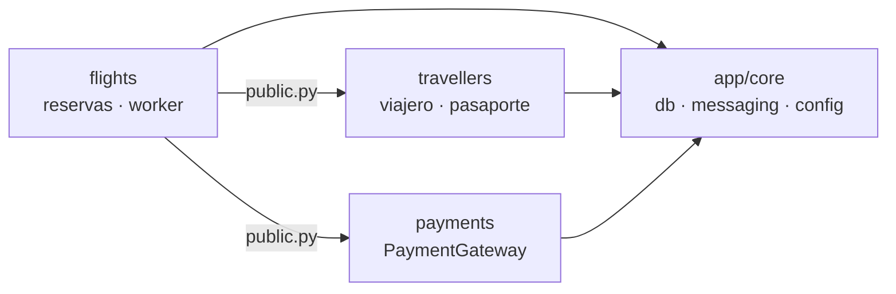
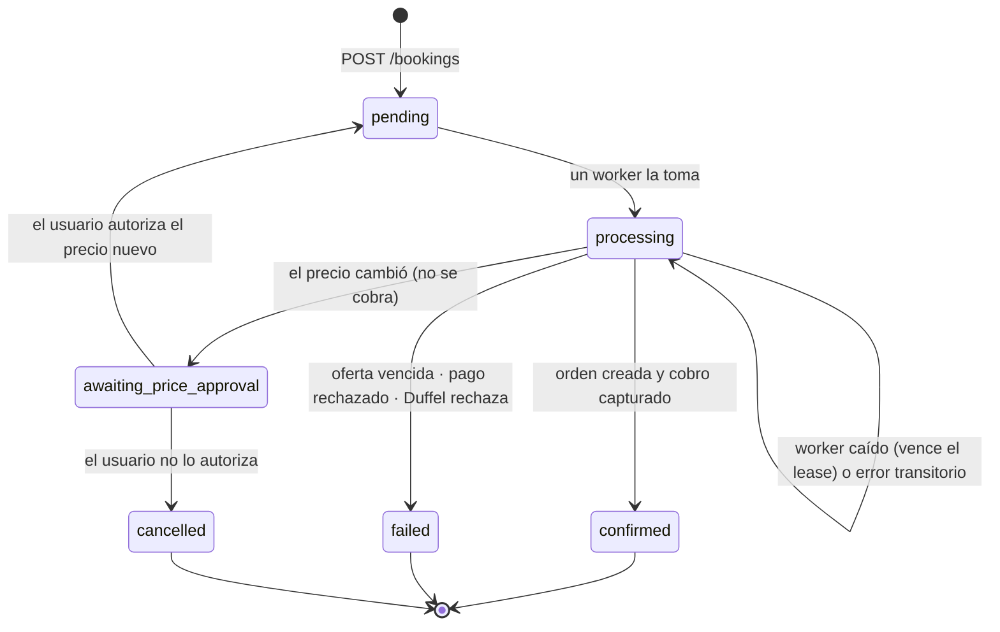

# Spec: reserva de vuelos (etapa 2)

> Estado: **aprobado e implementado**. Lo implementado, con los ajustes que surgieron, está en [02-reserva-vuelos.md](../../architecture/02-reserva-vuelos.md). Ajustes respecto de este documento: el inbox se marca de forma idempotente y el efecto único lo da el lock de la reserva; el worker reintenta si otra entrega tiene el lease (4 min, 10 intentos de 30 s); la oferta vencida termina como `offer_unavailable` (Duffel no la distingue); los procesos viven en `app/workers`; en el último intento no se manda a la DLQ sino que se reconcilia y falla.
> Reglas generales: [00-global.md](../../architecture/00-global.md) (en especial §4.1, monolito modular).
> Fecha: 2026-10-27

## 1. Alcance

**Entra:**

- Pantalla 5 (Pasajeros y pago) y pantalla 6 (Confirmación) del tablero, en desktop y mobile.
- Reserva asíncrona con Idempotency-Key, Transactional Outbox, Inbox, RabbitMQ y SSE.
- Bifurcación por precio: si al reconfirmar cambió el precio, se pide autorización antes de cobrar.
- Módulo `app/travellers` con los datos del viajero y su pasaporte.
- Módulo `app/payments` con un puerto `PaymentGateway` y una implementación simulada.
- Un schema de PostgreSQL por módulo y un test que valida los límites entre módulos.
- Búsqueda limitada a **un adulto** (alcance "vainilla").

**No entra (queda deshabilitado o para más adelante):**

| Tema | Cómo queda |
|---|---|
| «Reservar ahora y pagar después» (`hold`) | Opción visible, deshabilitada, «próximamente» |
| «Volver a buscar» desde el aviso de precio | Evolución futura: reemplazaría la búsqueda vigente. Si la oferta vence, se vuelve a "Tu viaje", que ya ofrece «Actualizar precios» |
| "Tu viaje" en el servidor (`PUT /trips/{id}/items/{item_key}`) | Sigue en el navegador |
| Varios pasajeros e infantes | El buscador permite solo 1 adulto |
| Tarjetas de descuento o de fidelidad | Son del dominio de vuelos; sin soporte por ahora |
| «Gestionar» (cambiar, cancelar, actualizar) y "Mis reservas" | Botones deshabilitados, «próximamente» |
| Pasarela de pago real | Pago simulado detrás de `PaymentGateway` |
| Usuarios y permisos | Una reserva se consulta con su UUID (limitación conocida, §10) |

## 2. Módulos



| Módulo | Schema | Tablas | Interfaz pública (`public.py`) |
|---|---|---|---|
| `flights` | `flights` | `airports`, `cities` (se mueven desde `public`), `bookings` | — (nadie la consume todavía) |
| `travellers` | `travellers` | `travellers`, `identity_documents` | `TravellerDetails`, `IdentityDocumentDetails`, `TravellerRef`, `create_traveller(session, details)` |
| `payments` | `payments` | `payment_authorizations` | `PaymentGateway` (puerto), `PaymentRequest`, `Authorization`, `PaymentDeclinedError`, `get_payment_gateway()` |
| `app/core/messaging` | `messaging` | `outbox`, `inbox` | Técnico: `add_event`, relay, consumidor, difusor SSE |

### 2.1 Schemas de PostgreSQL

- Las consultas pueden unir tablas de schemas distintos, porque es la misma base. **Las reglas del monolito modular las prohíben entre módulos.** Dentro de un módulo, los joins y las claves foráneas son libres (por ejemplo `identity_documents.traveller_id → travellers.id`).
- Cada modelo declara `__table_args__ = {"schema": "<módulo>"}`. Alembic usa `include_schemas=True` y su tabla `alembic_version` queda en `public`.
- Una migración crea los schemas y mueve `airports` y `cities` con `ALTER TABLE … SET SCHEMA flights`, sin copiar datos. `pg_trgm` sigue en `public`, que está en el `search_path`.
- **Por qué:** cada schema se puede extraer con su servicio el día que haga falta, y en la base se ve de quién es cada tabla.

### 2.2 Límites verificados

Un test (`app/tests/test_module_boundaries.py`) corre `import-linter`, con una versión fijada en `requirements-dev.txt`. Si el test falla, `make test` falla. Contratos:

1. `app.core` no importa ningún módulo de negocio.
2. `app.travellers` y `app.payments` no importan verticales (`app.flights`, `app.hotels`).
3. Un módulo solo importa de otro su `public.py`: está prohibido importar `domain`, `repositories`, `services`, `api` y `providers` de otro módulo.
4. No hay ciclos entre módulos.

## 3. `travellers`

**Guarda:** los datos de la persona, que valen para cualquier vertical.

| Campo | Regla genérica (en `travellers/domain/validators.py`) |
|---|---|
| `given_name`, `family_name` | No vacíos, sin espacios en los extremos |
| `born_on` | Fecha en el pasado |
| `gender` | `m` / `f` (según el documento) |
| `email` | Email válido |
| `phone_number` | E.164 (`+` y de 8 a 15 dígitos) |
| `identity_documents[]` | Por ahora solo `passport`: número, país emisor (ISO 3166-1 alpha-2), vencimiento futuro |

**No guarda** lo que impone la aerolínea. Eso lo valida `flights`:

| Regla de `flights` (en `flights/domain/validators.py`) | Origen |
|---|---|
| `title`: `mr`, `ms`, `mrs`, `miss`, `dr` | Duffel / aerolínea |
| Nombre y apellido: alfabeto permitido y 40 caracteres entre los dos. Las tildes y la ñ se transliteran (`Muñoz` → `MUNOZ`) | Duffel |
| Adulto: 18 años o más el día de la salida | Tipo de pasajero buscado |
| Pasaporte obligatorio si la oferta tiene `requires_identity_documents` | Oferta |

**Sin cuentas no se deduplica:** cada reserva crea un viajero. Cuando existan usuarios, `POST /bookings` podrá recibir el `traveller_id` de un viajero guardado en lugar de los datos.

## 4. `payments` (simulado)

```python
class PaymentGateway(Protocol):
    async def authorize(self, request: PaymentRequest) -> Authorization: ...  # idempotente por request.idempotency_key
    async def capture(self, authorization_id: str) -> None: ...
    async def void(self, authorization_id: str) -> None: ...
```

- **Orden del cobro:** se autoriza antes de crear la orden en Duffel, se captura si la orden se creó y se anula si Duffel la rechazó. Es el orden que exige una pasarela real.
- **`FakePaymentGateway`:**
  - guarda las autorizaciones en `payments.payment_authorizations`;
  - aprueba cualquier tarjeta salvo la terminada en `0002`, que se rechaza para poder probar el caso, como hacen las pasarelas en modo test.
- **Datos de la tarjeta:** el frontend valida el formulario y **nunca envía el número completo ni el código**. Manda un `payment_token` simulado, `tok_fake_<últimos 4>`, igual que haría la tokenización de una pasarela real.
- **Pago a Duffel:** siempre con `balance` por `cost.total` (§9 de 02-reserva).

## 5. Reserva (`flights`)

### 5.1 Tabla `flights.bookings`

| Columna | Uso |
|---|---|
| `id` UUID PK | Id público de la reserva |
| `idempotency_key` UUID **UNIQUE** · `request_hash` | Idempotency-Key y SHA-256 del body canónico |
| `status` | §5.2 |
| `version` int | Sube en cada cambio de estado; es el `id` del evento SSE |
| `provider`, `offer_id` | Oferta elegida |
| `traveller_id` UUID | Referencia a `travellers` (sin clave foránea) |
| `passenger` JSONB | **Copia fija** de lo que se manda a la aerolínea, incluidos `title` y el nombre transliterado |
| `expected_price` (monto + moneda) | Precio de venta que vio el usuario al confirmar |
| `offered_price` (monto + moneda) NULL | Precio nuevo cuando cambió (`awaiting_price_approval`) |
| `approved_price` (monto + moneda) NULL | Precio que el usuario autorizó |
| `payment_token`, `payment_authorization_id` | Pago simulado |
| `provider_order_id`, `booking_reference` | Orden de Duffel y localizador |
| `order` JSONB | Lo necesario para la pantalla 6: itinerario con operador, tickets, estado del pago, `available_actions` |
| `failure_code` | `offer_expired`, `offer_unavailable`, `payment_declined`, `provider_rejected`, `provider_unavailable` |
| `lease_until` | Hasta cuándo un worker es dueño de la reserva en `processing` |
| `created_at`, `updated_at` | |

El **costo y la ganancia no se guardan** en `bookings`: se recalculan con la `PricingPolicy` (misma clave `duffel:off_…`) y nunca salen por la API.

### 5.2 Estados



**Regla del Outbox:** todo cambio de `status` inserta su evento en `messaging.outbox` en la misma transacción. Eventos:
- `booking.requested` (comando, para el worker);
- `booking.processing`, `booking.awaiting_price_approval`, `booking.confirmed`, `booking.failed` y `booking.cancelled` (eventos, para el SSE).

### 5.3 Endpoints

Todos bajo `/api/v1/flights/bookings`. Los errores usan el formato `{"error": {...}}`.

| Método y ruta | Body | Respuesta |
|---|---|---|
| `POST /` + header `Idempotency-Key` | `offer_id`, `expected_price`, `passenger` (`title` + datos del viajero + pasaporte opcional), `payment_token` | `202` con la reserva (`pending`) |
| `GET /{id}` | — | `200` con estado, precios, `failure_code` y, si está confirmada, `booking_reference` y `order` |
| `POST /{id}/price-decision` | `decision: accept \| reject`, `price` (el precio nuevo informado) | `202` con la reserva |
| `GET /{id}/events` | — | `text/event-stream` (§7) |

**Idempotency-Key** (§4 de 02-reserva):

| Caso | Respuesta |
|---|---|
| Clave nueva | Se crean, en una transacción, el viajero (`travellers.public.create_traveller` con la misma sesión), la reserva y `booking.requested` → `202` |
| Misma clave, mismo body | La reserva existente, en su estado actual → `200`. No se procesa de nuevo |
| Misma clave, otro body | `422 idempotency_key_reused` |
| Sin header o con un valor que no es UUID | `400 idempotency_key_required` |
| Dos requests simultáneas | La segunda choca con el `UNIQUE`, se hace *rollback* y se devuelve la existente |

**Decisión de precio:** es idempotente por estado.
- Con `accept` y el `price` igual a `offered_price`: guarda `approved_price`, vuelve a `pending` y emite un `booking.requested` nuevo.
- Si la decisión ya se aplicó con los mismos datos, devuelve la reserva sin cambios.
- Con la reserva en otro estado: `409 price_decision_not_applicable`.
- Con un precio distinto del informado: `422 price_mismatch`.

### 5.4 Worker de reservas

Consume `booking.requested` desde la cola `flights.booking-worker`.

```
1. ¿message_id en messaging.inbox (consumidor booking-worker)?         → ack y salir
2. Tomar la reserva (en una transacción):
     UPDATE bookings SET status='processing', lease_until=now()+5min, version+1
     WHERE id=:id AND (status='pending' OR (status='processing' AND lease_until < now()))
     + outbox(booking.processing)
   Si no se actualizó ninguna fila (otro worker la tiene o ya terminó): inbox + ack
3. Reconciliar: provider.find_order(offer_id, booking_id) → si existe, ir a 7
4. Refrescar: provider.get_offer(offer_id)
     vencida o no disponible → failed(offer_expired | offer_unavailable)
5. ¿Cambió el precio?  price = PricingPolicy(oferta refrescada)
     comparar con approved_price o, si no hay, con expected_price (monto y moneda)
     ├─ distinto → awaiting_price_approval, offered_price=price + outbox + inbox + ack
     └─ igual    → seguir
6. payments.authorize(price, payment_token, idempotency_key=booking_id:price)
     rechazado → failed(payment_declined)
   provider.create_order(offer, pasajero, pago balance = cost.total, metadata.booking_id)
     422 offer_request_already_booked → reconciliar (paso 3); si la orden es nuestra, ir a 7;
                                        si no, void + failed(offer_unavailable)
     rechazo definitivo (otro 4xx conocido) → void + failed(provider_rejected)
     timeout / 5xx → NO se marca failed: reintento (§5.5)
7. payments.capture → confirmed + booking_reference + order + outbox + inbox + ack
```

- **El Inbox se escribe con el resultado final** (pasos 5, 7 o `failed`), no al tomar el mensaje. Así, si el worker se cae después de tomarla, la reentrega vuelve a procesarla: el lease ya venció y la reconciliación del paso 3 evita una orden doble.
- El pasajero se manda con el `pas_…` que devuelve el refresco de la oferta, de modo que el frontend no lo conoce.
- **Puerto `FlightProvider`:** agrega `get_offer`, `find_order` y `create_order`, que reciben y devuelven DTOs de la plataforma.

### 5.5 Reintentos y DLQ

- Ante un error transitorio, el worker publica de nuevo en una cola de espera con TTL (`flights.booking-worker.retry`, 30 s) que, al vencer, devuelve el mensaje a la cola principal. Esto se arma con una *dead-letter exchange*, y cada reintento lleva su número en un header.
- **Al quinto intento:** se reconcilia por última vez. Si no hay orden, se anula el pago y la reserva pasa a `failed(provider_unavailable)`. El mensaje va a la `flights.booking-worker.dlq` y se registra un log de nivel `error`.

## 6. Mensajería (`app/core/messaging`)

| Pieza | Detalle |
|---|---|
| `outbox` | `id`, `exchange`, `routing_key`, `aggregate_id`, `payload` (sin datos personales: solo ids, estado y versión), `created_at`, `published_at` (índice parcial `WHERE published_at IS NULL`) |
| `inbox` | `(message_id, consumer)` PK, `processed_at` |
| `add_event(session, …)` | Lo llama quien cambia un estado, dentro de su transacción |
| Relay | `python -m app.core.messaging.relay`. Cada 500 ms: `SELECT … FOR UPDATE SKIP LOCKED LIMIT 100` → publica con *publisher confirms* → `published_at`. Guarda `exchange` y `routing_key` en la fila, así no conoce a ningún módulo |
| Topología | `bookings.commands` (direct) y `bookings.events` (topic). La declara cada módulo al arrancar |
| Cliente | `aio-pika` |
| Tests | vhost `test` en el mismo RabbitMQ (`TEST_RABBITMQ_URL`) |

## 7. SSE

`GET /api/v1/flights/bookings/{id}/events`:

1. **Suscribirse primero:** el difusor de la API (una cola exclusiva por instancia, ligada a `bookings.events` con `booking.*`) registra la conexión para ese `booking_id`.
2. **Después leer la base** y mandar el estado actual: `event: status`, `id: <version>`, `data: {"booking_id", "status", "version"}`. En este orden no se pierde un cambio que ocurra entre la lectura y la suscripción.
3. Cada evento con `version` mayor que la última enviada se reenvía; los repetidos se descartan.
4. *Heartbeat* (comentario `: ping`) cada 15 s. La conexión se cierra al llegar a un estado final.
5. Al reconectar con `Last-Event-ID`, se vuelve al paso 1.

El evento **avisa** y no trae datos: el frontend invalida la query de `GET /{id}` y lee de ahí. Un aviso perdido o duplicado no rompe nada. Se usa el soporte de SSE de FastAPI si la versión instalada lo tiene; si no, `StreamingResponse`, sin dependencias nuevas.

## 8. Frontend

| Ruta | Pantalla |
|---|---|
| `/checkout/$itemKey` | **Pantalla 5.** Pasos «1 Vuelos · 2 Tu viaje · 3 Pasajeros · 4 Pago», contador de vencimiento, formulario del pasajero, «Cuándo pagar» (`hold` deshabilitado), tarjeta, aceptación de condiciones, resumen «Tu vuelo» y «Confirmar y pagar» |
| `/bookings/$bookingId` | **Pantalla 6.** Código de reserva con «Copiar», itinerario con el operador de cada tramo, tickets, pago y «Gestionar» (deshabilitado; solo las acciones de `available_actions`) |

**Flujo en la pantalla 5:**
- **Al confirmar:** se genera la `Idempotency-Key`, que se guarda en `sessionStorage` junto al ítem, y se hace `POST`. El botón pasa a «Confirmando con la aerolínea…» y se abre el SSE.
- **`awaiting_price_approval`:** se abre un diálogo sobre la misma pantalla con el precio anterior, el nuevo y la diferencia, y los botones «Aceptar y pagar <nuevo>» y «Cancelar».
- **`confirmed`:** se quita el ítem de "Tu viaje" y se navega a `/bookings/$id`.
- **`failed`:** se muestra un mensaje según el `failure_code`. Con la oferta vencida, se ofrece «Volver a Tu viaje», donde ya existe «Actualizar precios». Reintentar genera una **clave nueva**.
- **Recarga a mitad del proceso:** la clave guardada hace que el `POST` devuelva la reserva existente.

**Formulario:**
- React Hook Form + Zod. La validación de Zod replica la del backend para avisar antes, pero **el backend es la autoridad**.
- `libphonenumber-js` para el selector de país («AR +54») y el formato E.164.
- La transliteración (`Muñoz` → `MUNOZ`) se muestra como aviso antes de enviar.
- **Borrador:** los datos cargados se guardan en `sessionStorage` (pide el tablero de "Estados": «si vence mientras se completan los datos, lo cargado se conserva»). Los datos de la tarjeta nunca se guardan.

**Habilitar y limitar:**
- «Continuar a pasajeros» se habilita en "Tu viaje".
- El selector de pasajeros del buscador queda fijo en 1 adulto, con «próximamente».

## 9. Infraestructura

- **`docker-compose.yml`:**
  - `rabbitmq` (`rabbitmq:4-management`, con *healthcheck* y vhost `test`);
  - `outbox-relay` y `booking-worker`, con la misma imagen y volúmenes que `api` y otro `command`.
- **Variables:** `RABBITMQ_URL` y `TEST_RABBITMQ_URL`.
- **`make`:** `make logs-workers`, `make rabbitmq` (abre la consola de gestión) y `make lint` con el backend incluido.

## 10. Riesgos y limitaciones conocidas

| Tema | Detalle |
|---|---|
| Acceso por UUID | Sin usuarios, quien tenga el `booking_id` ve la reserva con sus datos personales. Se resuelve con autenticación (etapa futura) |
| Datos personales | Solo en `travellers` y `bookings.passenger`. Nunca van en la cola, en `outbox` ni en los logs |
| Resultado incierto en Duffel | Lo cubren la reconciliación por `offer_id` + `metadata.booking_id` y los reintentos. **Verificado en la fase 0:** Duffel ignora el header `Idempotency-Key`, pero rechaza una segunda orden sobre el mismo offer request (`422 offer_request_already_booked`), que sirve de guardián |
| Ofertas que vencen | Una oferta en `awaiting_price_approval` puede vencer antes de que el usuario decida: el worker la marca `failed(offer_expired)` |

## 11. Tests

| Nivel | Qué |
|---|---|
| Límites | `import-linter` con los contratos de §2.2 |
| `travellers` | Validadores; `create_traveller` contra PostgreSQL de test, con la sesión del que llama (rollback = sin viajero) |
| `payments` | Fake: autorizar es idempotente, `0002` se rechaza, capturar y anular |
| Idempotencia | Misma clave dos veces → una reserva; otro body → 422; sin clave → 400; dos requests concurrentes → una reserva y un viajero |
| Outbox | Estado y evento en la misma transacción (si falla, no queda ninguno); dos relays en paralelo no publican dos veces |
| Inbox | Mensaje reentregado → sin efecto doble |
| Worker | Duffel mockeado con fixtures reales: confirmada, precio cambiado → autorización → confirmada, precio cambiado → cancelada, oferta vencida, pago rechazado, reconciliación (orden ya existente), timeout → reintento → DLQ, worker caído con el lease vencido |
| SSE | Estado inicial al conectar, evento posterior, versión repetida descartada, reconexión con `Last-Event-ID`, cierre en estado final |
| Frontend | Formulario (validaciones, transliteración, edad, pasaporte cuando la oferta lo pide), flujo con MSW: confirmada, diálogo de precio, fallida, recarga con la misma clave |
| Navegador | Playwright contra los tableros 5 y 6, desktop y mobile |
